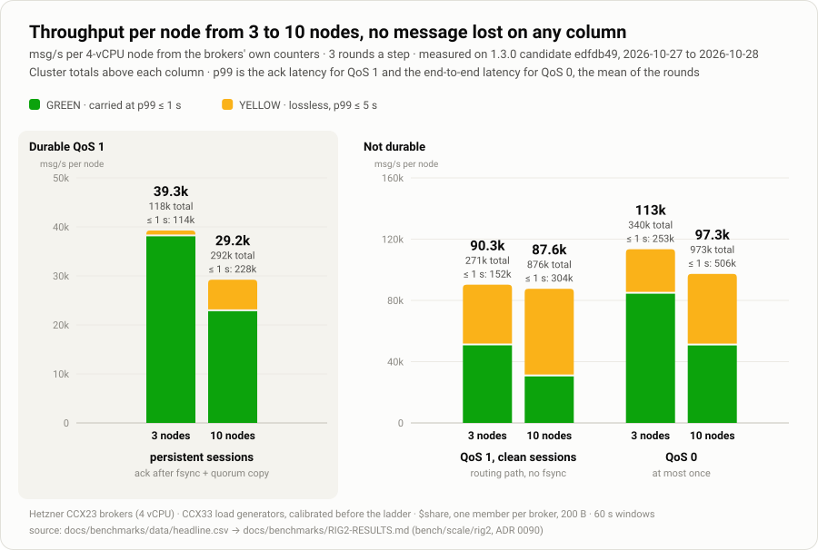
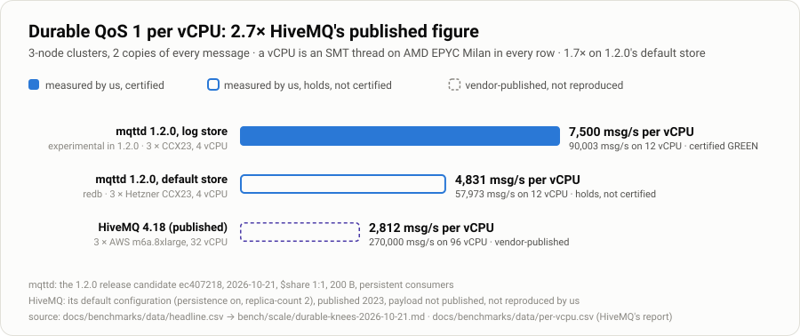
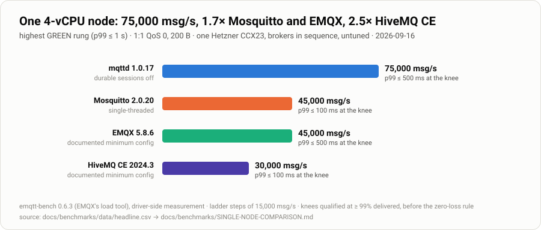

# mqttd — a security-first, cluster-native MQTT broker

[](https://github.com/mbilling/fss-mqtt-broker/actions/workflows/ci.yml)
[](https://github.com/mbilling/fss-mqtt-broker/releases)
[](LICENSE)
[](https://github.com/mbilling/fss-mqtt-broker/pkgs/container/fss-mqtt-broker)
[](https://scorecard.dev/viewer/?uri=github.com/mbilling/fss-mqtt-broker)
[](https://www.bestpractices.dev/projects/14161)

An MQTT 3.1.1 and 5.0 broker in Rust that clusters, replicates durable sessions by
default, and ships every feature under Apache-2.0.

> - **QoS 0:** 114k msg/s per 4-vCPU node, 1.14M msg/s on 10 nodes.
> - **Durable QoS 1** (acked after fsync and 2-copy replication): 27.0k msg/s per node,
>   270k on 10 nodes, certified on the log store (experimental in 1.2.0).
> - **Every feature, no paid tier:** clustering, durable replication, OIDC, audit, operator.

## Why mqttd

- **Cost per message.** Durable QoS 1 with 2 copies carries 7,500 msg/s per vCPU on
  1.2.0's log store, 2.7× the 2,812 per vCPU that HiveMQ 4.18 publishes for its default
  configuration, which also keeps 2 copies, on the same kind of vCPU (an AMD EPYC Milan
  SMT thread). On 1.2.0's default store it is 4,831, 1.7×. HiveMQ's figure is its own;
  we have not reproduced it, and its payload is not published.
  [Per vCPU, like for like](docs/benchmarks/EVIDENCE.md#per-vcpu-like-for-like)
- **No paid tier.** HiveMQ sells clustering in its commercial edition (the Community
  Edition is single-node), EMQX licenses production clustering under BSL 1.1 since 5.9,
  and VerneMQ's official binaries need a paid licence for commercial production. In
  mqttd, clustering, durable replication, OIDC, the audit chain, the Kubernetes operator
  and the FIPS variant are in the one Apache-2.0 build.
  [Licensing](docs/COMPARISON.md#licensing--distribution)
- **Data safety by default.** Durable sessions keep 2 copies (configurable 2–7) without
  any extra configuration, and an acknowledged QoS 1 or 2 message survives the loss of a
  node, proven under SIGKILL and partition harnesses.
  [Limitations](GUIDE.md#limitations) lists the edges.
- **Secure and auditable by default.** TLS 1.3, mTLS or OIDC identity, a deny-by-default
  ACL, revocation that evicts live sessions, and a hash-chained audit log. Every insecure
  mode is opt-in and logged `INSECURE:`. Mappings for EU CRA, IEC 62443 and SOC 2 /
  ISO 27001: [docs/compliance/](docs/compliance/).
- **Operable.** One static binary in a ~14 MB distroless image, a Helm chart, a
  Kubernetes operator, and cosign-signed reproducible builds with SBOM, SLSA provenance
  and VEX. [Install and verify](GUIDE.md#install-and-verify)

mqttd has no production users yet. The evidence below is what it offers instead.

## Evidence

Durable QoS 1 is the hardest path a broker serves: every acknowledgement waits for
fsync and a quorum copy on another node. It is the one we measure first.



- **The per-node rate holds from 3 to 10 nodes** in every class, and no message was
  lost on any bar.
- **Durable QoS 1 on 1.2.0's default store (redb)** stops taking more at 19.3k msg/s
  per node on 3 nodes and 18.5k on 10 (185k in total). Nothing was lost and p99 stayed
  at or below 500 ms, but the rig did not certify these rungs, so they are drawn hollow.
- **The log store** (`MQTTD_REPLICA_STORE=log`, experimental in 1.2.0) carries
  30.0k per node on 3 nodes and 27.0k on 10, certified GREEN. The 1.3.0 draft makes it
  the default for new data directories; this chart will be redrawn on 1.3.0.





**How a rung is judged** ([ADR 0048](docs/adr/0048-comparative-benchmarking.md#amendment-2026-09-27-a-rung-fails-only-on-loss-p99-is-graded-green--yellow--red)):
a rung fails only if it loses a message. A lossless rung is GREEN at p99 ≤ 1 s
(certified), YELLOW at ≤ 5 s, RED above.
How each figure was measured, every rung and the commands:
[EVIDENCE.md](docs/benchmarks/EVIDENCE.md). Where the others beat us (memory, tail
latency at their knee, connection scale, track record):
[Where competitors win](docs/benchmarks/EVIDENCE.md#where-competitors-win).

## Feature matrix

✅ open build · 💰 **paid edition only** · ⚠️ partial · ✖ absent · n/v not verified.
A subset of the full matrix in [COMPARISON.md](docs/COMPARISON.md) (dated 2026-10-12),
which carries every row, the notes and the sources.

| | mqttd | EMQX 6.x | HiveMQ CE | Mosquitto 2.x | VerneMQ 2.1 |
|---|---|---|---|---|---|
| Clustering | ✅ | 💰 BSL | 💰 | ✖ | ✅ (💰 binaries) |
| Replicated sessions | ✅ default | ⚠️ opt-in | 💰 | n/a | ✖ |
| Acked msg survives node loss | ✅ proven | n/v | 💰 | n/a | ✖ |
| Shared subscriptions | ✅ cluster-wide | ✅ | ✅ node | ✅ node | ⚠️ |
| Rule engine | ✅ EMQX rule SQL, no sinks | ✅ | ✖ | ✖ | ✖ |
| Bridge | ✅ | ✅ | ✖ | ✅ | ✅ |
| JWT client auth | ✅ | ✅ | 💰 | ✖ | ✖ |
| OIDC (JWKS discovery) | ✅ | ⚠️ JWKS URL | 💰 | ✖ | ✖ |
| Revocation reaches live sessions | ✅ | n/v | ✖ | ⚠️ dynsec only | ✖ |
| Tamper-evident audit | ✅ | n/v | n/v | ✖ | ✖ |
| Kubernetes operator | ✅ | ✅ | 💰 | ✖ | ⚠️ unmaintained |
| Signed reproducible builds + SBOM | ✅ | n/v | n/v | ✖ | ✖ |
| **License** | **Apache-2.0** | BSL 1.1 | Apache-2.0 | EPL/EDL | Apache src / EULA bin |

## Get started

**Local, one node** (plaintext and anonymous: a first look, never a deployment):

```sh
docker run -d --name mqttd -p 1883:1883 \
  -e MQTTD_PLAINTEXT_BIND=0.0.0.0:1883 -e MQTTD_ALLOW_ANONYMOUS=1 \
  -e MQTTD_DATA_DIR=/var/lib/mqttd -v mqttd-data:/var/lib/mqttd \
  ghcr.io/mbilling/fss-mqtt-broker:latest

mosquitto_sub -h 127.0.0.1 -p 1883 -t 'sensors/+/temp' &
mosquitto_pub -h 127.0.0.1 -p 1883 -t 'sensors/kitchen/temp' -m '21.5C'
```

**Kubernetes, Helm** (three nodes with TLS, per-node cluster certificates and an ACL;
the charts install from a checkout):

```sh
git clone https://github.com/mbilling/fss-mqtt-broker && cd fss-mqtt-broker
LEAF_DAYS=30 NS=mqttd REPLICAS=3 ./deploy/helm/mqttd/bootstrap.sh
helm install mqttd deploy/helm/mqttd -n mqttd \
  --set replicaCount=3 \
  --set secrets.tls.secretName=mqttd-tls \
  --set secrets.peerTls.secretName=mqttd-peer-tls \
  --set secrets.gossipKey.secretName=mqttd-gossip
```

**Kubernetes, operator** (the same objects from an `MqttdCluster`; render parity with
the chart is CI-gated):

```sh
# CRDs ship in crds/ and are applied on first install.
helm install mqttd-operator deploy/helm/mqttd-operator -n mqttd
# The example names the Secrets deploy/helm/mqttd/bootstrap.sh mints (run it first):
kubectl -n mqttd apply -f deploy/helm/mqttd-operator/example-mqttdcluster.yaml
kubectl -n mqttd get mqc mqttd -w
```

Chart and operator details: [KUBERNETES.md](docs/KUBERNETES.md).

Next: the secured setup, TLS 1.3 + mTLS + ACL and CI-tested, in
[GUIDE.md](GUIDE.md#single-node-secured-tls-13--mtls--acl); Windows in
[GUIDE.md](GUIDE.md#try-it-in-two-minutes); a first rule (filter, reshape, re-route) in
[RULES.md](docs/RULES.md#try-it-in-two-minutes).

## Learn more

| | |
|---|---|
| Evidence | [EVIDENCE.md](docs/benchmarks/EVIDENCE.md) · [docs/benchmarks/](docs/benchmarks/) · [COMPARISON.md](docs/COMPARISON.md) |
| Hardening | [HARDENING.md](docs/HARDENING.md) · [THREAT-MODEL.md](docs/THREAT-MODEL.md) |
| Observability | [shipped alerting](docs/OPERATIONS.md#shipped-alerting) · [`deploy/observability/`](deploy/observability/) |
| Rule engine | [RULES.md](docs/RULES.md) · [RULES-COOKBOOK.md](docs/RULES-COOKBOOK.md) |
| Admin API and CLI | [ADMIN-API.md](docs/ADMIN-API.md) · [ADMIN-CLI.md](docs/ADMIN-CLI.md) |
| Configuration | [CONFIGURATION.md](docs/CONFIGURATION.md) · [`mqttd.example.toml`](docs/mqttd.example.toml) |
| Migration | [MIGRATION.md](docs/MIGRATION.md): Mosquitto, EMQX and HiveMQ configs and ACLs to a reviewed draft |
| Architecture | [ARCHITECTURE.md](docs/ARCHITECTURE.md) · [`docs/adr/`](docs/adr/) (89 ADRs, per-task status) |
| Roadmap | [ROADMAP.md](docs/ROADMAP.md) · [delivery dashboard](docs/delivery/STATUS.md) |
| Policies | [SECURITY.md](SECURITY.md) · [SUPPORT.md](SUPPORT.md) · [docs/compliance/](docs/compliance/) · [security/vex/](security/vex/) |
| Everything else | [GUIDE.md](GUIDE.md), the long form · [docs/README.md](docs/README.md), the index |

## Support

- **Security reports, privately:** <https://github.com/mbilling/fss-mqtt-broker/security/advisories/new>,
  never a public issue. Policy, scope and timelines: [SECURITY.md](SECURITY.md); per-release
  CVE dispositions: [security/vex/](security/vex/).
- **Everything else:** [GitHub Issues](https://github.com/mbilling/fss-mqtt-broker/issues),
  the only channel today; no chat or forum yet.
- **Lifecycle:** the three most recent minor lines are patched; upgrades go one release
  at a time ([SUPPORT.md](SUPPORT.md)). `v1.2.0` is released and signed.
- **Commercial:** support, SLAs and certified builds, never features. Nothing is
  published yet; open an issue.

## Contributing

[CONTRIBUTING.md](CONTRIBUTING.md) · [Code of Conduct](CODE_OF_CONDUCT.md). Decisions
live in ADRs, progress in delivery docs; a task title is a claim that must be true, and
prose must not actively mislead.

```sh
cargo build && cargo test && cargo clippy --all-targets && cargo deny check
./scripts/interop/run.sh     # foreign-client conformance
mqttui --list                # There are 144 runnable scripts here: demos, smokes, migrations, benches
```

## License

[Apache-2.0](LICENSE): every crate, binary and image. No paid tier, no feature gates.
