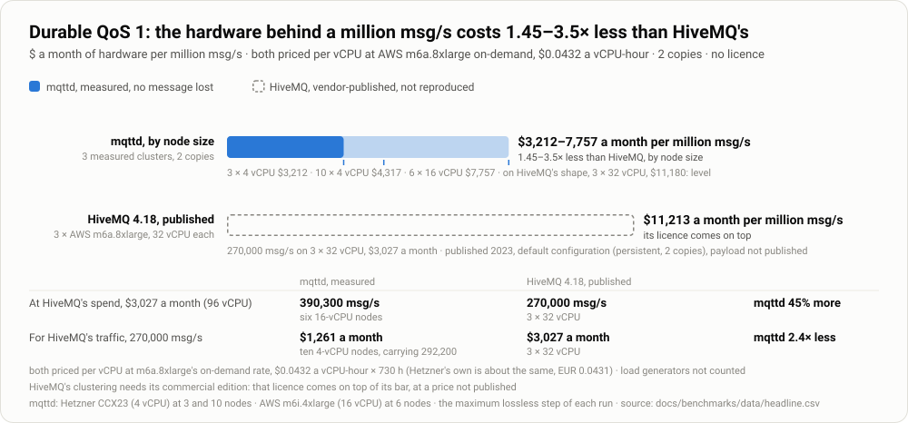
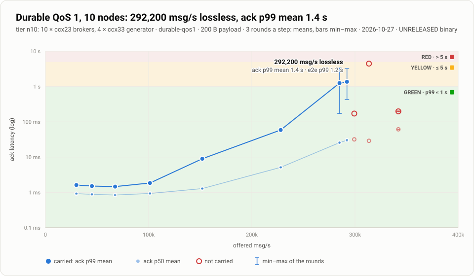

# mqttd — a security-first, cluster-native MQTT broker

[](https://github.com/mbilling/fss-mqtt-broker/actions/workflows/ci.yml)
[](https://github.com/mbilling/fss-mqtt-broker/releases)
[](LICENSE)
[](https://github.com/mbilling/fss-mqtt-broker/pkgs/container/fss-mqtt-broker)
[](https://scorecard.dev/viewer/?uri=github.com/mbilling/fss-mqtt-broker)
[](https://www.bestpractices.dev/projects/14161)

An MQTT 3.1.1 and 5.0 broker in Rust that clusters, replicates durable sessions by
default, and ships every feature under Apache-2.0.

> - **Durable QoS 1** (acked after fsync and a quorum copy on another node): 292,200 msg/s
>   with no message lost on 10 nodes, 228k at ack p99 ≤ 1 s.
> - **QoS 1 with clean sessions:** 876k msg/s on 10 nodes. **QoS 0:** 973k.
> - **Every feature, no paid tier:** clustering, durable replication, OIDC, audit, operator.

## Why mqttd

- **Cost per message.** At the same cloud price per vCPU, a durable QoS 1 cluster with 2
  copies costs 2.0–3.4× less to run than HiveMQ 4.18's published run, and HiveMQ's
  licence comes on top. Clustering needs their commercial edition, whose price isn't
  published. Per vCPU, mqttd carries 9,517 msg/s against HiveMQ's 2,812, on the same AMD
  EPYC Milan threads. HiveMQ's figure is its own: we haven't reproduced it, and its
  payload isn't published. [The results](docs/benchmarks/RIG2-RESULTS.md)
- **No paid tier.** HiveMQ sells clustering in its commercial edition (the Community
  Edition is single-node), EMQX licenses production clustering under BSL 1.1 since 5.9,
  and VerneMQ's official binaries need a paid licence for commercial production. In
  mqttd, clustering, durable replication, OIDC, the audit chain, the Kubernetes operator
  and the FIPS variant are in the one Apache-2.0 build.
  [Licensing](docs/COMPARISON.md#licensing--distribution)
- **Data safety by default.** Durable sessions keep 2 copies (configurable 2–7) without
  any extra configuration, and an acknowledged QoS 1 or 2 message survives the loss of a
  node, proven under SIGKILL and partition harnesses.
  [Limitations](GUIDE.md#limitations) lists the edges.
- **Secure and auditable by default.** TLS 1.3, mTLS or OIDC identity, a deny-by-default
  ACL, revocation that evicts live sessions, and a hash-chained audit log. Every insecure
  mode is opt-in and logged `INSECURE:`. Mappings for EU CRA, IEC 62443 and SOC 2 /
  ISO 27001: [docs/compliance/](docs/compliance/).
- **Operable.** One static binary in a ~14 MB distroless image, a Helm chart, a
  Kubernetes operator, and cosign-signed reproducible builds with SBOM, SLSA provenance
  and VEX. [Install and verify](GUIDE.md#install-and-verify)

mqttd has no production users yet. The evidence below is what it offers instead.

## Evidence

Durable QoS 1 is the hardest path a broker serves: every acknowledgement waits for
fsync and a quorum copy on another node. It is the one we measure first.


- **Durable QoS 1** carries 117,800 msg/s on 3 nodes (39.3k per node) and 292,200 on
  10 (29.2k per node), with no message lost. At ack p99 ≤ 1 s it carries 114k and 228k.
- **QoS 1 with clean sessions** carries 271k on 3 nodes and 876k on 10.
- **QoS 0** carries 340k on 3 nodes and 973k on 10.
- **One node** carries 92,900 durable (one copy, fsync only), 114,000 clean QoS 1 and
  123,100 QoS 0, all at p99 ≤ 1 s.



- **What it costs.** Both brokers are priced per vCPU at AWS `m6a.8xlarge` on-demand rates,
  the instance HiveMQ's run used. Hetzner charges about the same per vCPU.
  - **3 nodes:** mqttd's durable cluster costs 3.4× less than HiveMQ at the same traffic.
  - **10 nodes:** it costs 2.0× less, because mqttd's per-node durable rate falls.
  - **At HiveMQ's published 270k:** extending mqttd's line on its 3-to-10-node slope, it
    needs about 13 nodes, $1,640 a month against HiveMQ's $3,027: 1.8× less. That rate is
    an estimate, not a measurement.
  - **The licence:** HiveMQ's clustering licence comes on top, at a price not published.




**How a step is judged** ([ADR 0090](docs/adr/0090-benchmark-rig-redesign.md)):
- **Carried:** a step counts only when all 3 of its rounds lose no message and the brokers
  take at least 99% of the offered msg/s.
- **Throughput** comes from the brokers' own counters.
- **Latency** is the p99 on the load generator's own clock, the mean of the rounds. It is
  GREEN at ≤ 1 s, YELLOW at ≤ 5 s and RED above.

[RIG2-RESULTS.md](docs/benchmarks/RIG2-RESULTS.md) has every step, how it was measured and
the limits of these runs. Where the others beat us (memory, tail latency at their knee,
connection scale, track record):
[Where competitors win](docs/benchmarks/EVIDENCE.md#where-competitors-win).

## Feature matrix

✅ open build · 💰 **paid edition only** · ⚠️ partial · ✖ absent · n/v not verified.
A subset of the full matrix in [COMPARISON.md](docs/COMPARISON.md) (dated 2026-10-12),
which carries every row, the notes and the sources.

| | mqttd | EMQX 6.x | HiveMQ CE | Mosquitto 2.x | VerneMQ 2.2 |
|---|---|---|---|---|---|
| Clustering | ✅ | 💰 BSL | 💰 | ✖ | ✅ (💰 binaries) |
| Replicated sessions | ✅ default | ⚠️ opt-in | 💰 | n/a | ✖ |
| Acked msg survives node loss | ✅ proven | n/v | 💰 | n/a | ✖ |
| Shared subscriptions | ✅ cluster-wide | ✅ | ✅ node | ✅ node | ⚠️ |
| Rule engine | ✅ EMQX rule SQL, no sinks | ✅ | ✖ | ✖ | ✖ |
| Bridge | ✅ | ✅ | ✖ | ✅ | ✅ |
| JWT client auth | ✅ | ✅ | 💰 | ✖ | ✖ |
| OIDC (JWKS discovery) | ✅ | ⚠️ JWKS URL | 💰 | ✖ | ✖ |
| Revocation reaches live sessions | ✅ | n/v | ✖ | ⚠️ dynsec only | ✖ |
| Tamper-evident audit | ✅ | n/v | n/v | ✖ | ✖ |
| Kubernetes operator | ✅ | ✅ | 💰 | ✖ | ⚠️ unmaintained |
| Signed reproducible builds + SBOM | ✅ | n/v | n/v | ✖ | ✖ |
| **License** | **Apache-2.0** | BSL 1.1 | Apache-2.0 | EPL/EDL | Apache src / EULA bin |

## Get started

**Local, one node** (plaintext and anonymous: a first look, never a deployment):

```sh
docker run -d --name mqttd -p 1883:1883 \
  -e MQTTD_PLAINTEXT_BIND=0.0.0.0:1883 -e MQTTD_ALLOW_ANONYMOUS=1 \
  -e MQTTD_DATA_DIR=/var/lib/mqttd -v mqttd-data:/var/lib/mqttd \
  ghcr.io/mbilling/fss-mqtt-broker:latest

mosquitto_sub -h 127.0.0.1 -p 1883 -t 'sensors/+/temp' &
mosquitto_pub -h 127.0.0.1 -p 1883 -t 'sensors/kitchen/temp' -m '21.5C'
```

**Kubernetes, Helm** (three nodes with TLS, per-node cluster certificates and an ACL;
the charts install from a checkout):

```sh
git clone https://github.com/mbilling/fss-mqtt-broker && cd fss-mqtt-broker
LEAF_DAYS=30 NS=mqttd REPLICAS=3 ./deploy/helm/mqttd/bootstrap.sh
helm install mqttd deploy/helm/mqttd -n mqttd \
  --set replicaCount=3 \
  --set secrets.tls.secretName=mqttd-tls \
  --set secrets.peerTls.secretName=mqttd-peer-tls \
  --set secrets.gossipKey.secretName=mqttd-gossip
```

**Kubernetes, operator** (the same objects from an `MqttdCluster`; render parity with
the chart is CI-gated):

```sh
# CRDs ship in crds/ and are applied on first install.
helm install mqttd-operator deploy/helm/mqttd-operator -n mqttd
# The example names the Secrets deploy/helm/mqttd/bootstrap.sh mints (run it first):
kubectl -n mqttd apply -f deploy/helm/mqttd-operator/example-mqttdcluster.yaml
kubectl -n mqttd get mqc mqttd -w
```

Chart and operator details: [KUBERNETES.md](docs/KUBERNETES.md).

Next: the secured setup, TLS 1.3 + mTLS + ACL and CI-tested, in
[GUIDE.md](GUIDE.md#single-node-secured-tls-13--mtls--acl); Windows in
[GUIDE.md](GUIDE.md#try-it-in-two-minutes); a first rule (filter, reshape, re-route) in
[RULES.md](docs/RULES.md#try-it-in-two-minutes).

## Learn more

| | |
|---|---|
| Evidence | [EVIDENCE.md](docs/benchmarks/EVIDENCE.md) · [docs/benchmarks/](docs/benchmarks/) · [COMPARISON.md](docs/COMPARISON.md) |
| Hardening | [HARDENING.md](docs/HARDENING.md) · [THREAT-MODEL.md](docs/THREAT-MODEL.md) |
| Observability | [shipped alerting](docs/OPERATIONS.md#shipped-alerting) · [`deploy/observability/`](deploy/observability/) |
| Rule engine | [RULES.md](docs/RULES.md) · [RULES-COOKBOOK.md](docs/RULES-COOKBOOK.md) |
| Admin API and CLI | [ADMIN-API.md](docs/ADMIN-API.md) · [ADMIN-CLI.md](docs/ADMIN-CLI.md) |
| Configuration | [CONFIGURATION.md](docs/CONFIGURATION.md) · [`mqttd.example.toml`](docs/mqttd.example.toml) |
| Migration | [MIGRATION.md](docs/MIGRATION.md): Mosquitto, EMQX and HiveMQ configs and ACLs to a reviewed draft |
| Architecture | [ARCHITECTURE.md](docs/ARCHITECTURE.md) · [`docs/adr/`](docs/adr/) (91 ADRs, per-task status) |
| Roadmap | [ROADMAP.md](docs/ROADMAP.md) · [delivery dashboard](docs/delivery/STATUS.md) |
| Policies | [SECURITY.md](SECURITY.md) · [SUPPORT.md](SUPPORT.md) · [docs/compliance/](docs/compliance/) · [security/vex/](security/vex/) |
| Everything else | [GUIDE.md](GUIDE.md), the long form · [docs/README.md](docs/README.md), the index |

## Support

- **Security reports, privately:** <https://github.com/mbilling/fss-mqtt-broker/security/advisories/new>,
  never a public issue. Policy, scope and timelines: [SECURITY.md](SECURITY.md); per-release
  CVE dispositions: [security/vex/](security/vex/).
- **Everything else:** [GitHub Issues](https://github.com/mbilling/fss-mqtt-broker/issues),
  the only channel today; no chat or forum yet.
- **Lifecycle:** the three most recent minor lines are patched; upgrades go one release
  at a time ([SUPPORT.md](SUPPORT.md)). `v1.2.0` is released and signed.
- **Commercial:** support, SLAs and certified builds, never features. Nothing is
  published yet; open an issue.

## Contributing

[CONTRIBUTING.md](CONTRIBUTING.md) · [Code of Conduct](CODE_OF_CONDUCT.md). Decisions
live in ADRs, progress in delivery docs; a task title is a claim that must be true, and
prose must not actively mislead.

```sh
cargo build && cargo test && cargo clippy --all-targets && cargo deny check
./scripts/interop/run.sh     # foreign-client conformance
mqttui --list                # There are 153 runnable scripts here: demos, smokes, migrations, benches
```

## License

[Apache-2.0](LICENSE): every crate, binary and image. No paid tier, no feature gates.
