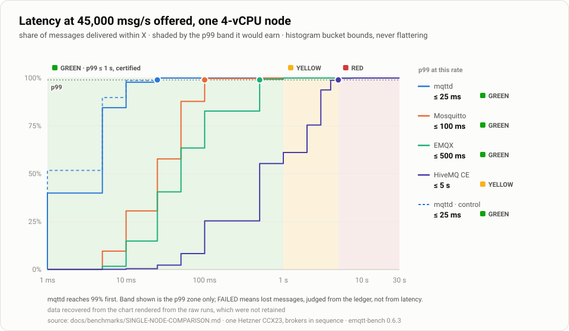
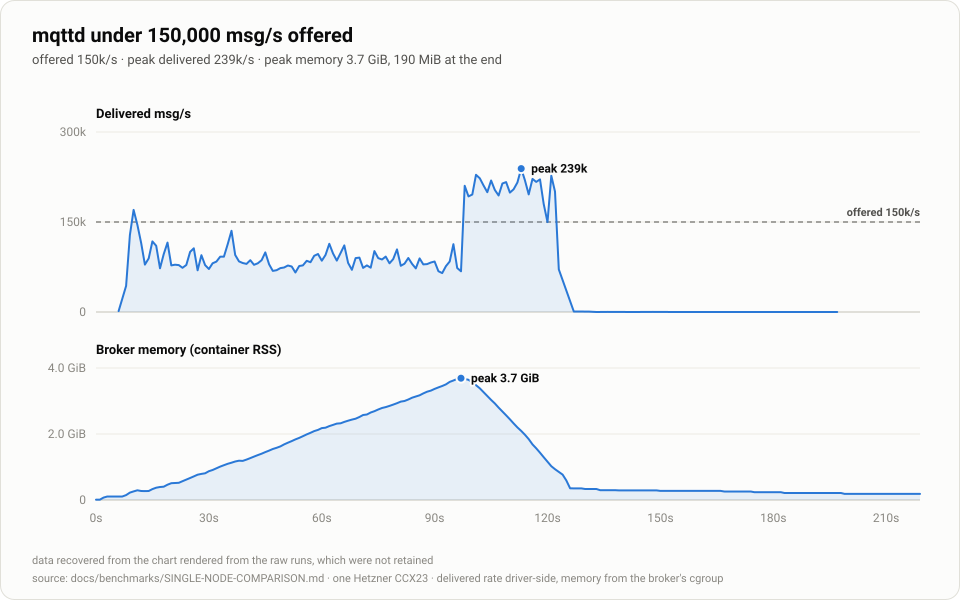
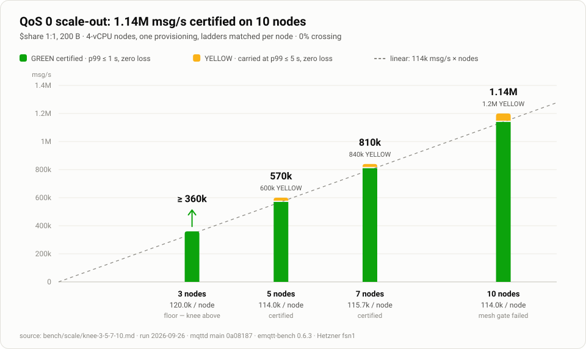
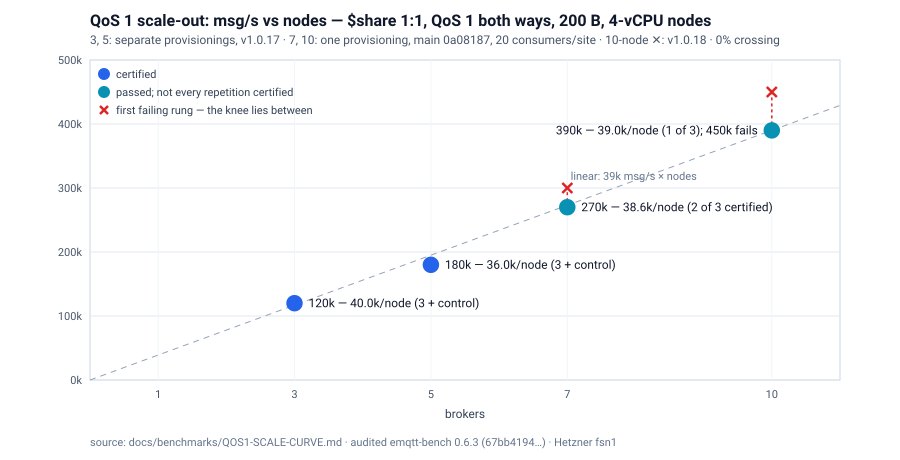
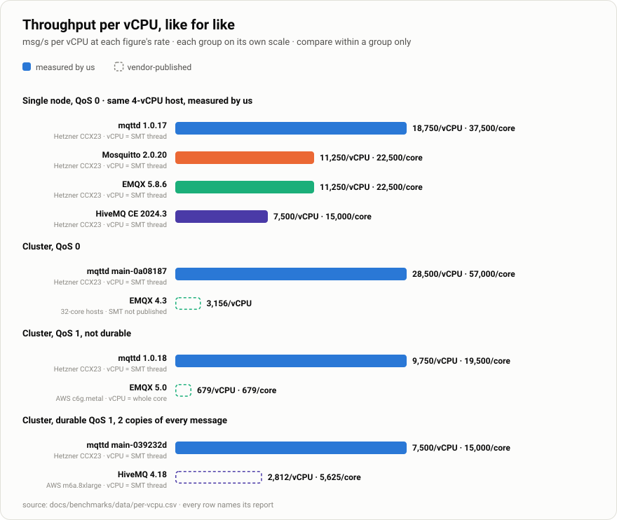

# Evidence: what mqttd carries, and how it was measured

**Dated 2026-10-25.** Every throughput figure the project publishes, with its method,
its limits and the cards it is read from. This page was the README's numbers sections
until 2026-10-25; the figures, tables and anchors are unchanged, and the README now
links here. The README's three charts are drawn from [`data/headline.csv`](data/headline.csv)
(each figure cites its card) by `bench/scale/chart-readme.py`; the other charts here come
from `bench/scale/chart-scale-out.py` and `bench/scale/chart-per-vcpu.py`.

Jump to: [headline figures](#headline-figures) · [in one table](#in-one-table) ·
[by the numbers](#by-the-numbers) · [scale on 1.2.0](#scale-what-we-measured-on-120) ·
[QoS 0 scale-out](#cluster-scale-out-qos-0-shared-subscriptions) ·
[durable and QoS 1 scale-out](#durable-and-qos-1-scale-out) ·
[per vCPU](#per-vcpu-like-for-like) ·
[published cluster benchmarks](#against-published-cluster-benchmarks) ·
[method](#benchmarks) · [where competitors win](#where-competitors-win)

## Headline figures

> **Open == Enterprise: every feature, no paid tier.**
>
> MQTT 3.1.1 + 5.0 · Rust · durable sessions quorum-replicated **by default** · Apache-2.0, everything.
>
> **75,000 msg/s** on one 4-vCPU node at p99 ≤ 1 s — **1.7× Mosquitto and EMQX, 2.5× HiveMQ CE**, same host, EMQX's own load tool. [Numbers ↓](#by-the-numbers)
>
> **Linear scale-out, 3 → 10 nodes:**
> - **QoS 0:** ~114,000 msg/s **per 4-vCPU node** — **1.14M msg/s on 10 nodes, 40 vCPU in total**; 1.2M at p99 ≤ 2 s, no loss.
> - **QoS 1, clean sessions:** ~39,000–45,000 msg/s per node — **390,000–450,000 msg/s on 10 nodes**.
> - **Durable QoS 1** (ack after fsync + replication): **90,000 msg/s on 3 nodes, 12 vCPU** on the log store, again GREEN on the release candidate; **270,000 msg/s on 10 nodes** ([↓](#durable-and-qos-1-scale-out)).
>
> All three use shared subscriptions. [Scale-out ↓](#cluster-scale-out-qos-0-shared-subscriptions)
>
> **Newest, measured on 1.2.0** (read from the brokers' counters, 2026-10-21): durable QoS 1 on 10 nodes **270,000 msg/s on the log store, certified**, and about 185,000 on the default store; QoS 1 with clean sessions 39–45k msg/s per node on 10 nodes. On a pre-release build (2026-10-12), durable QoS 1 delivered **173,000 → 206,000 → 240,000 msg/s on 10 → 12 → 14 nodes**. More than a billion messages ledgered, none lost. [What we measured ↓](#scale-what-we-measured-on-120)

## In one table

| | mqttd | the others |
|---|---|---|
| **Single-node throughput** | 75k msg/s at p99 ≤ 1 s, 30% CPU idle | 45k / 45k / 30k (Mosquitto / EMQX / HiveMQ CE) |
| **Cluster scale-out** | flat per node from 3 → 10 nodes: ~114k msg/s QoS 0 and ~39k QoS 1 (clean sessions) per 4-vCPU node; ~1M msg/s QoS 0 on **40 vCPU** | vendor-published ~1M msg/s runs: HiveMQ on 40 nodes, EMQX on 1,472 cores ([different workloads ↓](#against-published-cluster-benchmarks)) |
| **Per vCPU** (same kind of vCPU) | 7,500 msg/s durable QoS 1, 2 copies | HiveMQ 4.18: 2,812 durable QoS 1, 2 copies ([like for like ↓](#per-vcpu-like-for-like)) |
| **Durable sessions** | quorum-replicated, **default**; acked QoS 1/2 survives node loss, even in flight | Mosquitto/NanoMQ single-node · VerneMQ loses queues on node death · EMQX opt-in |
| **Revocation** | policy reload **evicts live sessions** | not documented by any compared broker |
| **Secure by default** | TLS 1.3, mTLS/OIDC, deny-by-default ACL, hash-chained audit; insecure = opt-in + `INSECURE:` log | varies; NanoMQ and Mosquitto < 2.0 allow anonymous by default |
| **Clustering** | free, Apache-2.0, signed reproducible builds | EMQX 💰 BSL · VerneMQ 💰 EULA binaries · HiveMQ CE single-node |
| **Checkable claims** | every capability → task → evidence ([dashboard](../delivery/STATUS.md)); losing cells printed | — |

## By the numbers

**How a rung is judged** ([ADR 0048](../adr/0048-comparative-benchmarking.md#amendment-2026-09-27-a-rung-fails-only-on-loss-p99-is-graded-green--yellow--red)): a rung **fails only if it loses messages**. A lossless rung is graded by p99 — **GREEN ≤ 1 s (certified)**, **YELLOW ≤ 5 s**, **RED** above. Every knee below is the highest GREEN rung; the YELLOW figure beside it is the latency around the knee, for workloads that can take it.

Sources: [SINGLE-NODE-COMPARISON.md](SINGLE-NODE-COMPARISON.md) (2026-09-16, one Hetzner CCX23, 4 vCPU / 16 GB, brokers in sequence, untuned) · [knee-3-5-7-10.md](../../bench/scale/knee-3-5-7-10.md) (2026-09-26, QoS 0 scale-out, 3 → 10 nodes on one provisioning) · [SCALE-CURVE.md](SCALE-CURVE.md) (one host + NVMe per broker) · [0080-replicas-ab-n3.md](../../bench/scale/0080-replicas-ab-n3.md) (2026-09-30, durable QoS 1 on 3 nodes) · [per-vcpu.csv](data/per-vcpu.csv) (every per-vCPU figure and its source).

**Single-node knee** — highest GREEN rate, p99 ≤ 1 s (1:1 QoS 0, 200 B). Qualified at ≥ 99% delivered before the zero-loss rule; the raw runs are not retained, so zero loss is not re-checked:

```text
mqttd      1.0.17   ██████████████████████████████████████████████████  75,000 msg/s
Mosquitto  2.0.20   ██████████████████████████████                      45,000
EMQX       5.8.6    ██████████████████████████████                      45,000
HiveMQ CE  2024.3   ████████████████████                                30,000
```

| broker | knee | p99 at knee | CPU idle | RSS | what limits it |
|---|---|---|---|---|---|
| **mqttd** | **75,000** | ≤ 500 ms | **30%** | 133 MiB | tail latency |
| Mosquitto | 45,000 | ≤ 100 ms | 70% | **18 MiB** | single thread (1 of 4 cores) |
| EMQX | 45,000 | ≤ 500 ms | 2% | 434 MiB | CPU |
| HiveMQ CE | 30,000 | ≤ 100 ms | 5% | 927 MiB | JVM heap → OOM crash |

**Latency distribution at 45,000 msg/s** (Mosquitto's and EMQX's knee) — share delivered within:

| | 1 ms | 10 ms | 25 ms | 100 ms | 1 s |
|---|---|---|---|---|---|
| **mqttd** | **39.9%** | **97.8%** | **100%** | 100% | 100% |
| Mosquitto | 0.1% | 30.6% | 57.8% | 99.7% | 100% |
| EMQX | 0.1% | 14.9% | 40.6% | 82.8% | 100% |
| HiveMQ CE | 0.0% | 0.4% | 2.3% | 25.4% | 61.1% |



**Overload at 150,000 msg/s:**

| | mqttd | Mosquitto | EMQX | HiveMQ CE |
|---|---|---|---|---|
| behaviour | queues, drains at **239k msg/s** (1.6× offer) | sheds, 38% of offer | queues | JVM dies |
| peak memory | 3.8 GiB | 991 MiB | 3.6 GiB | 12 GiB |
| memory returned | **95%** | **98%** | 24% | — |



### Scale: what we measured on 1.2.0

**The per-node rate held from 3 to 10 nodes, and no message was lost.** Campaigns on one
provisioning of 4-vCPU brokers each, 3 and 10 nodes on the same hosts, on the 1.2.0 release
candidate (2026-10-21):

| | 3 nodes | 10 nodes | p99 | messages ledgered · lost |
|---|---|---|---|---|
| **QoS 1, clean sessions** | 40.0k msg/s per node (120,000 msg/s), and 50.0k (150,000) at the top of its ladder | 39.0k per node (390,000 msg/s), 42.0k (420,000) and 45.0k (450,000), the highest rung run | ≤ 50 ms | 323,555,538 · 0 |
| **Durable QoS 1**: persistent sessions, every delivery fsynced and quorum-acked, default store (redb) | 16.0k per node taken in full (48,017 msg/s); stops taking more at 19.3k (57,973) | 14.9k per node taken in full (148,717 msg/s); stops taking more at 18.5k (185,376) | ≤ 500 ms | 444,664,692 · 0 (both stores) |
| **Durable QoS 1 on the log store** (`MQTTD_REPLICA_STORE=log`, experimental), same hosts | 30.0k per node (90,003 msg/s), certified GREEN | 27.0k per node (270,034 msg/s), certified GREEN; 29.9k (298,530) at the top of its ladder | ≤ 500 ms | |


- **Clean sessions did not find a limit at either size.** Every rung delivered its whole
  offer.
- **No regression from 2026-10-12 to the release candidate.** On the same hosts, the
  2026-10-12 build delivered 390,005 msg/s at 10 nodes and the candidate 390,004, both at
  p99 ≤ 25 ms ([the comparison](../../bench/scale/qos1-knees-2026-10-21.md#what-it-shows)).
- **Durable QoS 1 has the same ceiling per node at 3 and at 10 nodes**, about 19k msg/s on
  the default store. Offered more than that, the brokers acknowledge more slowly,
  publishers fall behind their schedule, and nothing is dropped. The 2026-10-12 build on the
  same hosts stopped at the same point (185,025 msg/s at 10 nodes), so the release carries
  durable QoS 1 as before.
- **The log store carries at least 46% more durable QoS 1 on the same hardware**: 27k
  against 18.5k msg/s per node at 10 nodes, 30k against 19.3k at 3, certified by the rig
  ([the A/B](../../bench/scale/durable-knees-2026-10-21.md#what-it-shows)). It is still
  experimental (ADR 0078 criteria 1 and 5 are open), so it is not the default.
- **Some cross-node traffic did not stop it scaling.** At 3 nodes no publish was
  forwarded between brokers (0.00%). On the loaded durable 10-node rungs 13–17% of
  publishes were, up to 40% on the busiest broker, and the cluster reached the same ceiling
  per node. Clean sessions at 10 nodes forwarded 0.00%. The durable case forwards by
  design: a persistent session lives on the broker that owns it, not on the one its
  client dialled, so at 10 nodes some brokers hold no local member of a site's `$share`
  group ([the counters](../../bench/scale/durable-knees-2026-10-21.md#cross-node-traffic)).

**How to read this.** Rates are the brokers' own counters over a 60 s window. A rung
*holds* if no message was lost (every message identity sent was acknowledged and
received, and no broker dropped one) and p99 is at or below 1 s. Every rung here holds.
That rule is simpler than the rig's certification, which graded some of these rungs
NOT CARRIED, for a saturated load-generator host, driver-side evidence it refused, or an
offer the cluster did not take in full. The binary is the 1.2.0 release candidate
(`ec407218`, built with the release recipe). The released `v1.2.0` differs from it only by
a patch to two TLS libraries (#1063) and by tests. Brokers are Hetzner CCX23 (4 vCPU). Each rung is one 60 s window. These are not points on the
[certified curve](QOS1-SCALE-CURVE.md). Every rung, both readings and the
commands: [qos1-knees-2026-10-21.md](../../bench/scale/qos1-knees-2026-10-21.md) ·
[durable-knees-2026-10-21.md](../../bench/scale/durable-knees-2026-10-21.md) ·
[qos1-knees-2026-10-12.md](../../bench/scale/qos1-knees-2026-10-12.md) ·
[durable-knees-2026-10-12.md](../../bench/scale/durable-knees-2026-10-12.md).

**Durable QoS 1 past 10 nodes: the total grew at each size.** A third campaign the same
day: one provisioning formed as 14, then 12, then 10 nodes, the same durable workload
with 28 persistent consumers per site.

| nodes | offered 15k msg/s per node: delivered | offered 18k msg/s per node: delivered | p99 | messages ledgered · lost |
|---|---|---|---|---|
| 10 | 150,419 msg/s (15.0k per node) | 173,100 of 180,000 (17.3k per node) | ≤ 500 ms | 91,243,694 · 0 |
| 12 | 179,039 msg/s (14.9k per node) | 205,750 of 216,000 (17.1k per node) | ≤ 500 ms | 83,430,832 · 0 |
| 14 | 208,739 msg/s (14.9k per node) | 240,497 of 252,000 (17.2k per node) | ≤ 500 ms | 131,558,906 · 0 |


- **Adding nodes added throughput.** 10 → 12 → 14 nodes delivered 150,419 → 179,039 →
  208,739 msg/s offered 15k per node, and 173,100 → 205,750 → 240,497 offered 18k, at the
  same rate per node, with nothing lost.
- **At 18k per node the brokers took 95–96% of the offer** and slowed the publishers.
  The brokers were the limit, not the load generators, which had CPU to spare.
- **The larger clusters forwarded more between brokers and kept the rate**: 4.78% of
  publishes at 10 nodes, 13.41% at 12, 15.79% at 14.

**Limits.** Same reading rule as above, on a pre-release build of 1.2.0 (`7d4eced`,
2026-10-12), default store. The
rig certified none of these six rungs: on each, publishers ran behind schedule. Each is
one 60 s window. The closing arm, a repeat of the 14-node cluster as a drift control, did
not run: the re-formed cluster did not reach a full mesh
([#971](https://github.com/mbilling/fss-mqtt-broker/issues/971)). So drift over the two
hours is not bounded by a repeat, only by the 1-site controls around each ladder. Brokers
11–14 sit in a second placement group and may share a physical host with another broker.
With the two campaigns above, 733,316,488 messages ledgered, none lost. These runs inject
no fault: a broker that holds a member dead and cannot reach it for eight seconds
acknowledges QoS 1 publishes it does not deliver
([#973](https://github.com/mbilling/fss-mqtt-broker/issues/973)), and nothing here
provokes that. Every rung, the
rig's verdicts, the cross-node counters and the commands:
[durable-scaleout-10-12-14.md](../../bench/scale/durable-scaleout-10-12-14.md).

### Cluster scale-out, QoS 0 shared subscriptions

The highest rate each cluster size carries GREEN — p99 ≤ 1 s, zero loss —
and the YELLOW rung above it (1:1 via `$share`, 200 B, 10 consumers per site). All four sizes ran on
**one provisioning**, the same hosts re-formed 10 → 7 → 5 → 3 → 10. Each size had
2 load generators per broker and ladders matched in per-node offer, so a driver
carries the same load at every size:

```text
3 nodes  ██████████·······················  ≥ 360k msg/s  ≥ 120k/node   every rung GREEN — knee above
5 nodes  ████████████████·················    570k         114k/node     YELLOW 600k   (p99 ≤ 2 s)
7 nodes  ███████████████████████··········    810k         116k/node     YELLOW 840k   (p99 ≤ 2 s)
10 nodes █████████████████████████████████  1,140k         114k/node     YELLOW 1,200k (p99 ≤ 2 s)   highest GREEN rung (see below)
```



**Per-node capacity is flat from 3 to 10 nodes.** 5, 7 and 10 nodes are all GREEN
at ~114k msg/s per node and YELLOW at 120k (p99 ≤ 2 s, nothing lost). 3 nodes is GREEN at 120k, which is one ladder
step (6–10k/node) above the others and inside the run's declared ±0.1 resolution.
Crossing was 0.00% on every broker of every rung, and ingress stayed balanced
(busiest broker ≤ 1.01× the mean). A closing 10-node arm on the same hosts matched
the opening one within 0.002%.

Read strictly, by the rules fixed before the run:
- **3 nodes' figure is a floor.** Its whole ladder passed.
- **10 nodes is uncertified.** Near saturation, one busy broker stopped answering
  membership probes and was declared dead by its peers for ~30 s, at 108k/node on
  10 nodes and at 120k/node on 7. The run's own mesh gate therefore fails the
  10-node arm. No message was lost (0 dropped, 0 pending), but this is a real
  membership flap under load and is tracked as a limitation.
- The 10-node ladder also had one NOT STEADY rung at 96k/node, which received the
  full offer but never held the per-site band. Its strictly certified figure is
  900k.

Method, the rules fixed before the run, and the commands to reproduce it:
[knee-3-5-7-10.md](../../bench/scale/knee-3-5-7-10.md#reproduce).

The earlier "5 → 7 nodes plateaus" reading came from a benchmark gap: one of 7
brokers had no local subscriber, so 14% of publishes crossed the cluster. It
does not reproduce under a controlled harness.

### Durable and QoS 1 scale-out

**Durable QoS 1 on 3 nodes** (every ack waits for fsync + replication; persistent
`$share` consumers; 3 × CCX23, 12 vCPU, log store): **90,000 msg/s GREEN**, p99
≤ 100 ms, no loss, **7,500 msg/s per vCPU**. The same at 2 and 3 replicas; 2
replicas carried 122,594 msg/s at most against 104,716 for 3. Measured 2026-09-30
on an unreleased build of main ([0080-replicas-ab-n3.md](../../bench/scale/0080-replicas-ab-n3.md)).

**Write elision** (ADR 0089, `durable.write_elision_ms`, 50 ms by default from 1.3.0): a
delivery to an online persistent subscriber goes out at once and is written only if its
PUBACK does not arrive inside the window. The publisher's ack then waits
for the subscriber's PUBACK **or** fsync + replication, whichever comes first, so an
acknowledged message is still never lost. On 3 nodes at 60,000 msg/s, a 50 ms window kept
98% of deliveries off the disk and cut p99 from ≤ 500 ms to ≤ 25 ms
([elision-window-n3-2026-10-21.md](../../bench/scale/elision-window-n3-2026-10-21.md)).

The earlier curve below is a different harness: closed loop, 48 publishers with 8
messages in flight each, so its rate is set by latency at that concurrency, not by
capacity (v1.0.5, [SCALE-CURVE.md](SCALE-CURVE.md)):

```text
1 node  ████████████████████░░░░░░░░░░░░░   8.5k msg/s   p99 90 ms
3 nodes ████████████████████░░░░░░░░░░░░░   8.6k         p99 82 ms   quorum tax absorbed
5 nodes █████████████████████████████████  13.9k         p99 56 ms   1.63× one node
```

**Cluster scale-out, QoS 1 shared subscriptions** (clean sessions, at-least-once
both ways — no durable session, so this is the routing path, not the fsync one):

```text
3 nodes  ██████████░░░░░░░░░░░░░░░░░░░░░░░  120k msg/s   25.9 MB/s   p99 ≤ 5 ms     40.0k/node
5 nodes  ███████████████░░░░░░░░░░░░░░░░░░  180k         38.9 MB/s   p99 ≤ 5 ms     36.0k/node
7 nodes  ███████████████████████░░░░░░░░░░  270k         58.3 MB/s   p99 ≤ 500 ms   38.6k/node   knee: 300k not carried
10 nodes █████████████████████████████████  390k         84.2 MB/s   p99 ≤ 500 ms   39.0k/node   knee: 420k–450k
```

**Per-node QoS 1 capacity holds out to 10 nodes.**
- **3 and 5 nodes:** separate provisionings.
- **7 and 10 nodes:** one provisioning on 2026-09-26, with 20 consumers per site so
  every broker holds a local member. Crossing was 0.00% throughout, and a closing
  10-node arm matched the opening one within 0.001%.
- **Certification:** 2 of 3 repetitions are certified at 7 nodes and 1 of 3 at 10.
  The rest were invalid on the load driver's own endpoint scrapes, while every
  broker received the full offer.



Latency is not what limits QoS 1: every rung here is GREEN, p99 ≤ 500 ms, and
nothing was lost. The knee is backpressure. 7 nodes carries 270k and does not carry
300k (42.9k/node) because publishers ran late. At QoS 1 that means slow acks from
the brokers; every load generator was still ≥ 66% idle. 10 nodes showed nothing
wrong at 420k (42k/node), and publishers ran late at 450k (45k/node), so its knee is
at or just above 7 nodes'. The 420k rungs are not certified: the load driver's metrics endpoint renders too slowly
under that load for the 60 s window's evidence check. Details and every
rung: [QOS1-SCALE-CURVE.md](QOS1-SCALE-CURVE.md#7-and-10-nodes--one-provisioning-2026-09-26);
reproduce: [QOS1-SCALE-CURVE.md § Reproduction](QOS1-SCALE-CURVE.md#reproduction).


The newest runs, on 1.2.0, are not points on this curve and have their own section:
[Scale: what we measured on 1.2.0](#scale-what-we-measured-on-120).

MB/s is application payload (216 B/message). **The constraint is packets, not
bytes** — measured: holding 60,000 msg/s and growing the payload to 8 KiB reached
**492 MB/s** (1,576 Mbit/s per node) while softirq stayed flat at 24–34% across
the whole 38× increase. So **small messages are the expensive case** — size a
cluster on messages per second, not megabytes. 492 MB/s is a floor; nothing was
saturated there.

Three repetitions plus a passing control at each size, delivery matching offer to
within 2 msg/s, 144M message identities reconciled with zero lost. **These are
what the rig carried, and the rig ran out first**: one core of each broker host
saturates on *network interrupt handling* (54.6% softirq, 1.2% idle, while its
three siblings sit 33–39% idle), and mqttd's own hub loop was at **0.46 of a
core** — roughly 2× headroom — measured by the broker's own dispatch metric
rather than by sampling CPU. Spreading that softirq is a settled dead end for capacity
(#505/#507: +1.9%, noise); the cause is **cross-node forwarding**, which is why
`shared_prefer_local` is the default (#508/#511, +42% at N=5). Full method, the
per-core breakdown, and two earlier revisions of this claim that were wrong:
[QOS1-SCALE-CURVE.md](QOS1-SCALE-CURVE.md).

### Per vCPU, like for like



A vCPU is not a fixed unit, so every figure here says what one is:
- **An SMT thread** on our Hetzner CCX23s and on HiveMQ's AWS `m6a`: both AMD EPYC
  Milan, two vCPUs per physical core. Per vCPU, these compare directly.
- **A whole core** on EMQX 5.0's AWS `c6g` (Graviton2, no SMT). A core does more work
  than one thread, so per vCPU it is flattered against an SMT host; compare it per
  physical core instead (the chart shows both).

Figures are only compared inside one workload class. A durable, replicated QoS 1
message costs several times a QoS 0 one, and connection count dominates the large
vendor runs.

| class | mqttd | best comparable | ratio |
|---|---|---|---|
| single node, QoS 0, **same host, measured by us** | 18,750 /vCPU | EMQX 5.8.6 11,250 · HiveMQ CE 7,500 | 1.7× · 2.5× |
| cluster, QoS 1, not durable | 9,750 /vCPU (clean sessions) | EMQX 5.0 679 /core (published; compare per core) | — |
| cluster, durable QoS 1, 2 copies | 7,500 /vCPU (fsync + replication) | HiveMQ 4.18 2,812 /vCPU (published) | **2.7×** |

Mosquitto (11,250 /vCPU on the same host) is single-threaded: it uses one of the
four vCPUs, so per vCPU it undersells what one thread does. HiveMQ publishes its
benchmarks on its default configuration, which persists sessions and keeps **2
copies** of all persistent data ([`replica-count` 2](https://docs.hivemq.com/hivemq/latest/user-guide/cluster.html)).
So HiveMQ 4.18's 270,000 QoS 1 msg/s on 96 vCPU is durable, like mqttd's figure at
its default of 2 replicas: the same copy count, on the same kind of thread (EPYC
Milan SMT). Its payload is not published. Data, with every source:
[per-vcpu.csv](data/per-vcpu.csv); chart:
`bench/scale/chart-per-vcpu.py`.

### Against published cluster benchmarks

HiveMQ and EMQX publish large-cluster results around 1M msg/s. **We have not
reproduced these.** The table puts their published figures next to ours, with
every difference that matters shown alongside:

| | **mqttd** (ours, 2026-09-26) | HiveMQ 4.11 (2023) | EMQX 5.0 (2022) | EMQX 4.3 (2021) | HiveMQ 4.18 (2023) |
|---|---|---|---|---|---|
| throughput | **1.14M** QoS 0 (810k certified at 7 nodes) | 1M QoS 1 PUBLISH/s peak | > 1M QoS 1 in and out | 505k QoS 0, 1:1 | 270k QoS 1, durable (default: 2 copies) |
| cluster | **10 × 4 vCPU = 40 vCPU** | 40 nodes (AWS; instance type not published) | 23 × `c6g.metal` = 1,472 cores | 5 × 32 cores = 160 cores | 3 × `m6a.8xlarge` = 96 vCPU |
| per vCPU | **~28,500 msg/s** | — | ~680 in | ~3,200 | ~2,800 |
| one vCPU is | SMT thread (EPYC Milan) | not published | whole core (Graviton2) | not published (per core) | SMT thread (EPYC Milan) |
| per physical core | **~57,000 msg/s** | — | ~680 in | ~3,200 | ~5,600 |
| connections | ~45k | 200M | 100M | 10M | 20k |
| payload · pattern | 200 B · 1:1 `$share` | 16 B · 20M pubs → 180M subs | 256 B · 1:1 wildcard | 50 B · 1:1 | not published |
| CPU at that rate | busiest broker 11–19% idle | 75–80% | 97% | 56–68% | not published |

**What the differences mean.** The two ~1M headline runs carried **2,000–4,000×
more connections** than ours (EMQX 4.3: ~220×), and connection count dominates
their resource use: HiveMQ reports about 13 KB of heap per connection, and EMQX
uses 90% of RAM at 100M connections. HiveMQ's runs and EMQX 5.0's are QoS 1;
ours is QoS 0. So the per-vCPU rows are **not a like-for-like ratio**. It is a statement about the hardware each system needs to
carry a message at the connection counts shown.

The closest comparison is HiveMQ 4.18: 20k clients, QoS 1 on HiveMQ's default
configuration (persistent, 2 copies), and the same CPU (EPYC Milan, a vCPU is an
SMT thread on both). mqttd's durable QoS 1 at 2 copies is 90,000 msg/s on 3 × 4
vCPU: **7,500 msg/s per vCPU against HiveMQ's ~2,800**, 2.7× ([per vCPU ↑](#per-vcpu-like-for-like)).
HiveMQ's payload is not published.

What the table does not show, and where the others lead:
- **connection scale:** 100–200M connections is a regime we have not measured
- **track record:** mqttd has no production users yet

What it does show:
- **an open cluster:** mqttd's clustering is free and Apache-2.0. HiveMQ
  clustering is commercial, and EMQX 5.x/6.x clustering is BSL.
- **durability by default:** sessions are quorum-replicated without any extra
  configuration.

Sources: [HiveMQ 200M connections](https://www.hivemq.com/whitepaper/achieving-200-mil-concurrent-connections-with-hivemq/) ·
[HiveMQ 4.18 throughput](https://www.hivemq.com/blog/hivemq-4-18-delivers-higher-mqtt-throughput/) ·
[EMQX 5.0 100M connections](https://www.emqx.com/en/blog/reaching-100m-mqtt-connections-with-emqx-5-0) ·
[EMQX 4.3 10M connections](https://www.emqx.com/en/resources/emqx-v-4-3-0-ten-million-connections-performance-test-report).

| more published points | |
|---|---|
| `$share` fan-out floor, 1 → 3 → 5 nodes (v1.0.5, driver-limited; superseded by the scale-out curve above) | ~18.6k → ~53.9k → ~81.4k msg/s |
| 50,000 idle connections | 19.3–19.7 KiB each, flat across cluster sizes |
| durable QoS 1 vs clean session, same publish | ~28 ms vs ~0.03 ms p50 (dev host) |
| codec, 256 B PUBLISH | encode ~270 ns · decode ~190 ns · per-PR regression gate |

**Where mqttd loses:**
- Mosquitto: **7× less memory** at its knee; tighter tail (≤ 100 ms) at its own knee, as does HiveMQ
- EMQX: quietest at 15k msg/s (≤ 1 ms p99; mqttd matches)
- 3 nodes ≈ 1 node on the durable path, in the closed-loop v1.0.5 curve; the open-loop 1.2.0 runs hold the per-node durable rate from 3 to 10 nodes ([↑](#scale-what-we-measured-on-120))
- near saturation a busy broker can be declared dead by its peers for ~30 s (membership flap, seen at 108–120k msg/s per node; no loss at 0% crossing)
- **No production users yet**
- full list: [GUIDE.md § Limitations](../../GUIDE.md#limitations)

---

## Benchmarks

Rules ([ADR 0048](../adr/0048-comparative-benchmarking.md)): pinned versions · disclosed hardware and config · dated · losing cells printed · control arm or the run is void.

### Single-node comparison — method

| | |
|---|---|
| Record | [SINGLE-NODE-COMPARISON.md](SINGLE-NODE-COMPARISON.md), dated 2026-09-17 |
| Host | Hetzner CCX23 (4 dedicated vCPU, EPYC-Milan, 16 GB); 3 × CCX43 (16 vCPU) drivers |
| Versions | mqttd 1.0.17 (published image) · Mosquitto 2.0.20 · EMQX 5.8.6 · HiveMQ CE 2024.3 — digests + config SHA-256 per arm |
| Tool | emqtt-bench 0.6.3 (EMQX's); driver-side measurement only |
| Workload | 1:1 QoS 0, 200 B, 25 msg/s per publisher; ladder 15k → 150k msg/s; 60 s per rung |
| Rung verdict | **FAILED** only on loss · carried = ≥ 95% of offer, settled, drained · p99 **GREEN ≤ 1 s** (certified) / **YELLOW ≤ 5 s** / **RED** · this run predates the zero-loss rule and passed rungs at ≥ 99% delivered |
| Config | documented minimum per broker, [committed verbatim](../../bench/scale/compare/); **nobody tuned**; HiveMQ heap = ½ host RAM |
| Posture | plaintext, anonymous, in-memory; **mqttd durable OFF** (`MQTTD_DURABLE_SESSIONS=0`), disclosed |
| Control | mqttd run first and last → same knee, 0.1% drift; > 5% would void the run |
| Second run | 2026-09-17, fresh fleet: mqttd 75k knee and HiveMQ heap death reproduced |
| Latency | histogram bucket upper bounds ("p99 ≤ X") — coarse, cannot flatter |
| Cost | ~€5, ~2.5 h |

```sh
cd bench/scale && export HCLOUD_TOKEN=…
COMPARE_BROKERS="mqttd mosquitto emqx hivemq" \
COMPARE_RATES="15000 30000 45000 60000 75000 90000 120000 150000" \
BROKER_TYPE=ccx23 DRIVER_TYPE=ccx43 DRIVER_COUNT=3 ./run.sh compare
python3 summarize-compare.py .runs/<stamp>/results
```

More charts: [latency 30k](img/latency-30000.svg) · [latency 75k](img/latency-75000.svg) · overload [Mosquitto](img/timeline-mosquitto-150k.svg) · [EMQX](img/timeline-emqx-150k.svg) · [HiveMQ](img/timeline-hivemq-150k.svg)

### Scaling curve — method

| | |
|---|---|
| Record | [SCALE-CURVE.md](SCALE-CURVE.md), verified against `v1.0.5` (2026-08-24) |
| Hosts | one CCX23 + local NVMe per broker; CCX33 drivers; fresh cluster per size |
| Build | released, cosign-signed, byte-reproducible binary; shipped systemd unit |
| Lanes | durable QoS 1 / QoS 2 (`durable_bench`, exact ack RTTs) · `$share` fan-out (emqtt-bench) · 50k idle connections |
| Workload | 256 B; 48 publishers × window 8; 60 s windows; median of 3 |
| Self-check | per-host disk barrier floor gates the durable curve; driver-limited rungs excluded; counter mismatches flagged |
| Cost | `./run.sh smoke` < €0.50 / 20 min; full 1+3+5 a few euros |

| durable QoS 1 | 1 node | 3 nodes | 5 nodes |
|---|---|---|---|
| acked msg/s | 8,503 | 8,647 | **13,893** |
| p99 saturating | 90 ms | 82 ms | **56 ms** |
| p99 uncontended | 1.01 ms | 1.81 ms | 1.69 ms |
| × disk barrier rate | 3.9× | 4.4× | 7.2× |
| QoS 2 msg/s | 2,970 | 2,124 | 3,009 |
| clean sessions msg/s | 32.1k | 89.4k | 109.6k |

**QoS 0 scale-out (3 → 10 nodes), method:**
[knee-3-5-7-10.md](../../bench/scale/knee-3-5-7-10.md)
- **Hardware:** one provisioning (10 × CCX23 brokers, 20 × CCX33 drivers), re-formed per
  size by `resize-cluster.sh`; drivers are 2 per broker.
- **Safeguards per size:** a mesh-settle wait, a forwarding positive control, a driver
  health gate with in-place swap of a bad host, and a closing drift control.
- **Ladders:** matched per node and stopped two failing rungs past the knee.
- **Candidate:** the unreleased `main` 0a08187, pinned by sha256.

Other published measurements (dev-grade, single host, never capacity): [DURABLE-PATH.md](DURABLE-PATH.md) · [BASELINE.md](BASELINE.md) · [BACKUP-RESTORE.md](BACKUP-RESTORE.md).

### Where competitors win

| dimension | winner | detail |
|---|---|---|
| Memory at knee | Mosquitto | 18 MiB vs 133 MiB (7×); 4 MiB at 15k |
| Tail at own knee | Mosquitto, HiveMQ CE | ≤ 100 ms vs mqttd ≤ 500 ms |
| Quiet at low load | EMQX (mqttd matches) | ≤ 1 ms p99 at 15k |
| Footprint | NanoMQ, Mosquitto | ~4.6 MB image / few-MB daemon vs ~14 MB |
| Track record | all of them | mqttd: **no production users** |
| Hard memory cap | Mosquitto | mqttd: watermark + brownout only |
| Feature surface | EMQX | dashboard, rule-engine data sinks, MQTT-SN/CoAP |
| Linear scale-out, durable path | nobody yet | QoS 0 is flat 3 → 10 nodes; durable QoS 1 3 ≈ 1 node in the closed-loop v1.0.5 curve, per node flat 3 → 10 in the 1.2.0 runs ([↑](#scale-what-we-measured-on-120)); plan [#537](https://github.com/mbilling/fss-mqtt-broker/issues/537) |
| Connection scale | HiveMQ, EMQX | published 200M / 100M connections; mqttd measured to 50k |
| Not covered | — | single-node comparison: one instance type, QoS 0, plaintext, no TLS, no cluster; newer Mosquitto 2.1 / EMQX 6.x unmeasured; vendor cluster figures published, not reproduced |
