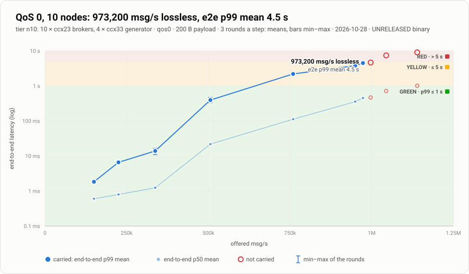
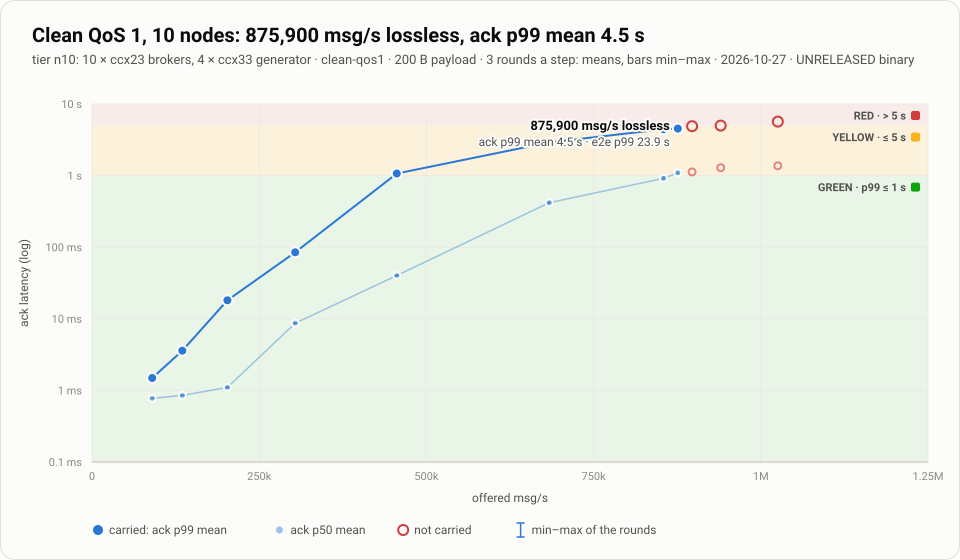
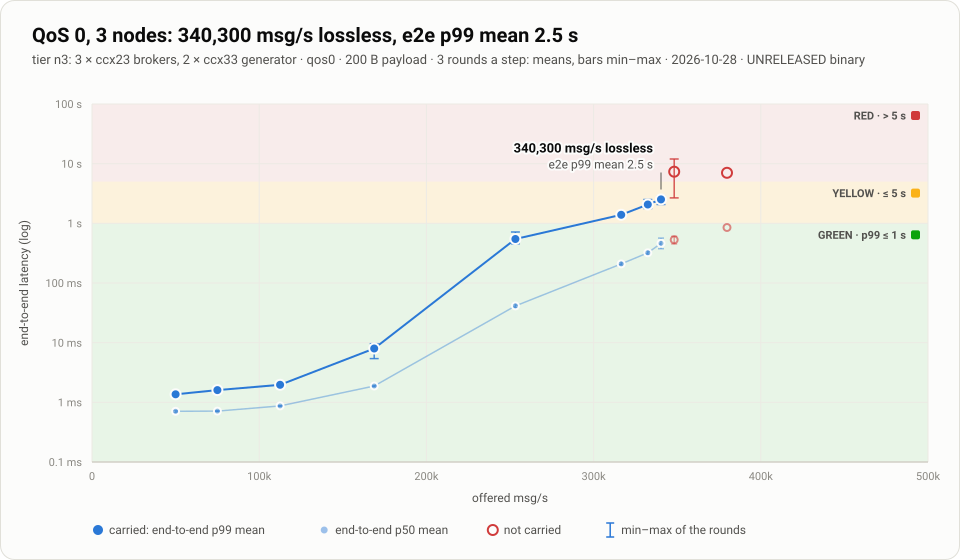
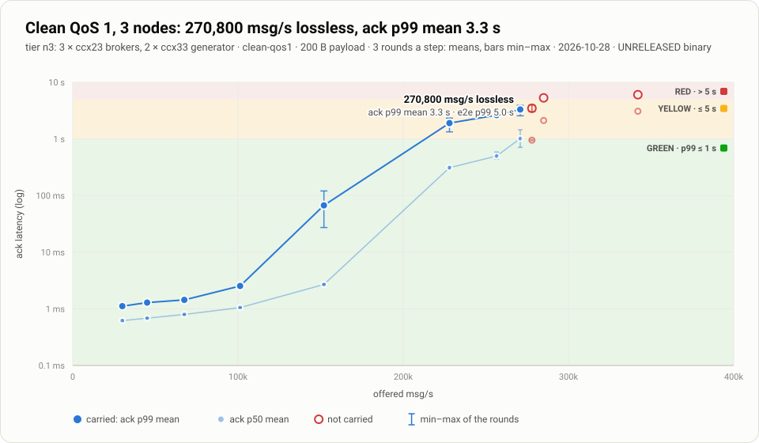
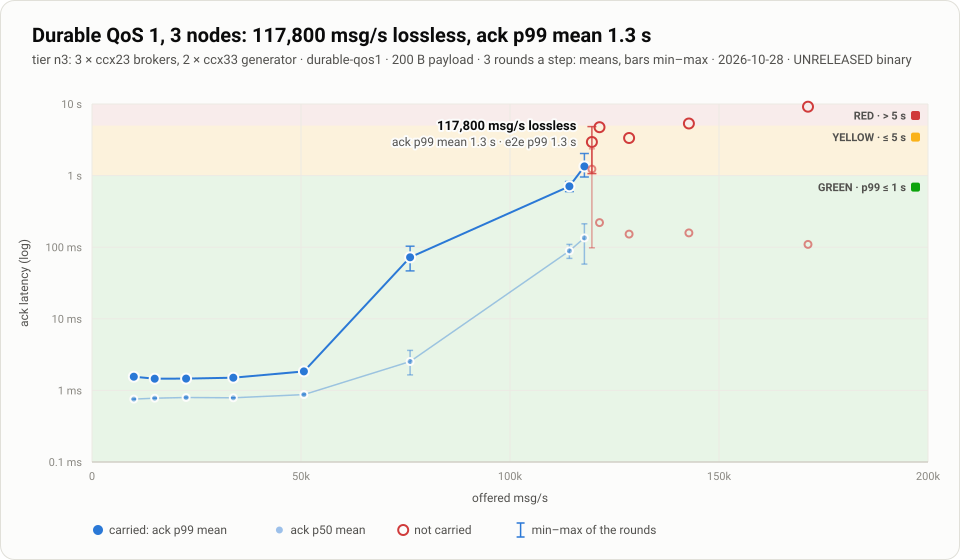

# Benchmark results: the ADR 0090 rig

Every throughput and latency figure in the README comes from this card. They were measured
on 2026-10-27 and 2026-10-28 with the benchmark rig of
[ADR 0090](../adr/0090-benchmark-rig-redesign.md) (`bench/scale/rig2/`).

## How a figure is measured

- **The broker under test** is the 1.3.0 candidate, main `edfdb49`, as a static musl binary
  with sha256 `f5c13cb1…677ebc2`. It runs with its defaults: the segment log store for a
  fresh data dir, 2 copies of every durable session, and TLS between nodes.
- **The hosts** are Hetzner CCX23 brokers (4 dedicated vCPU, AMD EPYC Milan, local NVMe).
  The load generators run on CCX33 hosts: 2 for 3 nodes, 4 for 10 nodes.
- **The load generator** is `mqtt-load` (`crates/mqtt-load`), an open-loop paced
  generator. Every topic's publishers and every `$share` group's members are spread over
  every broker. A generator refuses a workload whose busiest session would carry more than
  1.25× the mean.
- **Calibration.** Before the first step, every generator runs the same load. A host that
  saturates, or whose latency is far above the others', is replaced.
- **Workloads.** All three use 200-byte payloads:
  - **durable QoS 1:** persistent `$share` consumers with a session expiry of 30 s;
  - **QoS 1, clean sessions:** the same shape, with clean sessions;
  - **QoS 0:** the same shape, at most once.
- **Throughput** is msg/s from the brokers' own counters (`mqttd_publish_received_total`).
- **Latency** is measured on the generator's one clock:
  - **ack latency** for QoS 1, publish to PUBACK, where a durable ack waits for fsync and
    the quorum copy;
  - **end-to-end latency** for QoS 0, publish to delivery.
- **A step** is 3 rounds of 20 s warm-up and 60 s measured. It is **CARRIED** only when
  every round lost nothing (by the generators' identity ledgers and the brokers' drop
  counters) and the brokers took at least 99% of the offer. Its latency is the mean of the
  rounds' p99, ± their standard deviation.
- **The ramp** climbs ×1.5 on every carried step, then bisects to 3%.
- **Maximum lossless** is the highest carried step, whatever its latency.
- **"p99 ≤ 1 s"** is the highest carried step whose mean p99 is at most 1 s.
- **VOID.** A round whose generator could not keep up is VOID and rerun. It never counts
  against the broker.

**Known limits of these runs.**
- **One durable session's ceiling.** A single durable session tops out at about 2,500 msg/s
  (16 appends in flight ÷ the append latency), until ADR 0091 T4. Every workload here spreads
  its load evenly, so no session came near it.
- **Uneven `$share` spread.** Prefer-local `$share` selection gave the busiest consumer about
  1.6× the mean consumer's deliveries.
- **Two DISCONNECTED steps at 10 nodes.** In the clean QoS 1 ladder, 1,025,400 and 897,300
  msg/s read DISCONNECTED, because of a generator bug since fixed (#1140): publishers stopped
  pinging during a long drain, and the broker closed them for silence. By the brokers' own
  figures, 1,025,400 was not taken (97.5% of the offer). 897,300 was taken at 99.4%, with no
  acknowledged message lost.

## 10 nodes

### QoS 0

Run `n10-20261028T013559Z` · 10 × ccx23 brokers, 4 × ccx33 generators · 3 rounds a step · 200 B payload · latency is the end-to-end p99, the mean of the rounds ± their standard deviation.

- **Maximum lossless:** 973,200 msg/s offered (brokers received 973,040), end-to-end p99 4.49 ± 0.13 s
- **end-to-end p99 ≤ 1 s:** 506,300 msg/s (394.7 ± 67.9 ms)
- **end-to-end p99 ≤ 250 ms:** 337,500 msg/s (13.9 ± 2.8 ms)
- **end-to-end p99 ≤ 100 ms:** 337,500 msg/s (13.9 ± 2.8 ms)

| step | offered msg/s | verdict | rounds | brokers received (mean) | end-to-end p99 (mean ± sd) |
|---|---|---|---|---|---|
| 1 | 150,000 | CARRIED | 3 | 150,000 | 1.8 ± 0.0 ms |
| 2 | 225,000 | CARRIED | 3 | 225,003 | 6.6 ± 0.3 ms |
| 3 | 337,500 | CARRIED | 3 | 337,527 | 13.9 ± 2.8 ms |
| 4 | 506,300 | CARRIED | 3 | 506,650 | 394.7 ± 67.9 ms |
| 5 | 759,500 | CARRIED | 3 | 759,978 | 2.20 ± 0.04 s |
| 6 | 1,139,300 | FAILED | 1 | 1,136,981 | 9.08 s |
| 7 | 949,400 | CARRIED | 3 | 948,671 | 3.77 ± 0.04 s |
| 8 | 1,044,400 | FAILED | 1 | 1,042,098 | 7.45 s |
| 9 | 996,900 | FAILED | 1 | 999,968 | 4.65 s |
| 10 | 973,200 | CARRIED | 3 | 973,040 | 4.49 ± 0.13 s |

### QoS 1, clean sessions

Run `n10-20261027T141938Z` · 10 × ccx23 brokers, 4 × ccx33 generators · 3 rounds a step · 200 B payload · latency is the ack p99, the mean of the rounds ± their standard deviation.

- **Maximum lossless:** 875,900 msg/s offered (brokers received 878,217), ack p99 4.54 ± 0.07 s
- **ack p99 ≤ 1 s:** 303,800 msg/s (84.9 ± 1.3 ms)
- **ack p99 ≤ 250 ms:** 303,800 msg/s (84.9 ± 1.3 ms)
- **ack p99 ≤ 100 ms:** 303,800 msg/s (84.9 ± 1.3 ms)

| step | offered msg/s | verdict | rounds | brokers received (mean) | ack p99 (mean ± sd) |
|---|---|---|---|---|---|
| 1 | 90,000 | CARRIED | 3 | 90,000 | 1.5 ± 0.0 ms |
| 2 | 135,000 | CARRIED | 3 | 135,000 | 3.6 ± 0.2 ms |
| 3 | 202,500 | CARRIED | 3 | 202,497 | 18.2 ± 1.3 ms |
| 4 | 303,800 | CARRIED | 3 | 303,794 | 84.9 ± 1.3 ms |
| 5 | 455,700 | CARRIED | 3 | 455,769 | 1.07 ± 0.01 s |
| 6 | 683,600 | CARRIED | 3 | 683,676 | 2.90 ± 0.04 s |
| 7 | 1,025,400 | DISCONNECTED | 1 | 999,478 | 5.68 s |
| 8 | 854,500 | CARRIED | 3 | 854,592 | 4.45 ± 0.05 s |
| 9 | 940,000 | OFFER NOT TAKEN | 1 | 930,064 | 4.98 s |
| 10 | 897,300 | DISCONNECTED | 1 | 892,062 | 4.90 s |
| 11 | 875,900 | CARRIED | 3 | 878,217 | 4.54 ± 0.07 s |

### Durable QoS 1

Run `n10-20261027T141938Z` · 10 × ccx23 brokers, 4 × ccx33 generators · 3 rounds a step · 200 B payload · latency is the ack p99, the mean of the rounds ± their standard deviation.

- **Maximum lossless:** 292,200 msg/s offered (brokers received 291,395), ack p99 1.37 ± 1.60 s
- **ack p99 ≤ 1 s:** 228,000 msg/s (58.9 ± 3.0 ms)
- **ack p99 ≤ 250 ms:** 228,000 msg/s (58.9 ± 3.0 ms)
- **ack p99 ≤ 100 ms:** 228,000 msg/s (58.9 ± 3.0 ms)

| step | offered msg/s | verdict | rounds | brokers received (mean) | ack p99 (mean ± sd) |
|---|---|---|---|---|---|
| 1 | 30,000 | CARRIED | 3 | 30,000 | 1.6 ± 0.0 ms |
| 2 | 45,000 | CARRIED | 3 | 45,000 | 1.5 ± 0.1 ms |
| 3 | 67,500 | CARRIED | 3 | 67,500 | 1.5 ± 0.0 ms |
| 4 | 101,300 | CARRIED | 3 | 101,300 | 1.8 ± 0.0 ms |
| 5 | 152,000 | CARRIED | 3 | 152,000 | 9.0 ± 0.5 ms |
| 6 | 228,000 | CARRIED | 3 | 228,001 | 58.9 ± 3.0 ms |
| 7 | 342,000 | FAILED | 2 | 341,938 | 198.6 ± 7.2 ms |
| 8 | 285,000 | CARRIED | 3 | 284,872 | 1.25 ± 1.81 s |
| 9 | 313,500 | OFFER NOT TAKEN | 1 | 300,790 | 4.46 s |
| 10 | 299,300 | FAILED | 1 | 297,694 | 171.8 ms |
| 11 | 292,200 | CARRIED | 3 | 291,395 | 1.37 ± 1.60 s |
## 3 nodes

### QoS 0

Run `n3-20261028T030901Z` · 3 × ccx23 brokers, 2 × ccx33 generators · 3 rounds a step · 200 B payload · latency is the end-to-end p99, the mean of the rounds ± their standard deviation.

- **Maximum lossless:** 340,300 msg/s offered (brokers received 341,479), end-to-end p99 2.52 ± 0.40 s
- **end-to-end p99 ≤ 1 s:** 253,200 msg/s (546.7 ± 146.2 ms)
- **end-to-end p99 ≤ 250 ms:** 168,800 msg/s (8.0 ± 2.2 ms)
- **end-to-end p99 ≤ 100 ms:** 168,800 msg/s (8.0 ± 2.2 ms)

| step | offered msg/s | verdict | rounds | brokers received (mean) | end-to-end p99 (mean ± sd) |
|---|---|---|---|---|---|
| 1 | 50,000 | CARRIED | 3 | 50,000 | 1.4 ± 0.0 ms |
| 2 | 75,000 | CARRIED | 3 | 75,000 | 1.6 ± 0.0 ms |
| 3 | 112,500 | CARRIED | 3 | 112,501 | 2.0 ± 0.1 ms |
| 4 | 168,800 | CARRIED | 3 | 168,801 | 8.0 ± 2.2 ms |
| 5 | 253,200 | CARRIED | 3 | 252,569 | 546.7 ± 146.2 ms |
| 6 | 379,800 | FAILED | 1 | 370,363 | 7.02 s |
| 7 | 316,500 | CARRIED | 3 | 316,213 | 1.39 ± 0.08 s |
| 8 | 348,200 | OFFER NOT TAKEN | 2 | 344,689 | 7.32 ± 6.58 s |
| 9 | 332,400 | CARRIED | 3 | 332,980 | 2.07 ± 0.39 s |
| 10 | 340,300 | CARRIED | 3 | 341,479 | 2.52 ± 0.40 s |

### QoS 1, clean sessions

Run `n3-20261028T030901Z` · 3 × ccx23 brokers, 2 × ccx33 generators · 3 rounds a step · 200 B payload · latency is the ack p99, the mean of the rounds ± their standard deviation.

- **Maximum lossless:** 270,800 msg/s offered (brokers received 271,264), ack p99 3.31 ± 0.69 s
- **ack p99 ≤ 1 s:** 152,000 msg/s (67.2 ± 47.9 ms)
- **ack p99 ≤ 250 ms:** 152,000 msg/s (67.2 ± 47.9 ms)
- **ack p99 ≤ 100 ms:** 152,000 msg/s (67.2 ± 47.9 ms)

| step | offered msg/s | verdict | rounds | brokers received (mean) | ack p99 (mean ± sd) |
|---|---|---|---|---|---|
| 1 | 30,000 | CARRIED | 3 | 30,000 | 1.1 ± 0.0 ms |
| 2 | 45,000 | CARRIED | 3 | 45,000 | 1.3 ± 0.1 ms |
| 3 | 67,500 | CARRIED | 3 | 67,500 | 1.4 ± 0.0 ms |
| 4 | 101,300 | CARRIED | 3 | 101,300 | 2.5 ± 0.2 ms |
| 5 | 152,000 | CARRIED | 3 | 151,993 | 67.2 ± 47.9 ms |
| 6 | 228,000 | CARRIED | 3 | 228,813 | 1.90 ± 0.51 s |
| 7 | 342,000 | OFFER NOT TAKEN | 1 | 265,822 | 6.04 s |
| 8 | 285,000 | OFFER NOT TAKEN | 1 | 264,721 | 5.30 s |
| 9 | 256,500 | CARRIED | 3 | 256,759 | 2.63 ± 0.18 s |
| 10 | 270,800 | CARRIED | 3 | 271,264 | 3.31 ± 0.69 s |
| 11 | 277,900 | OFFER NOT TAKEN | 3 | 276,474 | 3.47 ± 0.48 s |

### Durable QoS 1

Run `n3-20261028T030901Z` · 3 × ccx23 brokers, 2 × ccx33 generators · 3 rounds a step · 200 B payload · latency is the ack p99, the mean of the rounds ± their standard deviation.

- **Maximum lossless:** 117,800 msg/s offered (brokers received 118,047), ack p99 1.35 ± 0.60 s
- **ack p99 ≤ 1 s:** 114,200 msg/s (708.1 ± 113.9 ms)
- **ack p99 ≤ 250 ms:** 76,100 msg/s (72.2 ± 28.7 ms)
- **ack p99 ≤ 100 ms:** 76,100 msg/s (72.2 ± 28.7 ms)

| step | offered msg/s | verdict | rounds | brokers received (mean) | ack p99 (mean ± sd) |
|---|---|---|---|---|---|
| 1 | 10,000 | CARRIED | 3 | 10,000 | 1.6 ± 0.1 ms |
| 2 | 15,000 | CARRIED | 3 | 15,000 | 1.5 ± 0.1 ms |
| 3 | 22,500 | CARRIED | 3 | 22,500 | 1.5 ± 0.0 ms |
| 4 | 33,800 | CARRIED | 3 | 33,800 | 1.5 ± 0.1 ms |
| 5 | 50,700 | CARRIED | 3 | 50,700 | 1.8 ± 0.0 ms |
| 6 | 76,100 | CARRIED | 3 | 76,094 | 72.2 ± 28.7 ms |
| 7 | 114,200 | CARRIED | 3 | 114,241 | 708.1 ± 113.9 ms |
| 8 | 171,300 | FAILED | 1 | 129,531 | 9.18 s |
| 9 | 142,800 | FAILED | 1 | 121,758 | 5.35 s |
| 10 | 128,500 | OFFER NOT TAKEN | 1 | 126,324 | 3.35 s |
| 11 | 121,400 | FAILED | 1 | 115,502 | 4.75 s |
| 12 | 117,800 | CARRIED | 3 | 118,047 | 1.35 ± 0.60 s |
| 13 | 119,600 | FAILED | 2 | 114,623 | 2.95 ± 2.66 s |
