# Benchmark results: the ADR 0090 rig

Every throughput and latency figure in the README comes from this card. They were measured
with the benchmark rig of [ADR 0090](../adr/0090-benchmark-rig-redesign.md)
(`bench/scale/rig2/`): on Hetzner on 2026-10-27 and 2026-10-28, and on AWS on 2026-10-30 and 2026-10-31
([96 vCPU](#aws-96-vcpu), [32 vCPU](#aws-32-vcpu)), on 2026-11-04 (the v1.3.0 release) and on
2026-11-06 and 2026-11-07 ([the plant shape](#aws-the-plant-shape), v1.3.0).

## How a figure is measured

- **The broker under test** is the 1.3.0 candidate, main `edfdb49`, as a static musl binary
  with sha256 `f5c13cb1…677ebc2`. It runs with its defaults: the segment log store for a
  fresh data dir, 2 copies of every durable session, and TLS between nodes. The 1-node
  run used main `9520b33`, which adds #1146 so that a lone node keeps one copy
  ([1 node](#1-node)).
- **The hosts** are Hetzner CCX23 brokers (4 dedicated vCPU, AMD EPYC Milan, local NVMe).
  The load generators run on CCX33 hosts: 2 for 1 and 3 nodes, 4 for 10 nodes.
  The AWS runs use `m6i.4xlarge` (16 vCPU) and `m6i.8xlarge` (32 vCPU) brokers, Intel Ice
  Lake with a gp3 EBS root, one `m7a.8xlarge` (AMD EPYC Genoa), and `c6in.4xlarge` (the
  m6i.4xlarge's CPU on a network-optimized card), with `m6i.2xlarge` and `m6i.4xlarge`
  generators ([AWS, 96 vCPU](#aws-96-vcpu), [the plant shape](#aws-the-plant-shape)).
- **The load generator** is `mqtt-load` (`crates/mqtt-load`), an open-loop paced
  generator. Every topic's publishers and every `$share` group's members are spread over
  every broker. A generator refuses a workload whose busiest session would carry more than
  1.25× the mean.
- **Calibration.** Before the first step, every generator runs the same load. A host that
  saturates, or whose latency is far above the others', is replaced.
- **Workloads.** The three standard ones use 200-byte payloads:
  - **durable QoS 1:** persistent `$share` consumers with a session expiry of 30 s;
  - **QoS 1, clean sessions:** the same shape, with clean sessions;
  - **QoS 0:** the same shape, at most once;
  - **the plant shape** ([AWS, the plant shape](#aws-the-plant-shape)): durable QoS 1 as a
    fleet of sites, each one bridge connection of 250 topics at up to 10,000 msg/s, 50–200 B
    payloads, one durable `$share` group over every topic.
- **Throughput** is msg/s from the brokers' own counters (`mqttd_publish_received_total`).
- **Latency** is measured on the generator's one clock:
  - **ack latency** for QoS 1, publish to PUBACK, where a durable ack waits for fsync and
    the quorum copy;
  - **end-to-end latency** for QoS 0, publish to delivery.
- **A step** is 3 rounds of 20 s warm-up and 60 s measured. It is **CARRIED** only when
  every round lost nothing (by the generators' identity ledgers and the brokers' drop
  counters) and the brokers took at least 99% of the offer. Its latency is the mean of the
  rounds' p99, ± their standard deviation.
- **The ramp** climbs ×1.5 on every carried step, then bisects to 3%.
- **Maximum lossless** is the highest carried step, whatever its latency.
- **"p99 ≤ 1 s"** is the highest carried step whose mean p99 is at most 1 s.
- **VOID.** A round whose generator could not keep up is VOID and rerun. It never counts
  against the broker.

**Known limits of these runs.**
- **One durable session's ceiling.** A single durable session tops out at about 2,500 msg/s
  (16 appends in flight ÷ the append latency), until ADR 0091 T4. Every workload here spreads
  its load evenly, so no session came near it.
- **Uneven `$share` spread.** Prefer-local `$share` selection gave the busiest consumer about
  1.6× the mean consumer's deliveries on Hetzner, and up to 7.1× on AWS ([below](#aws-96-vcpu)).
- **Two DISCONNECTED steps at 10 nodes.** In the clean QoS 1 ladder, 1,025,400 and 897,300
  msg/s read DISCONNECTED, because of a generator bug since fixed (#1140): publishers stopped
  pinging during a long drain, and the broker closed them for silence. By the brokers' own
  figures, 1,025,400 was not taken (97.5% of the offer). 897,300 was taken at 99.4%, with no
  acknowledged message lost.

## 10 nodes

### QoS 0

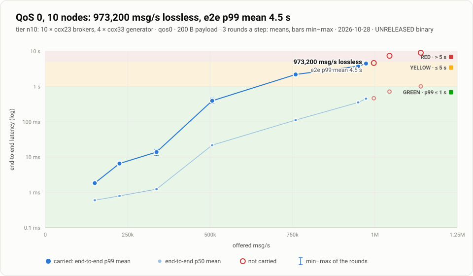

Run `n10-20261028T013559Z` · 10 × ccx23 brokers, 4 × ccx33 generators · 3 rounds a step · 200 B payload · latency is the end-to-end p99, the mean of the rounds ± their standard deviation.

- **Maximum lossless:** 973,200 msg/s offered, 97.3k per node (brokers received 973,040), end-to-end p99 4.49 ± 0.13 s
- **end-to-end p99 ≤ 1 s:** 506,300 msg/s (394.7 ± 67.9 ms)
- **end-to-end p99 ≤ 250 ms:** 337,500 msg/s (13.9 ± 2.8 ms)
- **end-to-end p99 ≤ 100 ms:** 337,500 msg/s (13.9 ± 2.8 ms)

| step | offered msg/s | verdict | rounds | brokers received (mean) | end-to-end p99 (mean ± sd) |
|---|---|---|---|---|---|
| 1 | 150,000 | CARRIED | 3 | 150,000 | 1.8 ± 0.0 ms |
| 2 | 225,000 | CARRIED | 3 | 225,003 | 6.6 ± 0.3 ms |
| 3 | 337,500 | CARRIED | 3 | 337,527 | 13.9 ± 2.8 ms |
| 4 | 506,300 | CARRIED | 3 | 506,650 | 394.7 ± 67.9 ms |
| 5 | 759,500 | CARRIED | 3 | 759,978 | 2.20 ± 0.04 s |
| 6 | 1,139,300 | FAILED | 1 | 1,136,981 | 9.08 s |
| 7 | 949,400 | CARRIED | 3 | 948,671 | 3.77 ± 0.04 s |
| 8 | 1,044,400 | FAILED | 1 | 1,042,098 | 7.45 s |
| 9 | 996,900 | FAILED | 1 | 999,968 | 4.65 s |
| 10 | 973,200 | CARRIED | 3 | 973,040 | 4.49 ± 0.13 s |

### QoS 1, clean sessions

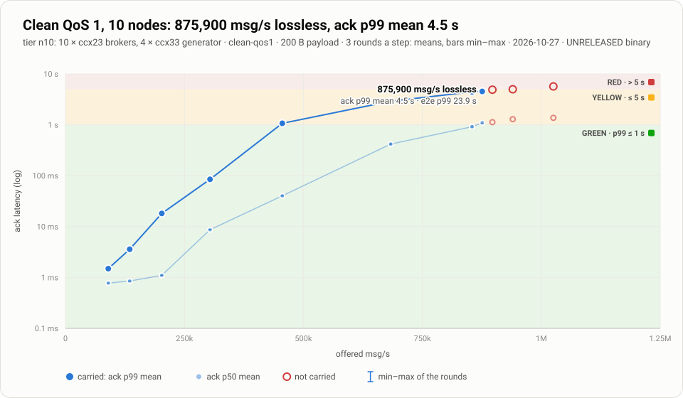

Run `n10-20261027T141938Z` · 10 × ccx23 brokers, 4 × ccx33 generators · 3 rounds a step · 200 B payload · latency is the ack p99, the mean of the rounds ± their standard deviation.

- **Maximum lossless:** 875,900 msg/s offered, 87.6k per node (brokers received 878,217), ack p99 4.54 ± 0.07 s
- **ack p99 ≤ 1 s:** 303,800 msg/s (84.9 ± 1.3 ms)
- **ack p99 ≤ 250 ms:** 303,800 msg/s (84.9 ± 1.3 ms)
- **ack p99 ≤ 100 ms:** 303,800 msg/s (84.9 ± 1.3 ms)

| step | offered msg/s | verdict | rounds | brokers received (mean) | ack p99 (mean ± sd) |
|---|---|---|---|---|---|
| 1 | 90,000 | CARRIED | 3 | 90,000 | 1.5 ± 0.0 ms |
| 2 | 135,000 | CARRIED | 3 | 135,000 | 3.6 ± 0.2 ms |
| 3 | 202,500 | CARRIED | 3 | 202,497 | 18.2 ± 1.3 ms |
| 4 | 303,800 | CARRIED | 3 | 303,794 | 84.9 ± 1.3 ms |
| 5 | 455,700 | CARRIED | 3 | 455,769 | 1.07 ± 0.01 s |
| 6 | 683,600 | CARRIED | 3 | 683,676 | 2.90 ± 0.04 s |
| 7 | 1,025,400 | DISCONNECTED | 1 | 999,478 | 5.68 s |
| 8 | 854,500 | CARRIED | 3 | 854,592 | 4.45 ± 0.05 s |
| 9 | 940,000 | OFFER NOT TAKEN | 1 | 930,064 | 4.98 s |
| 10 | 897,300 | DISCONNECTED | 1 | 892,062 | 4.90 s |
| 11 | 875,900 | CARRIED | 3 | 878,217 | 4.54 ± 0.07 s |

### Durable QoS 1

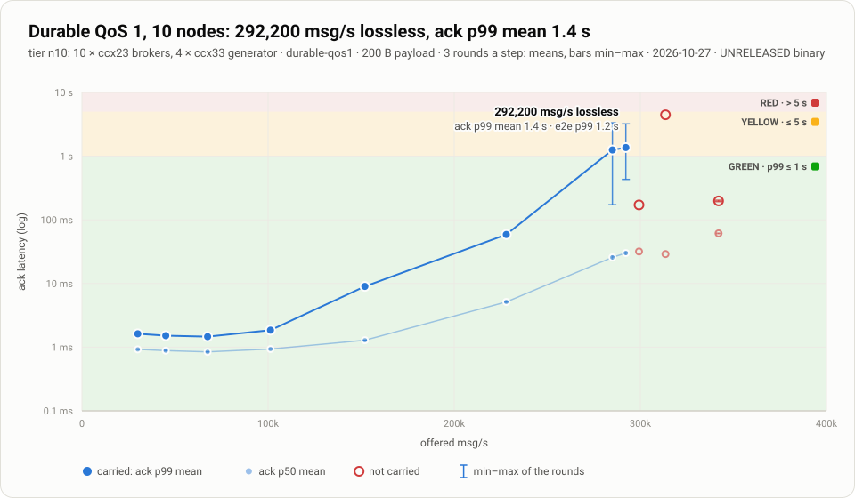

Run `n10-20261027T141938Z` · 10 × ccx23 brokers, 4 × ccx33 generators · 3 rounds a step · 200 B payload · latency is the ack p99, the mean of the rounds ± their standard deviation.

- **Maximum lossless:** 292,200 msg/s offered, 29.2k per node and 7,305 per vCPU (brokers received 291,395), ack p99 1.37 ± 1.60 s
- **ack p99 ≤ 1 s:** 228,000 msg/s (58.9 ± 3.0 ms)
- **ack p99 ≤ 250 ms:** 228,000 msg/s (58.9 ± 3.0 ms)
- **ack p99 ≤ 100 ms:** 228,000 msg/s (58.9 ± 3.0 ms)

| step | offered msg/s | verdict | rounds | brokers received (mean) | ack p99 (mean ± sd) |
|---|---|---|---|---|---|
| 1 | 30,000 | CARRIED | 3 | 30,000 | 1.6 ± 0.0 ms |
| 2 | 45,000 | CARRIED | 3 | 45,000 | 1.5 ± 0.1 ms |
| 3 | 67,500 | CARRIED | 3 | 67,500 | 1.5 ± 0.0 ms |
| 4 | 101,300 | CARRIED | 3 | 101,300 | 1.8 ± 0.0 ms |
| 5 | 152,000 | CARRIED | 3 | 152,000 | 9.0 ± 0.5 ms |
| 6 | 228,000 | CARRIED | 3 | 228,001 | 58.9 ± 3.0 ms |
| 7 | 342,000 | FAILED | 2 | 341,938 | 198.6 ± 7.2 ms |
| 8 | 285,000 | CARRIED | 3 | 284,872 | 1.25 ± 1.81 s |
| 9 | 313,500 | OFFER NOT TAKEN | 1 | 300,790 | 4.46 s |
| 10 | 299,300 | FAILED | 1 | 297,694 | 171.8 ms |
| 11 | 292,200 | CARRIED | 3 | 291,395 | 1.37 ± 1.60 s |
## 3 nodes

### QoS 0

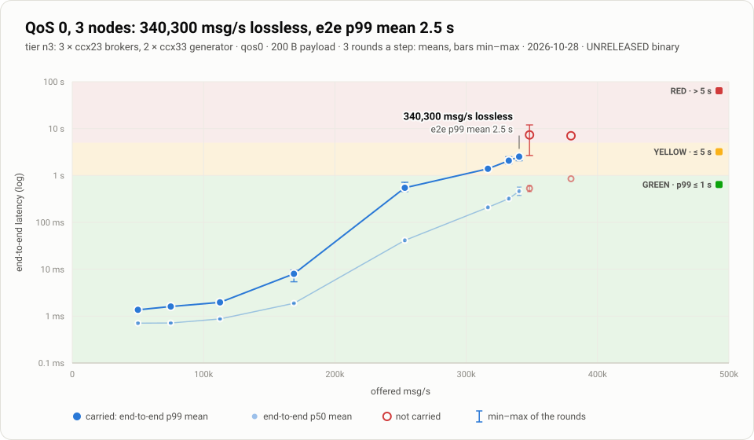

Run `n3-20261028T030901Z` · 3 × ccx23 brokers, 2 × ccx33 generators · 3 rounds a step · 200 B payload · latency is the end-to-end p99, the mean of the rounds ± their standard deviation.

- **Maximum lossless:** 340,300 msg/s offered, 113k per node (brokers received 341,479), end-to-end p99 2.52 ± 0.40 s
- **end-to-end p99 ≤ 1 s:** 253,200 msg/s (546.7 ± 146.2 ms)
- **end-to-end p99 ≤ 250 ms:** 168,800 msg/s (8.0 ± 2.2 ms)
- **end-to-end p99 ≤ 100 ms:** 168,800 msg/s (8.0 ± 2.2 ms)

| step | offered msg/s | verdict | rounds | brokers received (mean) | end-to-end p99 (mean ± sd) |
|---|---|---|---|---|---|
| 1 | 50,000 | CARRIED | 3 | 50,000 | 1.4 ± 0.0 ms |
| 2 | 75,000 | CARRIED | 3 | 75,000 | 1.6 ± 0.0 ms |
| 3 | 112,500 | CARRIED | 3 | 112,501 | 2.0 ± 0.1 ms |
| 4 | 168,800 | CARRIED | 3 | 168,801 | 8.0 ± 2.2 ms |
| 5 | 253,200 | CARRIED | 3 | 252,569 | 546.7 ± 146.2 ms |
| 6 | 379,800 | FAILED | 1 | 370,363 | 7.02 s |
| 7 | 316,500 | CARRIED | 3 | 316,213 | 1.39 ± 0.08 s |
| 8 | 348,200 | OFFER NOT TAKEN | 2 | 344,689 | 7.32 ± 6.58 s |
| 9 | 332,400 | CARRIED | 3 | 332,980 | 2.07 ± 0.39 s |
| 10 | 340,300 | CARRIED | 3 | 341,479 | 2.52 ± 0.40 s |

### QoS 1, clean sessions

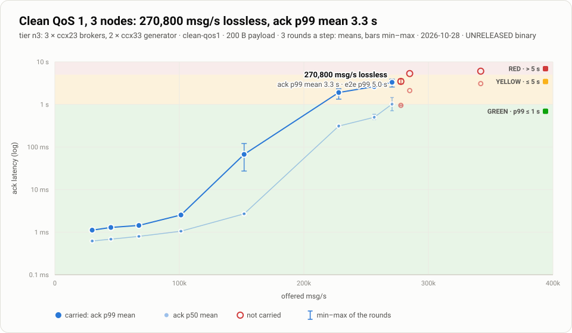

Run `n3-20261028T030901Z` · 3 × ccx23 brokers, 2 × ccx33 generators · 3 rounds a step · 200 B payload · latency is the ack p99, the mean of the rounds ± their standard deviation.

- **Maximum lossless:** 270,800 msg/s offered, 90.3k per node (brokers received 271,264), ack p99 3.31 ± 0.69 s
- **ack p99 ≤ 1 s:** 152,000 msg/s (67.2 ± 47.9 ms)
- **ack p99 ≤ 250 ms:** 152,000 msg/s (67.2 ± 47.9 ms)
- **ack p99 ≤ 100 ms:** 152,000 msg/s (67.2 ± 47.9 ms)

| step | offered msg/s | verdict | rounds | brokers received (mean) | ack p99 (mean ± sd) |
|---|---|---|---|---|---|
| 1 | 30,000 | CARRIED | 3 | 30,000 | 1.1 ± 0.0 ms |
| 2 | 45,000 | CARRIED | 3 | 45,000 | 1.3 ± 0.1 ms |
| 3 | 67,500 | CARRIED | 3 | 67,500 | 1.4 ± 0.0 ms |
| 4 | 101,300 | CARRIED | 3 | 101,300 | 2.5 ± 0.2 ms |
| 5 | 152,000 | CARRIED | 3 | 151,993 | 67.2 ± 47.9 ms |
| 6 | 228,000 | CARRIED | 3 | 228,813 | 1.90 ± 0.51 s |
| 7 | 342,000 | OFFER NOT TAKEN | 1 | 265,822 | 6.04 s |
| 8 | 285,000 | OFFER NOT TAKEN | 1 | 264,721 | 5.30 s |
| 9 | 256,500 | CARRIED | 3 | 256,759 | 2.63 ± 0.18 s |
| 10 | 270,800 | CARRIED | 3 | 271,264 | 3.31 ± 0.69 s |
| 11 | 277,900 | OFFER NOT TAKEN | 3 | 276,474 | 3.47 ± 0.48 s |

### Durable QoS 1

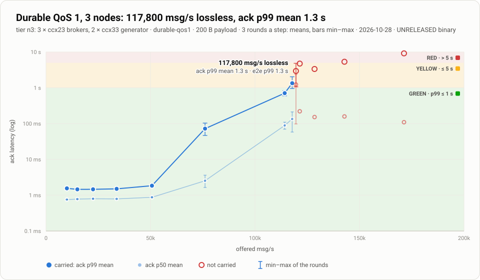

Run `n3-20261028T030901Z` · 3 × ccx23 brokers, 2 × ccx33 generators · 3 rounds a step · 200 B payload · latency is the ack p99, the mean of the rounds ± their standard deviation.

- **Maximum lossless:** 117,800 msg/s offered, 39.3k per node and 9,817 per vCPU (brokers received 118,047), ack p99 1.35 ± 0.60 s
- **ack p99 ≤ 1 s:** 114,200 msg/s (708.1 ± 113.9 ms)
- **ack p99 ≤ 250 ms:** 76,100 msg/s (72.2 ± 28.7 ms)
- **ack p99 ≤ 100 ms:** 76,100 msg/s (72.2 ± 28.7 ms)

| step | offered msg/s | verdict | rounds | brokers received (mean) | ack p99 (mean ± sd) |
|---|---|---|---|---|---|
| 1 | 10,000 | CARRIED | 3 | 10,000 | 1.6 ± 0.1 ms |
| 2 | 15,000 | CARRIED | 3 | 15,000 | 1.5 ± 0.1 ms |
| 3 | 22,500 | CARRIED | 3 | 22,500 | 1.5 ± 0.0 ms |
| 4 | 33,800 | CARRIED | 3 | 33,800 | 1.5 ± 0.1 ms |
| 5 | 50,700 | CARRIED | 3 | 50,700 | 1.8 ± 0.0 ms |
| 6 | 76,100 | CARRIED | 3 | 76,094 | 72.2 ± 28.7 ms |
| 7 | 114,200 | CARRIED | 3 | 114,241 | 708.1 ± 113.9 ms |
| 8 | 171,300 | FAILED | 1 | 129,531 | 9.18 s |
| 9 | 142,800 | FAILED | 1 | 121,758 | 5.35 s |
| 10 | 128,500 | OFFER NOT TAKEN | 1 | 126,324 | 3.35 s |
| 11 | 121,400 | FAILED | 1 | 115,502 | 4.75 s |
| 12 | 117,800 | CARRIED | 3 | 118,047 | 1.35 ± 0.60 s |
| 13 | 119,600 | FAILED | 2 | 114,623 | 2.95 ± 2.66 s |

### Durable QoS 1, on the 1.3.0 release candidate

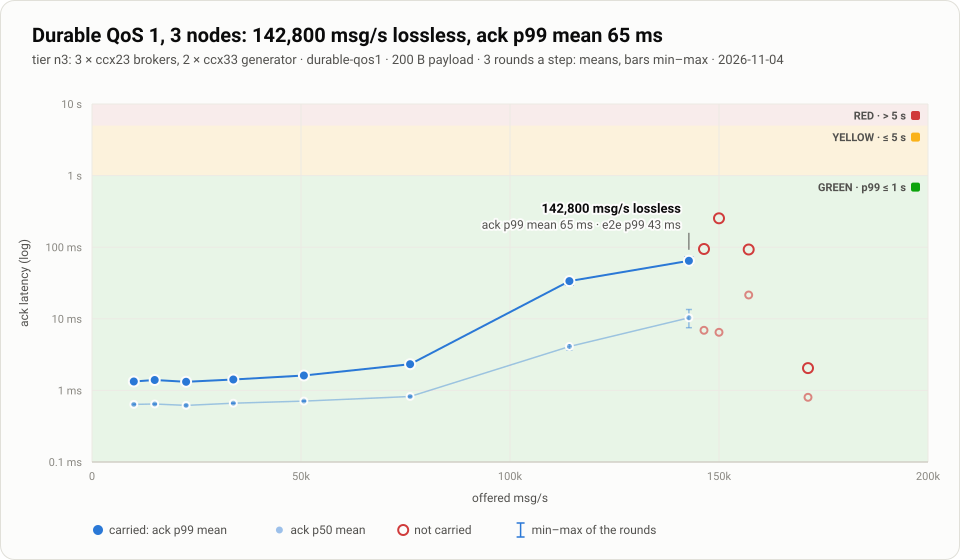

Run `n3-20261104T123655Z` · 3 × ccx23 brokers, 2 × ccx33 generators · 3 rounds a step · 200 B payload · latency is the ack p99, the mean of the rounds ± their standard deviation. The binary is the release candidate, main `a61c7b77` with ADR 0089 Amendment 4 (#1210), every default as it ships: each broker ran 2 runtime workers, the physical cores of its 4 vCPUs (ADR 0092 Amendment 4).

- **Maximum lossless:** 142,800 msg/s offered, 47.6k per node and 11,900 per vCPU (brokers received 142,797), ack p99 64.7 ± 7.9 ms
- **ack p99 ≤ 1 s:** 142,800 msg/s (64.7 ± 7.9 ms)
- **ack p99 ≤ 250 ms:** 142,800 msg/s (64.7 ± 7.9 ms)
- **ack p99 ≤ 100 ms:** 142,800 msg/s (64.7 ± 7.9 ms)

| step | offered msg/s | verdict | rounds | brokers received (mean) | ack p99 (mean ± sd) |
|---|---|---|---|---|---|
| 1 | 10,000 | CARRIED | 3 | 10,000 | 1.3 ± 0.0 ms |
| 2 | 15,000 | CARRIED | 3 | 15,000 | 1.4 ± 0.1 ms |
| 3 | 22,500 | CARRIED | 3 | 22,500 | 1.3 ± 0.0 ms |
| 4 | 33,800 | CARRIED | 3 | 33,800 | 1.4 ± 0.1 ms |
| 5 | 50,700 | CARRIED | 3 | 50,700 | 1.6 ± 0.0 ms |
| 6 | 76,100 | CARRIED | 3 | 76,100 | 2.3 ± 0.1 ms |
| 7 | 114,200 | CARRIED | 3 | 114,193 | 33.6 ± 3.9 ms |
| 8 | 171,300 | FAILED | 1 | 57,641 | 2.0 ms |
| 9 | 142,800 | CARRIED | 3 | 142,797 | 64.7 ± 7.9 ms |
| 10 | 157,100 | FAILED | 1 | 155,445 | 92.9 ms |
| 11 | 150,000 | FAILED | 1 | 126,456 | 252.9 ms |
| 12 | 146,400 | FAILED | 1 | 139,728 | 94.3 ms |

**What this run shows.**
- **The knee is bracketed to 2.5%:** 142,800 msg/s carried in all 3 rounds and 146,400
  failed. Round 3 at 142,800 first dropped 23 messages, then carried its retry after a full
  settle ("retried: transient").
- **No acknowledged message was lost.** Every message missing from a failed round was one
  the brokers had not acknowledged, so its publisher still owned it.
- **The drops near the knee came mid-round,** 38 to 56 s in, when one broker's append lanes
  filled. None fell in a round's first seconds, where ADR 0089 Amendment 4 removed a write
  storm. Above the knee, at 171,300, the drops started at once: the retry of that step
  dropped 95,939 messages as `append-backlog-full` and the brokers took 57,641 msg/s.
- **The `$share` spread:** at the knee the busiest consumer took 1.33× the mean consumer's
  deliveries, and at 171,300 up to 3.34×.

## 1 node

One broker, measured on 2026-10-28 on main `9520b33`: the 1.3.0 candidate plus #1146, the
only broker change between the two. With #1146 a lone node wants one copy of a durable
session, so **durable QoS 1 on 1 node is fsync only, with no quorum copy**. Its figure is
not comparable with the 3- and 10-node ones, which keep 2 copies.

### QoS 0

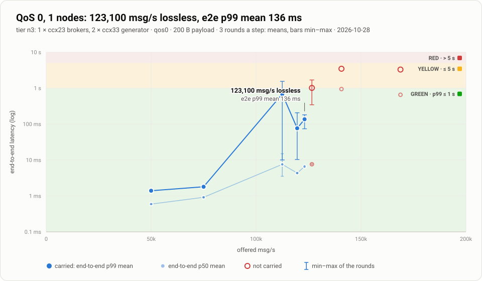

Run `n3-20261028T152346Z` (the 3-node tier with `BROKERS=1`) · 1 × ccx23 broker, 2 × ccx33 generators · 3 rounds a step · 200 B payload · latency is the end-to-end p99, the mean of the rounds ± their standard deviation.

- **Maximum lossless:** 123,100 msg/s offered, 123k per node (brokers received 123,132), end-to-end p99 135.7 ± 55.2 ms
- **end-to-end p99 ≤ 1 s:** 123,100 msg/s (135.7 ± 55.2 ms)
- **end-to-end p99 ≤ 250 ms:** 123,100 msg/s (135.7 ± 55.2 ms)
- **end-to-end p99 ≤ 100 ms:** 119,600 msg/s (76.3 ± 112.5 ms)

| step | offered msg/s | verdict | rounds | brokers received (mean) | end-to-end p99 (mean ± sd) |
|---|---|---|---|---|---|
| 1 | 50,000 | CARRIED | 3 | 50,000 | 1.4 ± 0.0 ms |
| 2 | 75,000 | CARRIED | 3 | 75,000 | 1.8 ± 0.1 ms |
| 3 | 112,500 | CARRIED | 3 | 112,320 | 683.6 ± 784.7 ms |
| 4 | 168,800 | FAILED | 1 | 168,596 | 3.29 s |
| 5 | 140,700 | FAILED | 1 | 140,699 | 3.45 s |
| 6 | 126,600 | FAILED | 2 | 126,658 | 1.01 ± 0.95 s |
| 7 | 119,600 | CARRIED | 3 | 119,646 | 76.3 ± 112.5 ms |
| 8 | 123,100 | CARRIED | 3 | 123,132 | 135.7 ± 55.2 ms |

### QoS 1, clean sessions

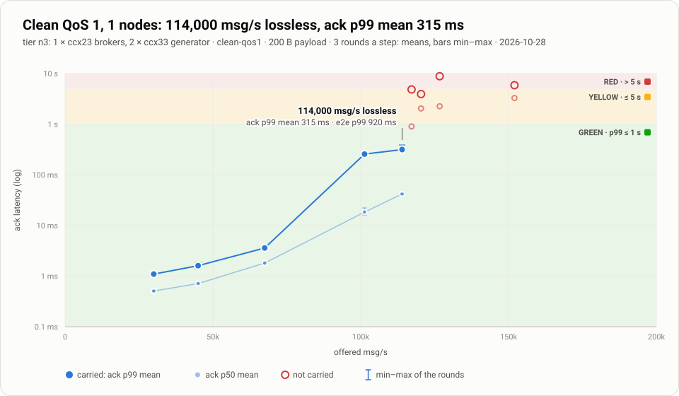

Run `n3-20261028T152346Z` (the 3-node tier with `BROKERS=1`) · 1 × ccx23 broker, 2 × ccx33 generators · 3 rounds a step · 200 B payload · latency is the ack p99, the mean of the rounds ± their standard deviation.

- **Maximum lossless:** 114,000 msg/s offered, 114k per node (brokers received 114,043), ack p99 315.4 ± 62.3 ms
- **ack p99 ≤ 1 s:** 114,000 msg/s (315.4 ± 62.3 ms)
- **ack p99 ≤ 250 ms:** 67,500 msg/s (3.6 ± 0.1 ms)
- **ack p99 ≤ 100 ms:** 67,500 msg/s (3.6 ± 0.1 ms)

| step | offered msg/s | verdict | rounds | brokers received (mean) | ack p99 (mean ± sd) |
|---|---|---|---|---|---|
| 1 | 30,000 | CARRIED | 3 | 30,000 | 1.1 ± 0.0 ms |
| 2 | 45,000 | CARRIED | 3 | 45,000 | 1.6 ± 0.2 ms |
| 3 | 67,500 | CARRIED | 3 | 67,500 | 3.6 ± 0.1 ms |
| 4 | 101,300 | CARRIED | 3 | 101,441 | 256.6 ± 13.8 ms |
| 5 | 152,000 | OFFER NOT TAKEN | 1 | 111,194 | 5.88 s |
| 6 | 126,700 | OFFER NOT TAKEN | 1 | 108,654 | 8.86 s |
| 7 | 114,000 | CARRIED | 3 | 114,043 | 315.4 ± 62.3 ms |
| 8 | 120,400 | OFFER NOT TAKEN | 1 | 113,839 | 3.94 s |
| 9 | 117,200 | OFFER NOT TAKEN | 1 | 108,796 | 4.85 s |

### Durable QoS 1

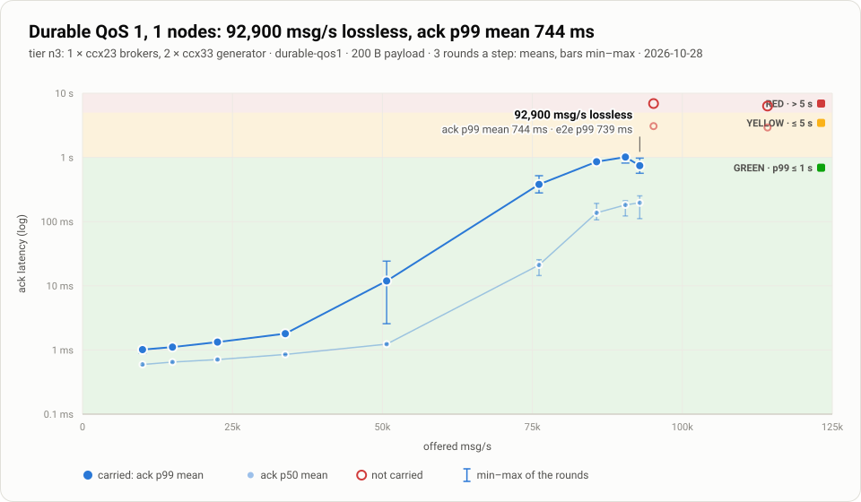

Run `n3-20261028T152346Z` (the 3-node tier with `BROKERS=1`) · 1 × ccx23 broker, 2 × ccx33 generators · 3 rounds a step · 200 B payload · latency is the ack p99, the mean of the rounds ± their standard deviation.

- **Maximum lossless:** 92,900 msg/s offered, 92.9k per node and 23,225 per vCPU (brokers received 93,277), ack p99 744.4 ± 208.5 ms
- **ack p99 ≤ 1 s:** 92,900 msg/s (744.4 ± 208.5 ms)
- **ack p99 ≤ 250 ms:** 50,700 msg/s (11.9 ± 11.2 ms)
- **ack p99 ≤ 100 ms:** 50,700 msg/s (11.9 ± 11.2 ms)

| step | offered msg/s | verdict | rounds | brokers received (mean) | ack p99 (mean ± sd) |
|---|---|---|---|---|---|
| 1 | 10,000 | CARRIED | 3 | 10,000 | 1.0 ± 0.1 ms |
| 2 | 15,000 | CARRIED | 3 | 15,000 | 1.1 ± 0.0 ms |
| 3 | 22,500 | CARRIED | 3 | 22,500 | 1.3 ± 0.0 ms |
| 4 | 33,800 | CARRIED | 3 | 33,800 | 1.8 ± 0.0 ms |
| 5 | 50,700 | CARRIED | 3 | 50,700 | 11.9 ± 11.2 ms |
| 6 | 76,100 | CARRIED | 3 | 76,080 | 379.4 ± 123.8 ms |
| 7 | 114,200 | OFFER NOT TAKEN | 1 | 88,334 | 6.32 s |
| 8 | 95,200 | OFFER NOT TAKEN | 1 | 67,631 | 6.91 s |
| 9 | 85,700 | CARRIED | 3 | 85,951 | 857.3 ± 49.6 ms |
| 10 | 90,500 | CARRIED | 3 | 90,207 | 1.01 ± 0.17 s |
| 11 | 92,900 | CARRIED | 3 | 93,277 | 744.4 ± 208.5 ms |

## AWS, 96 vCPU

Durable QoS 1 on AWS, measured on 2026-10-30 and 2026-10-31 on main `19f36004`: the candidate plus #1146 (a
lone node keeps one copy), the delivery-stage timers of #1153 and the wasmtime bump of #1158,
which do not change how a message is stored, routed or acknowledged. The binary is the
same static musl build the Hetzner runs use, sha256 `56120b89…1528cb`. Instances are
`m6i` (Intel Xeon Platinum 8375C, Ice Lake; a vCPU is an SMT thread) in `eu-north-1`, with a
100 GB gp3 EBS root (3,000 IOPS); the load is 20,000 clients, 10,000 publishers and 10,000
consumers over 6 generators, so every run has the client count of HiveMQ 4.18's published
run on 3 × `m6a.8xlarge`, 96 vCPU.

Two cluster shapes have those 96 vCPU: six 16-vCPU nodes carry 390,300 msg/s with no message
lost at ack p99 112 ms, three 32-vCPU nodes 270,800 at 1.17 s. The README's chart draws the
higher; per vCPU, both are below the 4-vCPU Hetzner nodes, because one node's throughput is
bound by its hub task rather than by its vCPU ([32 vCPU](#aws-32-vcpu)).

**Known limits of these runs.**
- **The 6-node knee is bracketed to 2.7%** (2026-10-31): 390,300 msg/s carried in all 3
  rounds, 400,800 lost 4,145 messages in one round of 3. The first ladder (2026-10-30) had
  climbed ×1.5 from 337,500 straight to 506,300 msg/s, where the brokers took 78% of the
  offer and rejected 2,284 publishes with the ack withheld (`append-backlog-full`, the
  append lane full), and stopped: the rig scores that label as loss, because under it the
  broker also sheds already-accepted messages, and the two cases are not yet told apart in
  the counter.
- **Uneven `$share` spread,** wider than on Hetzner: the busiest consumer took 1.5–2.6× the
  mean consumer's deliveries on 3 brokers and 2.4–7.1× on 6.
- **Hub-bound nodes.** On a 32-vCPU node the process used 3–4 cores at its knee, one of them
  the hub task's; the per-node rate is set by that task, not by the node's size.

### 6 × m6i.4xlarge

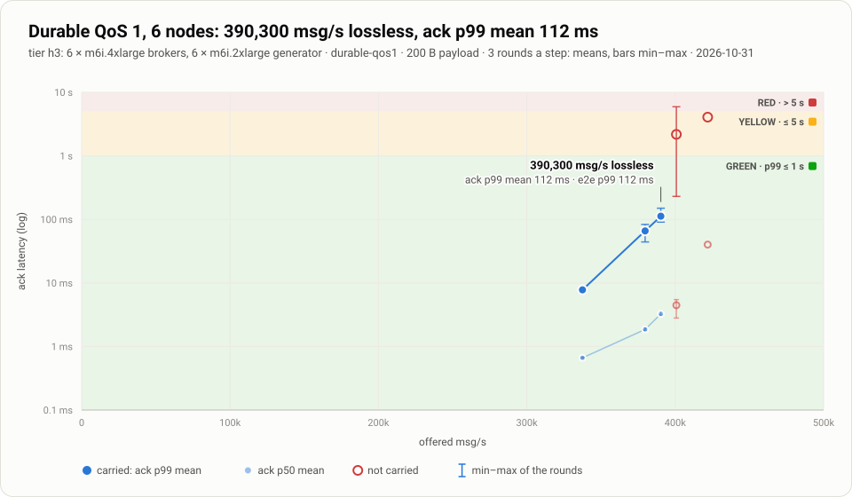

Run `h3-20261031T105803Z` · 6 × m6i.4xlarge brokers (96 vCPU in all), 6 × m6i.2xlarge generators · 3 rounds a step · 200 B payload · latency is the ack p99, the mean of the rounds ± their standard deviation. The ladder started at 337,500, the floor of the first run (`h3-20261030T200209Z`, 2026-10-30: 150,000, 225,000 and 337,500 carried at ack p99 0.7, 0.9 and 4.0 ms, then 506,300 FAILED), stepped ×1.25 and bisected from there with `BISECT_ON_FAIL=1`.

- **Maximum lossless:** 390,300 msg/s offered, 65.0k per node and 4,066 per vCPU (brokers received 390,277), ack p99 112.4 ± 32.8 ms
- **ack p99 ≤ 1 s:** 390,300 msg/s (112.4 ± 32.8 ms)
- **ack p99 ≤ 250 ms:** 390,300 msg/s (112.4 ± 32.8 ms)
- **ack p99 ≤ 100 ms:** 379,700 msg/s (65.8 ± 19.9 ms)
- ladder ended: knee bracketed: good at 390300, not at 400800 msg/s (2.7% gap)

| step | offered msg/s | verdict | rounds | brokers received (mean) | ack p99 (mean ± sd) |
|---|---|---|---|---|---|
| 1 | 337,500 | CARRIED | 3 | 337,502 | 7.8 ± 0.7 ms |
| 2 | 421,900 | OFFER NOT TAKEN | 1 | 413,990 | 4.07 s |
| 3 | 379,700 | CARRIED | 3 | 379,671 | 65.8 ± 19.9 ms |
| 4 | 400,800 | FAILED | 3 | 394,980 | 2.17 ± 3.25 s |
| 5 | 390,300 | CARRIED | 3 | 390,277 | 112.4 ± 32.8 ms |

The 400,800 step carried its first two rounds (ack p99 230 and 369 ms) and lost 4,145 messages in the third (`append-backlog-full`). In every round at that rate each node's hub loop was dispatching 82% of wall-clock time with a standing queue, and every round began with a 10 s durable-write transient (mean append 60–180 ms against 1.5 ms in steady state). In round 3 that transient on one node lasted 20 s at 180–240 ms per fsync batch, its pending table filled to its cap and its hub queue reached 210,000 commands, which never drained; the other nodes' appends waited on its replica applies, so ack p99 was 6 s cluster-wide and 70 consumer connections dropped.

### 3 × m6i.8xlarge

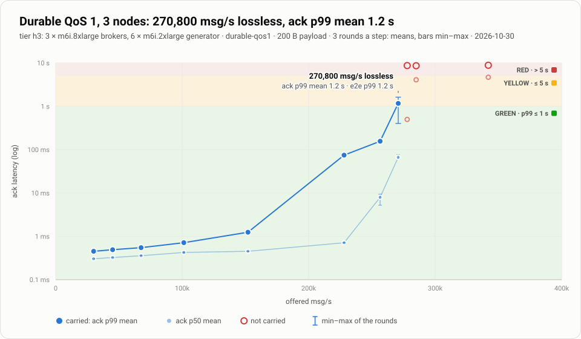

Run `h3-20261030T183536Z` · 3 × m6i.8xlarge brokers (96 vCPU in all), 6 × m6i.2xlarge generators · 3 rounds a step · 200 B payload · latency is the ack p99, the mean of the rounds ± their standard deviation.

- **Maximum lossless:** 270,800 msg/s offered, 90.3k per node and 2,821 per vCPU (brokers received 269,950), ack p99 1.17 ± 0.67 s
- **ack p99 ≤ 1 s:** 256,500 msg/s (156.6 ± 12.0 ms)
- **ack p99 ≤ 250 ms:** 256,500 msg/s (156.6 ± 12.0 ms)
- **ack p99 ≤ 100 ms:** 228,000 msg/s (74.7 ± 7.6 ms)
- ladder ended: knee bracketed: good at 270800, not at 277900 msg/s (2.6% gap)

| step | offered msg/s | verdict | rounds | brokers received (mean) | ack p99 (mean ± sd) |
|---|---|---|---|---|---|
| 1 | 30,000 | CARRIED | 3 | 30,000 | 0.5 ± 0.0 ms |
| 2 | 45,000 | CARRIED | 3 | 45,000 | 0.5 ± 0.0 ms |
| 3 | 67,500 | CARRIED | 3 | 67,500 | 0.5 ± 0.0 ms |
| 4 | 101,300 | CARRIED | 3 | 101,300 | 0.7 ± 0.0 ms |
| 5 | 152,000 | CARRIED | 3 | 152,000 | 1.2 ± 0.0 ms |
| 6 | 228,000 | CARRIED | 3 | 228,000 | 74.7 ± 7.6 ms |
| 7 | 342,000 | OFFER NOT TAKEN | 1 | 240,153 | 8.84 s |
| 8 | 285,000 | OFFER NOT TAKEN | 1 | 247,357 | 8.62 s |
| 9 | 256,500 | CARRIED | 3 | 256,574 | 156.6 ± 12.0 ms |
| 10 | 270,800 | CARRIED | 3 | 269,950 | 1.17 ± 0.67 s |
| 11 | 277,900 | OFFER NOT TAKEN | 1 | 262,779 | 8.72 s |

### 3 × m6i.8xlarge, after ADR 0092 T3

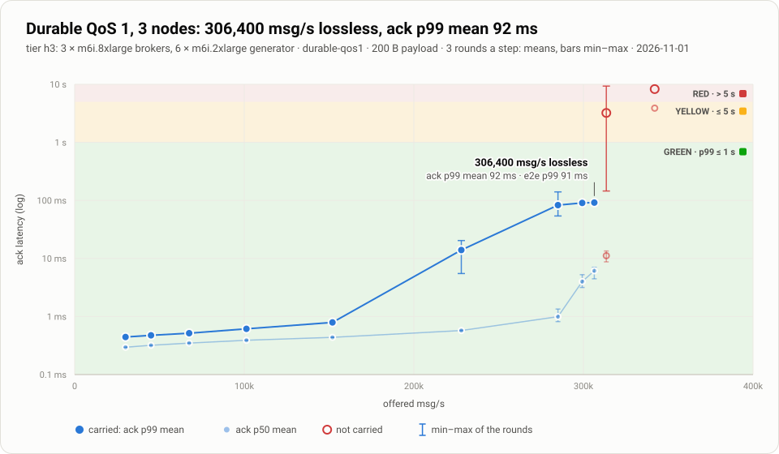

Run `h3-20261101T012140Z` · 3 × m6i.8xlarge brokers (96 vCPU in all), 6 × m6i.2xlarge generators · 3 rounds a step · 200 B payload · latency is the ack p99, the mean of the rounds ± their standard deviation. The binary is ADR 0092 T3's second batch (`1f58398b`, on main as `854fabb5`): the row above with the hub loop's per-message work cut in the order its profile gave; the delivery doc's evidence table has the step by step, 270,800 → 299,300 → 306,400, and the model's figures (a publish dispatch at the knee 7.0 → 5.6 µs).

- **Maximum lossless:** 306,400 msg/s offered, 102.1k per node and 3,192 per vCPU (brokers received 306,355), ack p99 91.6 ± 3.0 ms
- **ack p99 ≤ 1 s:** 306,400 msg/s (91.6 ± 3.0 ms)
- **ack p99 ≤ 250 ms:** 306,400 msg/s (91.6 ± 3.0 ms)
- **ack p99 ≤ 100 ms:** 306,400 msg/s (91.6 ± 3.0 ms)
- ladder ended: knee bracketed: good at 306400, not at 313500 msg/s (2.3% gap)

| step | offered msg/s | verdict | rounds | brokers received (mean) | ack p99 (mean ± sd) |
|---|---|---|---|---|---|
| 1 | 30,000 | CARRIED | 3 | 30,000 | 0.4 ± 0.0 ms |
| 2 | 45,000 | CARRIED | 3 | 45,000 | 0.5 ± 0.0 ms |
| 3 | 67,500 | CARRIED | 3 | 67,500 | 0.5 ± 0.0 ms |
| 4 | 101,300 | CARRIED | 3 | 101,300 | 0.6 ± 0.0 ms |
| 5 | 152,000 | CARRIED | 3 | 152,000 | 0.8 ± 0.0 ms |
| 6 | 228,000 | CARRIED | 3 | 228,004 | 14.0 ± 7.6 ms |
| 7 | 342,000 | DISCONNECTED | 1 | 245,741 | 8.27 s |
| 8 | 285,000 | CARRIED | 3 | 285,002 | 82.9 ± 49.5 ms |
| 9 | 313,500 | OFFER NOT TAKEN | 3 | 306,278 | 3.22 ± 5.30 s |
| 10 | 299,300 | CARRIED | 3 | 299,357 | 90.6 ± 3.0 ms |
| 11 | 306,400 | CARRIED | 3 | 306,355 | 91.6 ± 3.0 ms |

### 3 × m6i.8xlarge, v1.3.0

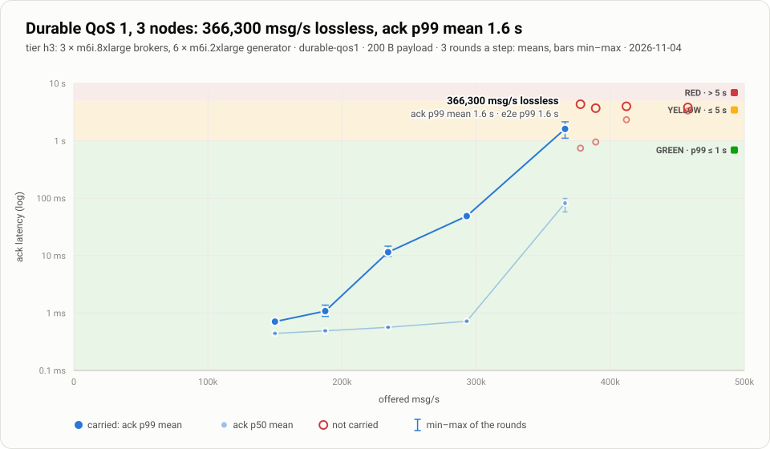

Run `h3-20261104T183144Z` · 3 × m6i.8xlarge brokers (96 vCPU in all), 6 × m6i.2xlarge generators · 3 rounds a step · 200 B payload · latency is the ack p99, the mean of the rounds ± their standard deviation. The binary is the published v1.3.0 release, every default as it ships: each broker ran 16 runtime workers, the physical cores of its 32 vCPUs. The ladder started at 150,000 msg/s, stepped ×1.25 and bisected from there.

- **Maximum lossless:** 366,300 msg/s offered, 122.1k per node and 3,816 per vCPU (brokers received 364,977), ack p99 1.61 ± 0.52 s
- **ack p99 ≤ 1 s:** 293,000 msg/s (48.8 ± 4.6 ms)
- **ack p99 ≤ 250 ms:** 293,000 msg/s (48.8 ± 4.6 ms)
- **ack p99 ≤ 100 ms:** 293,000 msg/s (48.8 ± 4.6 ms)
- ladder ended: incomplete, with the knee bracketed: good at 366300, not at 377800 msg/s (3.1% gap)

| step | offered msg/s | verdict | rounds | brokers received (mean) | ack p99 (mean ± sd) |
|---|---|---|---|---|---|
| 1 | 150,000 | CARRIED | 3 | 150,000 | 0.7 ± 0.0 ms |
| 2 | 187,500 | CARRIED | 3 | 187,500 | 1.1 ± 0.3 ms |
| 3 | 234,400 | CARRIED | 3 | 234,399 | 11.5 ± 2.7 ms |
| 4 | 293,000 | CARRIED | 3 | 292,983 | 48.8 ± 4.6 ms |
| 5 | 366,300 | CARRIED | 3 | 364,977 | 1.61 ± 0.52 s |
| 6 | 457,900 | OFFER NOT TAKEN | 1 | 384,858 | 3.81 s |
| 7 | 412,100 | OFFER NOT TAKEN | 1 | 382,758 | 3.98 s |
| 8 | 389,200 | OFFER NOT TAKEN | 1 | 378,297 | 3.70 s |
| 9 | 377,800 | OFFER NOT TAKEN | 1 | 363,897 | 4.33 s |

**What this run shows.**
- **No round lost a message.** Every step that did not carry was an offer the brokers did
  not take in full.
- **The run was cut short, not by the brokers.** At 19:37Z every host of the run was stopped
  from outside, by the account's AWS Budgets spend-limit role, during the bisection's last
  step at 372,100, which went void. So the knee is bracketed to 3.1%, and the latency
  bands' edges between 293,000 at 48.8 ms and 366,300 at 1.61 s were not measured: the
  bands' figures are floors.
- **Against HiveMQ 4.18's published run** on the same 96 vCPU, 3 × `m6a.8xlarge` at
  270,000 msg/s, three 32-vCPU nodes of v1.3.0 carry 1.36× as much.

## AWS, 32 vCPU

One broker on 2026-10-30, the same binary, generator shape and 20,000 clients as the 96-vCPU
runs. A lone node keeps one copy, so these are fsync only, like [1 node](#1-node) on
Hetzner, whose 4-vCPU node carried 92,900: eight times the vCPU carried less, because one
hub task bounds the node.

### 1 × m6i.8xlarge

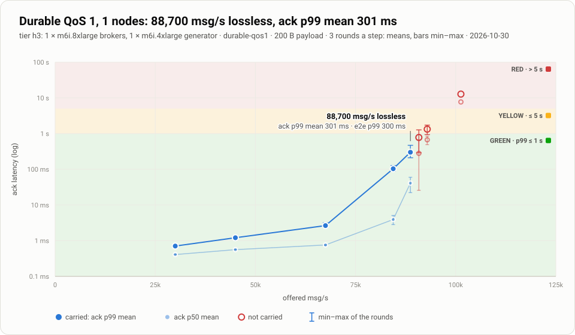

Run `h3-20261030T171933Z` · 1 × m6i.8xlarge broker (32 vCPU in all), 1 × m6i.4xlarge generator · 3 rounds a step · 200 B payload · latency is the ack p99, the mean of the rounds ± their standard deviation.

- **Maximum lossless:** 88,700 msg/s offered, 88.7k per node and 2,772 per vCPU (brokers received 88,665), ack p99 300.5 ± 147.5 ms
- **ack p99 ≤ 1 s:** 88,700 msg/s (300.5 ± 147.5 ms)
- **ack p99 ≤ 250 ms:** 84,400 msg/s (103.4 ± 21.1 ms)
- **ack p99 ≤ 100 ms:** 67,500 msg/s (2.6 ± 0.5 ms)
- ladder ended: knee bracketed: good at 88700, not at 90800 msg/s (2.4% gap)

| step | offered msg/s | verdict | rounds | brokers received (mean) | ack p99 (mean ± sd) |
|---|---|---|---|---|---|
| 1 | 30,000 | CARRIED | 3 | 30,000 | 0.7 ± 0.0 ms |
| 2 | 45,000 | CARRIED | 3 | 45,000 | 1.2 ± 0.0 ms |
| 3 | 67,500 | CARRIED | 3 | 67,500 | 2.6 ± 0.5 ms |
| 4 | 101,300 | OFFER NOT TAKEN | 1 | 83,245 | 12.78 s |
| 5 | 84,400 | CARRIED | 3 | 84,342 | 103.4 ± 21.1 ms |
| 6 | 92,900 | OFFER NOT TAKEN | 2 | 91,589 | 1.33 ± 0.56 s |
| 7 | 88,700 | CARRIED | 3 | 88,665 | 300.5 ± 147.5 ms |
| 8 | 90,800 | OFFER NOT TAKEN | 3 | 90,690 | 779.3 ± 491.5 ms |

### 1 × m6i.8xlarge, after ADR 0092 T3

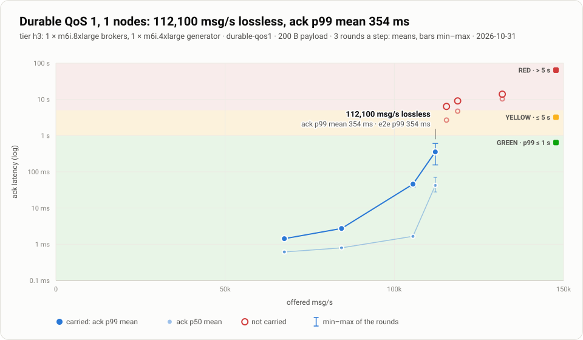

Run `h3-20261031T225644Z` · 1 × m6i.8xlarge broker (32 vCPU in all), 1 × m6i.4xlarge generator · 3 rounds a step · 200 B payload · latency is the ack p99, the mean of the rounds ± their standard deviation. The binary is ADR 0092 T3's second batch (`1f58398b`, on main as `854fabb5`): the row above with the hub loop's per-message work cut in the order its profile gave; the delivery doc's evidence table has the step by step — 88,700 on 2026-10-30 and 92,400 when main was re-measured on 2026-10-31, then 105,500 and 112,100 — and the model's figures (a publish dispatch 6.7 → 4.8 µs).

- **Maximum lossless:** 112,100 msg/s offered, 112.1k per node and 3,503 per vCPU (brokers received 112,052), ack p99 353.9 ± 230.6 ms
- **ack p99 ≤ 1 s:** 112,100 msg/s (353.9 ± 230.6 ms)
- **ack p99 ≤ 250 ms:** 105,500 msg/s (45.6 ± 7.3 ms)
- **ack p99 ≤ 100 ms:** 105,500 msg/s (45.6 ± 7.3 ms)
- ladder ended: knee bracketed: good at 112100, not at 115400 msg/s (2.9% gap)

| step | offered msg/s | verdict | rounds | brokers received (mean) | ack p99 (mean ± sd) |
|---|---|---|---|---|---|
| 1 | 67,500 | CARRIED | 3 | 67,500 | 1.4 ± 0.0 ms |
| 2 | 84,400 | CARRIED | 3 | 84,400 | 2.7 ± 0.4 ms |
| 3 | 105,500 | CARRIED | 3 | 105,498 | 45.6 ± 7.3 ms |
| 4 | 131,900 | OFFER NOT TAKEN | 1 | 107,478 | 13.92 s |
| 5 | 118,700 | OFFER NOT TAKEN | 1 | 102,450 | 9.08 s |
| 6 | 112,100 | CARRIED | 3 | 112,052 | 353.9 ± 230.6 ms |
| 7 | 115,400 | OFFER NOT TAKEN | 1 | 105,118 | 6.39 s |

### 1 × m6i.8xlarge, v1.3.0

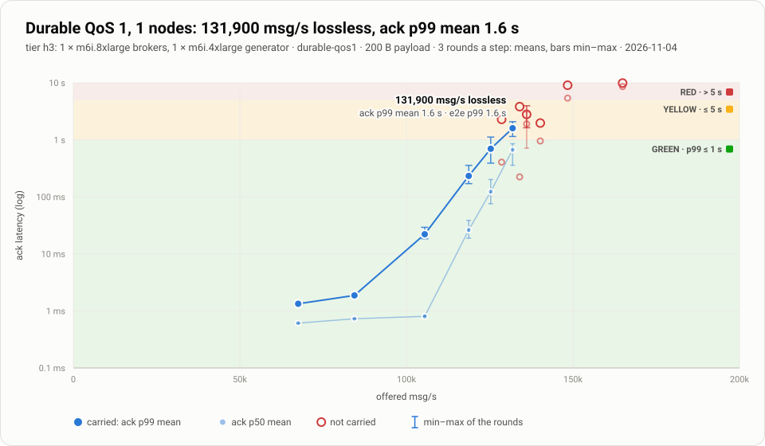

Run `h3-20261104T170821Z` · 1 × m6i.8xlarge broker (32 vCPU in all), 1 × m6i.4xlarge generator · 3 rounds a step · 200 B payload · latency is the ack p99, the mean of the rounds ± their standard deviation. The binary is the published v1.3.0 release, every default as it ships: 16 runtime workers and one hub loop. A lone node keeps one copy, so this is fsync only. The ladder is the one above: from 67,500 msg/s, ×1.25, bisected.

- **Maximum lossless:** 131,900 msg/s offered, 131.9k per node and 4,122 per vCPU (brokers received 134,137), ack p99 1.60 ± 0.47 s
- **ack p99 ≤ 1 s:** 125,300 msg/s (697.1 ± 377.0 ms)
- **ack p99 ≤ 250 ms:** 118,700 msg/s (233.0 ± 107.7 ms)
- **ack p99 ≤ 100 ms:** 105,500 msg/s (22.2 ± 6.1 ms)
- ladder ended: knee bracketed: good at 131900, not at 134000 msg/s (1.6% gap)

| step | offered msg/s | verdict | rounds | brokers received (mean) | ack p99 (mean ± sd) |
|---|---|---|---|---|---|
| 1 | 67,500 | CARRIED | 3 | 67,500 | 1.3 ± 0.0 ms |
| 2 | 84,400 | CARRIED | 3 | 84,400 | 1.9 ± 0.1 ms |
| 3 | 105,500 | CARRIED | 3 | 105,500 | 22.2 ± 6.1 ms |
| 4 | 131,900 | CARRIED | 3 | 134,137 | 1.60 ± 0.47 s |
| 5 | 164,900 | OFFER NOT TAKEN | 1 | 133,934 | 9.90 s |
| 6 | 148,400 | OFFER NOT TAKEN | 1 | 132,626 | 9.08 s |
| 7 | 140,200 | OFFER NOT TAKEN | 1 | 135,946 | 1.97 s |
| 8 | 136,100 | OFFER NOT TAKEN | 2 | 134,421 | 2.80 ± 1.65 s |
| 9 | 134,000 | OFFER NOT TAKEN | 1 | 125,458 | 3.83 s |
| 10 | 118,700 | CARRIED | 3 | 118,810 | 233.0 ± 107.7 ms |
| 11 | 125,300 | CARRIED | 3 | 125,556 | 697.1 ± 377.0 ms |
| 12 | 128,600 | OFFER NOT TAKEN | 1 | 124,181 | 2.29 s |

**What this run shows.**
- **No round lost a message.** Every step that did not carry was an offer the broker did not
  take in full.
- **The knee's edge is noisy:** 131,900 carried in all 3 rounds, its third on a retry after a
  full settle, while 128,600 and 134,000 each fell short of the 99% bar in a round. Read the
  knee as about 130,000 msg/s.

### 1 × m7a.8xlarge

An AMD EPYC 9R14 node (Genoa), for the CPU comparison: slower than the Ice Lake node above at the same vCPU. The hub task's work per message is 8% cheaper on it, but the task loses 41% of its time (18% on `m6i`) to wake-ups and migrations across the EPYC's four L3 domains, so it saturates at 59% busy against 82%.

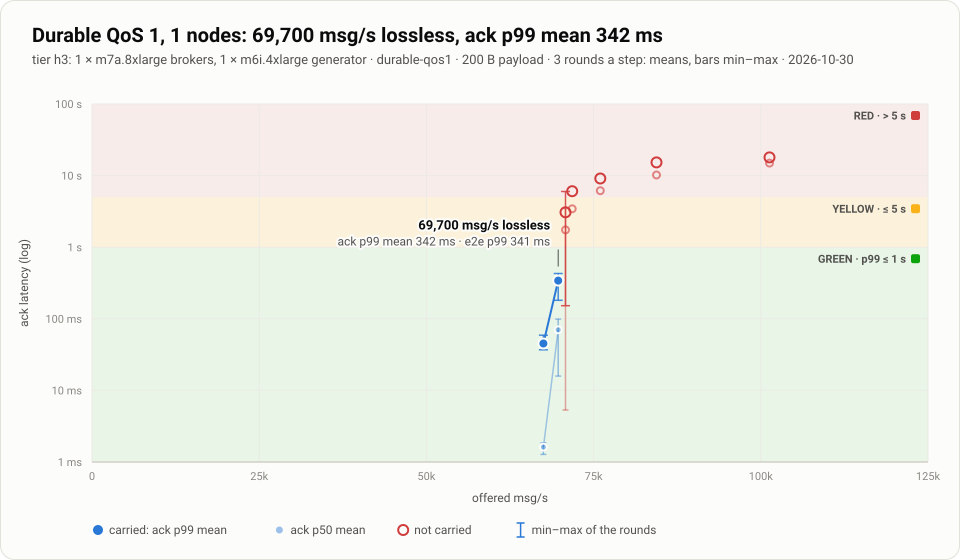

Run `h3-20261030T211314Z` · 1 × m7a.8xlarge broker (32 vCPU in all), 1 × m6i.4xlarge generator · 3 rounds a step · 200 B payload · latency is the ack p99, the mean of the rounds ± their standard deviation.

- **Maximum lossless:** 69,700 msg/s offered, 69.7k per node and 2,178 per vCPU (brokers received 69,651), ack p99 341.7 ± 138.9 ms
- **ack p99 ≤ 1 s:** 69,700 msg/s (341.7 ± 138.9 ms)
- **ack p99 ≤ 250 ms:** 67,500 msg/s (45.2 ± 12.1 ms)
- **ack p99 ≤ 100 ms:** 67,500 msg/s (45.2 ± 12.1 ms)
- ladder ended: knee bracketed: good at 69700, not at 70800 msg/s (1.6% gap)

| step | offered msg/s | verdict | rounds | brokers received (mean) | ack p99 (mean ± sd) |
|---|---|---|---|---|---|
| 1 | 67,500 | CARRIED | 3 | 67,506 | 45.2 ± 12.1 ms |
| 2 | 101,300 | OFFER NOT TAKEN | 1 | 75,120 | 17.97 s |
| 3 | 84,400 | OFFER NOT TAKEN | 1 | 69,856 | 15.27 s |
| 4 | 76,000 | OFFER NOT TAKEN | 1 | 68,114 | 9.10 s |
| 5 | 71,800 | OFFER NOT TAKEN | 1 | 67,122 | 6.06 s |
| 6 | 69,700 | CARRIED | 3 | 69,651 | 341.7 ± 138.9 ms |
| 7 | 70,800 | OFFER NOT TAKEN | 2 | 68,225 | 3.07 ± 4.13 s |

## AWS, the plant shape

Durable QoS 1 in the shape of a fleet of power plants, measured on 2026-11-06 and 2026-11-07
on the v1.3.0 release with `MQTTD_RECEIVE_MAXIMUM=4096` (the shipped default is 256, which
holds a site at 256 publishes in flight ÷ the ack latency). The workload is
`bench/scale/rig2/workloads/plant-qos1.env`: every site is one bridge connection carrying
its own 250 topics at up to 10,000 msg/s, payloads of 50 to 200 bytes, and one durable
`$share` group of 240 members per generator, the historian, takes every topic. Sites
follow the rate: a step's sites on a generator are its rate ÷ 10,000, rounded up to a whole
number per broker. Brokers are 16-vCPU `m6i.4xlarge` (Intel Xeon Platinum 8375C) and, in the
last run, `c6in.4xlarge`: the same CPU and vCPU count on a network-optimized card. The
generators are `m6i.2xlarge`, 6 for the 3-, 5- and 8-node clusters and 8 for 12 nodes.

**Linear from 3 to 12 nodes.** The maximum lossless step is 495,800 msg/s on 3 nodes,
826,300 on 5, 1,322,000 on 8 and 2,000,000 on 12 × `c6in.4xlarge`: 165,250–166,667 msg/s a
node, within 1%, at ack p99 0.39–0.66 s. The 12-node ladder ended at the rig's 2,000,000
msg/s ceiling (`MAX_RATE`), carried in all 3 rounds, so its knee lies above the figure. Each
cluster's highest step within ack p99 ≤ 100 ms is 421,900, 661,000, 1,057,600 and 1,322,000
msg/s (55, 46, 48 and 12 ms). The README's `plant-scale-out.svg` and `plant-latency.svg`
(`bench/scale/chart-plant.py`) draw these five ladders.

**The 5-, 8- and 12-node m6i clusters were built by a join under load** ([the rig's join
step](../../bench/scale/rig2/README.md#join-under-load)): a cluster carrying cohort A's traffic took its new
nodes one at a time, the rig waited for each to form, then cohort B's traffic was added and
the ladder ran on the grown cluster. 3 → 5 held under 396,600 msg/s (two joiners ready in
2.1–2.3 s each; publishers' ack p99 reached 11.8 s while the joiners formed, with 544 consumer
and 2,247 publisher reconnects, and no message lost), 5 → 8 held under 661,000 (three
joiners; worst ack p99 10.1 s while joining; 663 and 6,610 reconnects), and 8 → 12 **failed**
under 1,057,600: the brokers took all of the 1,586,400 msg/s offered after it, but 11 durable
sessions were gone when their consumer reconnected (the broker answered session present 0),
and while the fourth joiner formed the brokers refused 5,918 deliveries as
`append-backlog-full` and withheld those publishes' acks, so the publishers sent them again
(worst ack p99 7.2 s; 747 and 9,168 reconnects). The ledger still closed with no message
missing: the group's other members took what the gone sessions would have had, which a
durable subscriber outside a `$share` group has no claim to. The session loss is a broker
defect, not yet fixed ([#1218](https://github.com/mbilling/fss-mqtt-broker/issues/1218)).
The refused deliveries went to consumers whose append lanes had filled while their groups
moved to a joiner, and the `$share` deal now passes such a member's turn to one with room
([#1219](https://github.com/mbilling/fss-mqtt-broker/issues/1219), fixed in
[#1220](https://github.com/mbilling/fss-mqtt-broker/pull/1220)); that is not yet measured
on the rig.

**Known limits of these runs.**
- **12 × `m6i.4xlarge` is throttled by its network card, not by the broker.** Its ladder
  carried 1,322,000 msg/s at ack p99 39 ms, then ended on a round the rig voided at
  1,454,200: one generator's ack p99 (618 ms) stood far above the others' (median 83 ms),
  which the rig reads as that generator's host. Sampled every 20 s over `ethtool -S`, 7 of
  the 12 brokers' ENA `pps_allowance_exceeded` counters grew from about 700,000 packets/s a
  broker, about 110,000 msg/s a node: in none of the rounds at 1,057,600, in three of the
  four at 1,322,000 and in both at 1,454,200. The one clean round at 1,322,000 carried it at
  ack p99 18 ms with every generator alike. At 1,586,400 the brokers took 98.8% of the offer
  (the rule is 99%) with the hub loops' queues at 1,400–2,700 of their ~4,100 cap. The same 12
  nodes as `c6in.4xlarge` moved 1.15 million packets/s each at 2,000,000 msg/s with no
  exceedance on any of the 20 hosts, and carried 1,322,000 at ack p99 11.7 ms.
- **Hub-bound at 2,000,000.** On 12 × `c6in.4xlarge` the busiest node's hub loop dispatched
  83% of wall-clock at 2,000,000 msg/s, 4.9 µs a message, with its queue at most 6,172
  commands: the per-node ceiling is the hub task's, as on the other AWS shapes.
- **Latency at the knee.** Every cluster's maximum lossless step sits at ack p99 0.39–0.66 s;
  its highest step within 100 ms is 66–85% of it. The band edges are not bisected in these
  ladders (`band_bisect` off).
- **Uneven `$share` spread,** as on the other AWS runs: the busiest consumer received
  1.5–2.5× the mean consumer's deliveries at 12 nodes.

### 3 × m6i.4xlarge

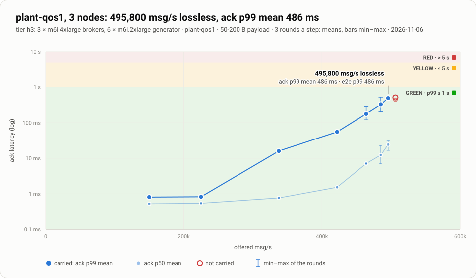

Run `h3-20261106T145432Z` · 3 × m6i.4xlarge brokers (48 vCPU in all), 6 × m6i.2xlarge generators · 3 rounds a step · 50–200 B payload · latency is the ack p99, the mean of the rounds ± their standard deviation. The ladder started at 150,000, climbed ×1.5 and bisected to 3%.

- **Maximum lossless:** 495,800 msg/s offered, 165.3k per node and 10,329 per vCPU (brokers received 493,679), ack p99 486.3 ± 24.6 ms
- **ack p99 ≤ 1 s:** 495,800 msg/s (486.3 ± 24.6 ms)
- **ack p99 ≤ 250 ms:** 464,100 msg/s (179.7 ± 91.8 ms)
- **ack p99 ≤ 100 ms:** 421,900 msg/s (55.3 ± 5.0 ms)
- ladder ended: knee bracketed: good at 495800, not at 506300 msg/s (2.1% gap)

| step | offered msg/s | verdict | rounds | brokers received (mean) | ack p99 (mean ± sd) |
|---|---|---|---|---|---|
| 1 | 150,000 | CARRIED | 3 | 150,000 | 0.8 ± 0.0 ms |
| 2 | 225,000 | CARRIED | 3 | 224,999 | 0.8 ± 0.0 ms |
| 3 | 337,500 | CARRIED | 3 | 337,496 | 15.9 ± 1.4 ms |
| 4 | 506,300 | OFFER NOT TAKEN | 1 | 493,318 | 509 ms |
| 5 | 421,900 | CARRIED | 3 | 421,866 | 55.3 ± 5.0 ms |
| 6 | 464,100 | CARRIED | 3 | 464,224 | 179.7 ± 91.8 ms |
| 7 | 485,200 | CARRIED | 3 | 483,977 | 326.2 ± 169.0 ms |
| 8 | 495,800 | CARRIED | 3 | 493,679 | 486.3 ± 24.6 ms |

The same run then joined two nodes under 396,600 msg/s (HELD) and its 5-node ladder was cut short by an account spend limit; the 5-node card below is the next run's.

### 5 × m6i.4xlarge, after a 3 → 5 join under load

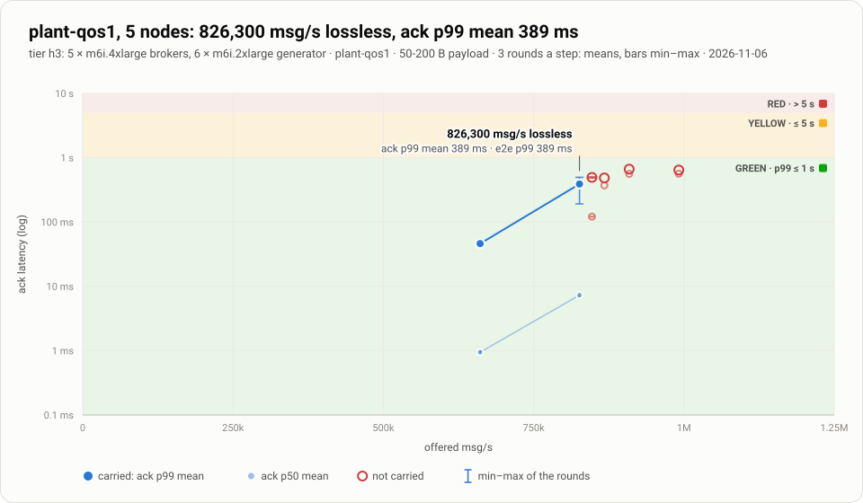

Run `h3-20261106T170406Z` · 3 × m6i.4xlarge brokers growing to 5 by a join (80 vCPU in all after it), 6 × m6i.2xlarge generators · 3 rounds a step · 50–200 B payload · latency is the ack p99, the mean of the rounds ± their standard deviation. The join HELD: cohort A at 396,600 msg/s, cohort B at 264,400 added after it, the 5 brokers took 660,997 of 661,000 offered. The ladder then started at 661,000 on the 5-node cluster, climbed ×1.5 and bisected to 3%.

- **Maximum lossless:** 826,300 msg/s offered, 165.3k per node and 10,329 per vCPU (brokers received 824,371), ack p99 389.2 ± 171.6 ms
- **ack p99 ≤ 1 s:** 826,300 msg/s (389.2 ± 171.6 ms)
- **ack p99 ≤ 250 ms:** 661,000 msg/s (46.2 ± 2.9 ms)
- **ack p99 ≤ 100 ms:** 661,000 msg/s (46.2 ± 2.9 ms)
- ladder ended: knee bracketed: good at 826300, not at 847000 msg/s (2.5% gap)

| step | offered msg/s | verdict | rounds | brokers received (mean) | ack p99 (mean ± sd) |
|---|---|---|---|---|---|
| 1 | 661,000 | CARRIED | 3 | 661,019 | 46.2 ± 2.9 ms |
| 2 | 991,500 | OFFER NOT TAKEN | 1 | 858,693 | 643 ms |
| 3 | 826,300 | CARRIED | 3 | 824,371 | 389.2 ± 171.6 ms |
| 4 | 908,900 | OFFER NOT TAKEN | 1 | 852,315 | 666 ms |
| 5 | 867,600 | OFFER NOT TAKEN | 1 | 848,738 | 485 ms |
| 6 | 847,000 | OFFER NOT TAKEN | 2 | 838,621 | 494.1 ± 14.5 ms |

### 8 × m6i.4xlarge, after a 5 → 8 join under load

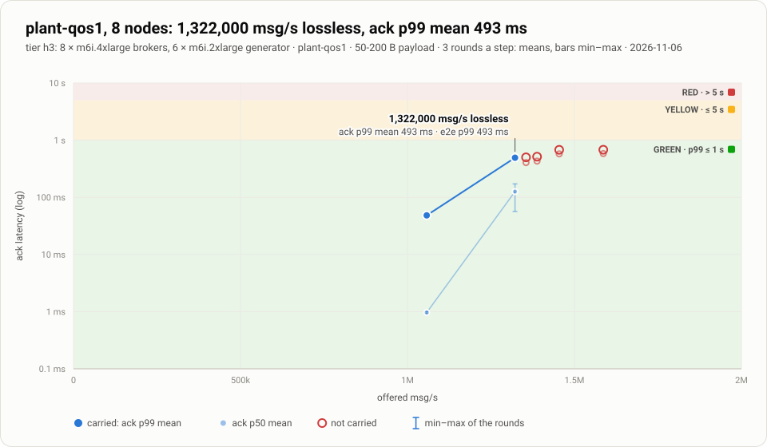

Run `h3-20261106T182931Z` · 5 × m6i.4xlarge brokers growing to 8 by a join (128 vCPU in all after it), 6 × m6i.2xlarge generators · 3 rounds a step · 50–200 B payload · latency is the ack p99, the mean of the rounds ± their standard deviation. The join HELD: cohort A at 661,000 msg/s, cohort B at 396,600 added after it, the 8 brokers took 1,057,588 of 1,057,600 offered. The ladder then started at 1,057,600 on the 8-node cluster, climbed ×1.5 and bisected to 3%.

- **Maximum lossless:** 1,322,000 msg/s offered, 165.3k per node and 10,328 per vCPU (brokers received 1,318,258), ack p99 493.5 ± 12.4 ms
- **ack p99 ≤ 1 s:** 1,322,000 msg/s (493.5 ± 12.4 ms)
- **ack p99 ≤ 250 ms:** 1,057,600 msg/s (48.4 ± 1.8 ms)
- **ack p99 ≤ 100 ms:** 1,057,600 msg/s (48.4 ± 1.8 ms)
- ladder ended: knee bracketed: good at 1322000, not at 1355100 msg/s (2.5% gap)

| step | offered msg/s | verdict | rounds | brokers received (mean) | ack p99 (mean ± sd) |
|---|---|---|---|---|---|
| 1 | 1,057,600 | CARRIED | 3 | 1,057,672 | 48.4 ± 1.8 ms |
| 2 | 1,586,400 | OFFER NOT TAKEN | 1 | 1,331,885 | 680 ms |
| 3 | 1,322,000 | CARRIED | 3 | 1,318,258 | 493.5 ± 12.4 ms |
| 4 | 1,454,200 | OFFER NOT TAKEN | 1 | 1,334,756 | 677 ms |
| 5 | 1,388,100 | OFFER NOT TAKEN | 1 | 1,338,033 | 515 ms |
| 6 | 1,355,100 | OFFER NOT TAKEN | 1 | 1,335,325 | 500 ms |

### 12 × m6i.4xlarge, after an 8 → 12 join under load

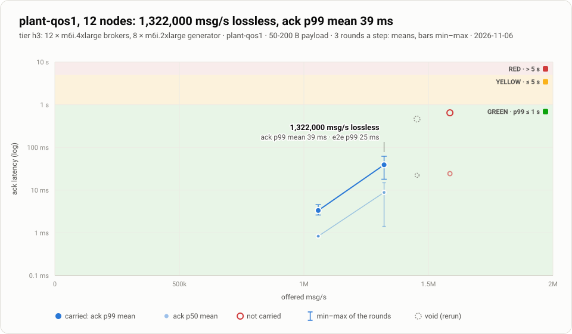

Run `h3-20261106T194402Z` · 8 × m6i.4xlarge brokers growing to 12 by a join (192 vCPU in all after it), 8 × m6i.2xlarge generators · 3 rounds a step · 50–200 B payload · latency is the ack p99, the mean of the rounds ± their standard deviation. The join FAILED (above): cohort A at 1,057,600 msg/s, cohort B at 528,800 added after it, the 12 brokers took 1,586,971 of 1,586,400 offered, but 11 durable sessions were lost and 5,918 messages dropped while the joiners formed. The ladder started at 1,586,400 on the 12-node cluster, where the brokers took 98.8% of the offer, and bisected from 1,057,600.

- **Maximum lossless:** 1,322,000 msg/s offered, 110.2k per node and 6,885 per vCPU (brokers received 1,322,042), ack p99 39.3 ± 22.1 ms
- **ack p99 ≤ 1 s:** 1,322,000 msg/s (39.3 ± 22.1 ms)
- **ack p99 ≤ 250 ms:** 1,322,000 msg/s (39.3 ± 22.1 ms)
- **ack p99 ≤ 100 ms:** 1,322,000 msg/s (39.3 ± 22.1 ms)
- ladder ended: VOID at 1454200 msg/s: round 1 stayed VOID through 2 attempts (generator 0's ack p99 617.5 ms is far above the other generators' median 82.8 ms: they reach the same brokers the same way, so its host set it)

| step | offered msg/s | verdict | rounds | brokers received (mean) | ack p99 (mean ± sd) |
|---|---|---|---|---|---|
| 1 | 1,586,400 | OFFER NOT TAKEN | 1 | 1,568,049 | 647 ms |
| 2 | 1,057,600 | CARRIED | 3 | 1,057,603 | 3.3 ± 1.1 ms |
| 3 | 1,322,000 | CARRIED | 3 | 1,322,042 | 39.3 ± 22.1 ms |
| 4 | 1,454,200 | VOID | 1 | 1,453,923 | 463 ms |

The figure is a floor, not a knee: the network cards, not the brokers, set it (the known limits above). The step at 1,322,000 read ack p99 37.8 and 62.1 ms in the two rounds whose brokers exceeded their packet allowance and 18.0 ms in the one whose brokers did not.

### 12 × c6in.4xlarge

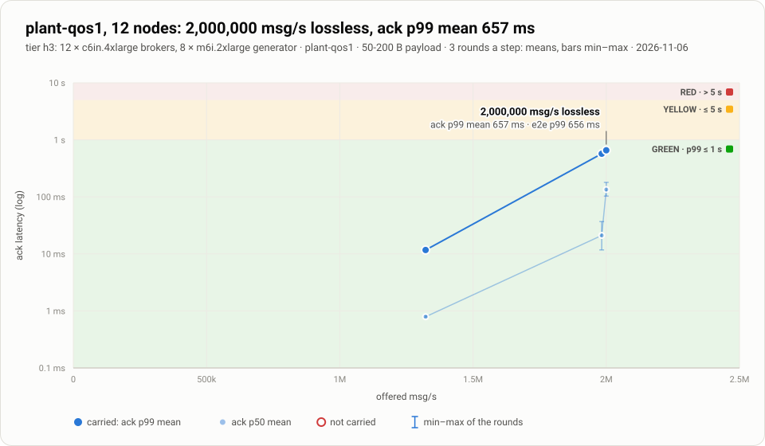

Run `h3-20261106T233606Z` · 12 × c6in.4xlarge brokers (192 vCPU in all), 8 × m6i.2xlarge generators · 3 rounds a step · 50–200 B payload · latency is the ack p99, the mean of the rounds ± their standard deviation. A cluster formed at once, not grown by a join. The ladder started at 1,322,000, the m6i cluster's floor, climbed ×1.5 to 1,983,000 and then to the rig's 2,000,000 msg/s ceiling (`MAX_RATE`), where it ended.

- **Maximum lossless:** 2,000,000 msg/s offered, 166.7k per node and 10,417 per vCPU (brokers received 1,991,040), ack p99 656.9 ± 2.7 ms
- **ack p99 ≤ 1 s:** 2,000,000 msg/s (656.9 ± 2.7 ms)
- **ack p99 ≤ 250 ms:** 1,322,000 msg/s (11.7 ± 0.7 ms)
- **ack p99 ≤ 100 ms:** 1,322,000 msg/s (11.7 ± 0.7 ms)
- ladder ended: carried at the ladder's ceiling (2000000 msg/s)

| step | offered msg/s | verdict | rounds | brokers received (mean) | ack p99 (mean ± sd) |
|---|---|---|---|---|---|
| 1 | 1,322,000 | CARRIED | 3 | 1,321,982 | 11.7 ± 0.7 ms |
| 2 | 1,983,000 | CARRIED | 3 | 1,980,811 | 571.6 ± 49.2 ms |
| 3 | 2,000,000 | CARRIED | 3 | 1,991,040 | 656.9 ± 2.7 ms |

The figure is a floor: the ladder's ceiling, not a knee. Every round at 2,000,000 was carried with the brokers receiving 99.3–99.8% of the offer and no message lost; the hub loops were at 0.82–0.83 busy on the busiest node. The ENA counters on all 20 hosts read no `pps_allowance_exceeded` at 1.15 million packets/s per broker.
