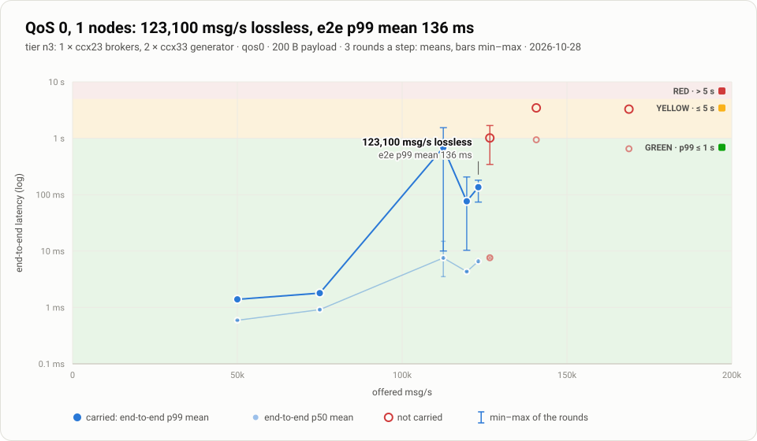
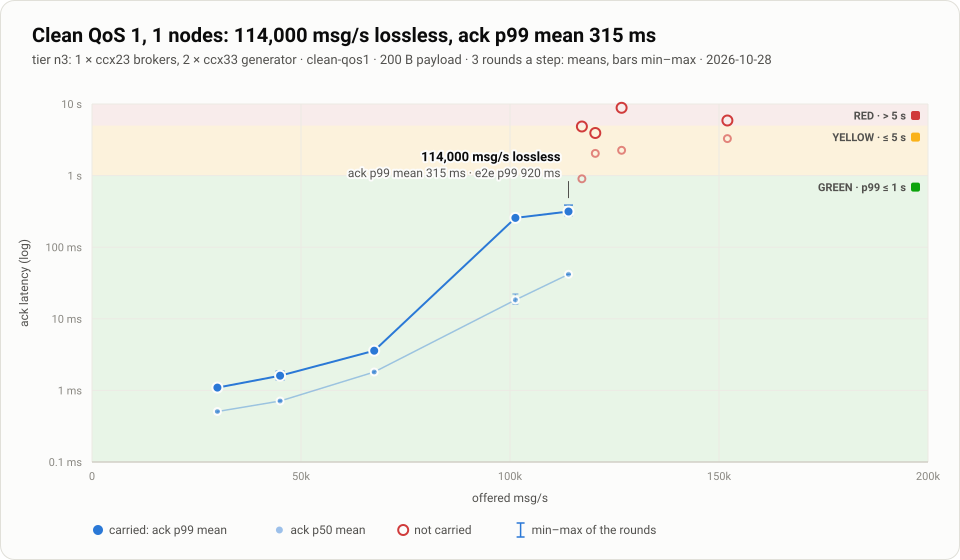
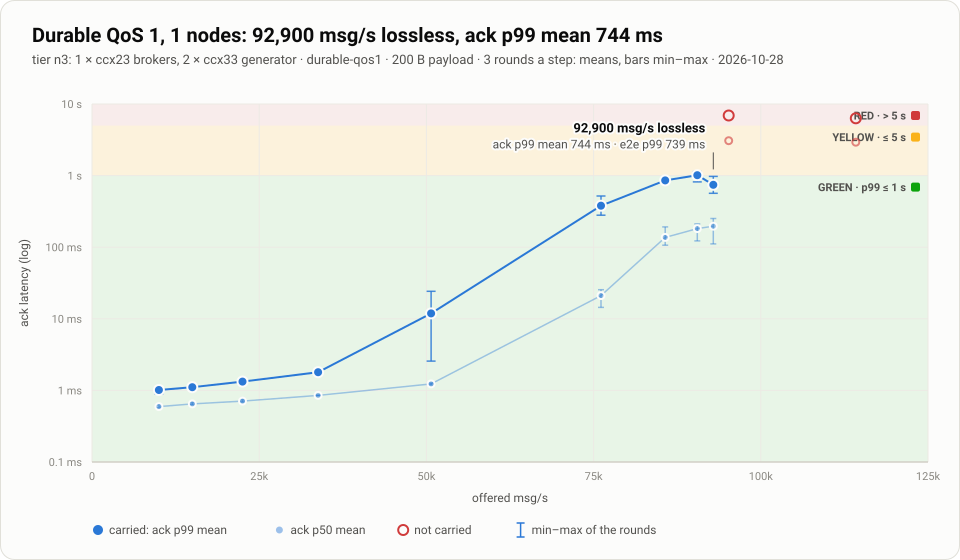
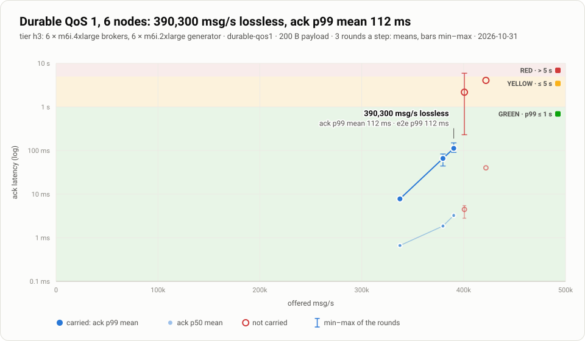
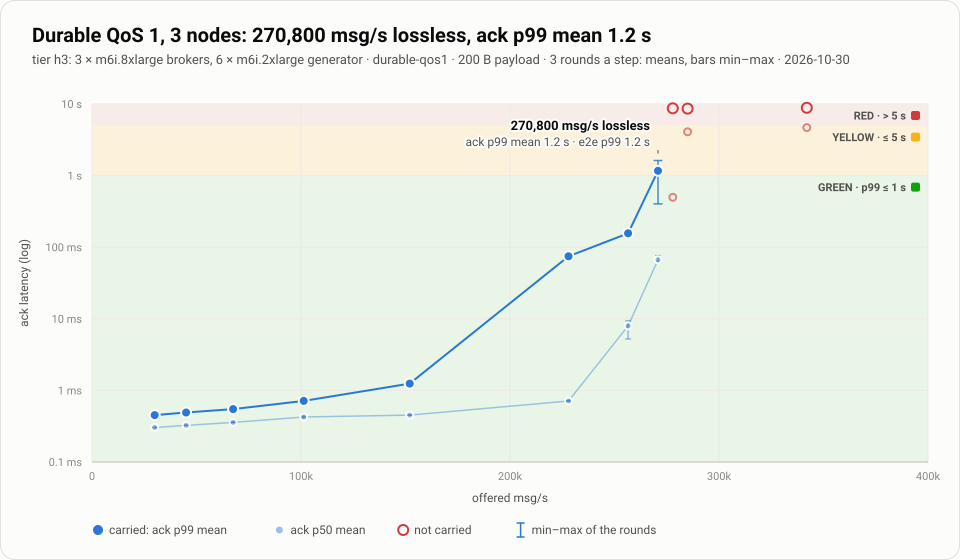
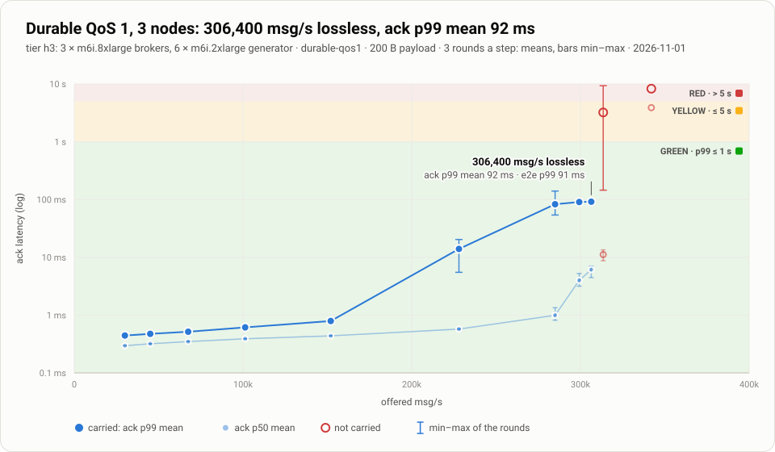
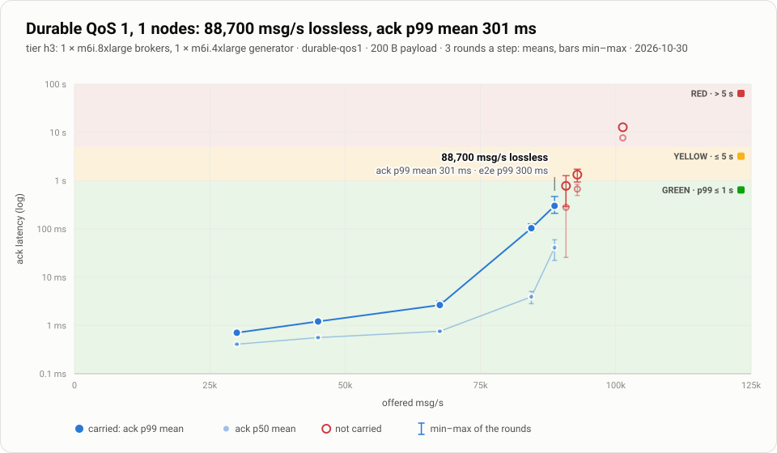
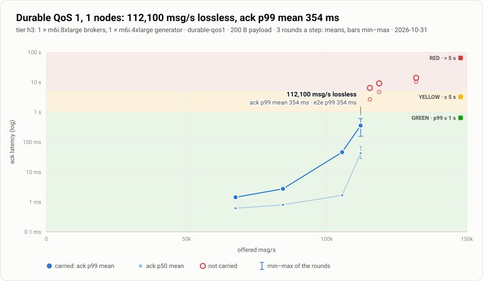
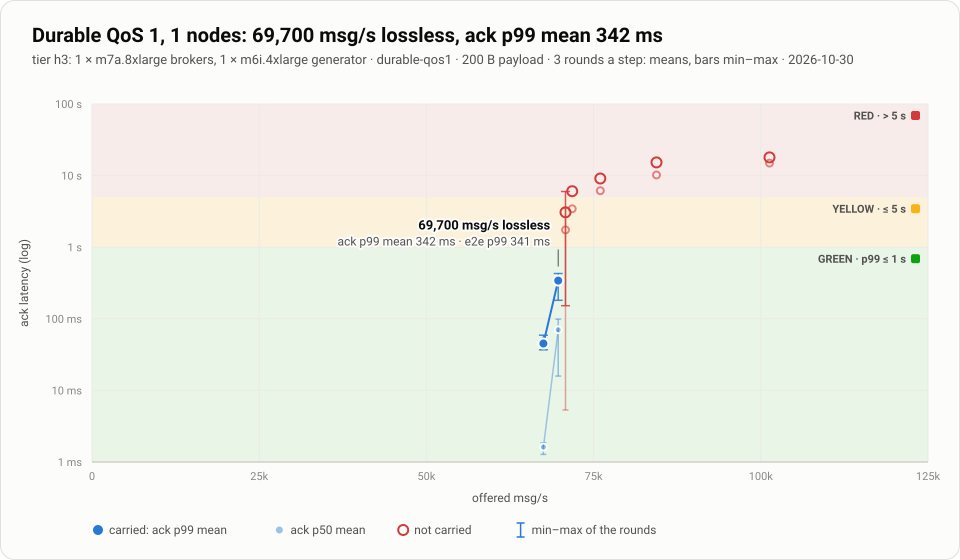

# Benchmark results: the ADR 0090 rig

Every throughput and latency figure in the README comes from this card. They were measured
with the benchmark rig of [ADR 0090](../adr/0090-benchmark-rig-redesign.md)
(`bench/scale/rig2/`): on Hetzner on 2026-10-27 and 2026-10-28, and on AWS on 2026-10-30 and 2026-10-31
([96 vCPU](#aws-96-vcpu), [32 vCPU](#aws-32-vcpu)).

## How a figure is measured

- **The broker under test** is the 1.3.0 candidate, main `edfdb49`, as a static musl binary
  with sha256 `f5c13cb1…677ebc2`. It runs with its defaults: the segment log store for a
  fresh data dir, 2 copies of every durable session, and TLS between nodes. The 1-node
  run used main `9520b33`, which adds #1146 so that a lone node keeps one copy
  ([1 node](#1-node)).
- **The hosts** are Hetzner CCX23 brokers (4 dedicated vCPU, AMD EPYC Milan, local NVMe).
  The load generators run on CCX33 hosts: 2 for 1 and 3 nodes, 4 for 10 nodes.
  The AWS runs use `m6i.4xlarge` (16 vCPU) and `m6i.8xlarge` (32 vCPU) brokers, Intel Ice
  Lake with a gp3 EBS root, and one `m7a.8xlarge` (AMD EPYC Genoa), with `m6i.2xlarge` and
  `m6i.4xlarge` generators ([AWS, 96 vCPU](#aws-96-vcpu)).
- **The load generator** is `mqtt-load` (`crates/mqtt-load`), an open-loop paced
  generator. Every topic's publishers and every `$share` group's members are spread over
  every broker. A generator refuses a workload whose busiest session would carry more than
  1.25× the mean.
- **Calibration.** Before the first step, every generator runs the same load. A host that
  saturates, or whose latency is far above the others', is replaced.
- **Workloads.** All three use 200-byte payloads:
  - **durable QoS 1:** persistent `$share` consumers with a session expiry of 30 s;
  - **QoS 1, clean sessions:** the same shape, with clean sessions;
  - **QoS 0:** the same shape, at most once.
- **Throughput** is msg/s from the brokers' own counters (`mqttd_publish_received_total`).
- **Latency** is measured on the generator's one clock:
  - **ack latency** for QoS 1, publish to PUBACK, where a durable ack waits for fsync and
    the quorum copy;
  - **end-to-end latency** for QoS 0, publish to delivery.
- **A step** is 3 rounds of 20 s warm-up and 60 s measured. It is **CARRIED** only when
  every round lost nothing (by the generators' identity ledgers and the brokers' drop
  counters) and the brokers took at least 99% of the offer. Its latency is the mean of the
  rounds' p99, ± their standard deviation.
- **The ramp** climbs ×1.5 on every carried step, then bisects to 3%.
- **Maximum lossless** is the highest carried step, whatever its latency.
- **"p99 ≤ 1 s"** is the highest carried step whose mean p99 is at most 1 s.
- **VOID.** A round whose generator could not keep up is VOID and rerun. It never counts
  against the broker.

**Known limits of these runs.**
- **One durable session's ceiling.** A single durable session tops out at about 2,500 msg/s
  (16 appends in flight ÷ the append latency), until ADR 0091 T4. Every workload here spreads
  its load evenly, so no session came near it.
- **Uneven `$share` spread.** Prefer-local `$share` selection gave the busiest consumer about
  1.6× the mean consumer's deliveries on Hetzner, and up to 7.1× on AWS ([below](#aws-96-vcpu)).
- **Two DISCONNECTED steps at 10 nodes.** In the clean QoS 1 ladder, 1,025,400 and 897,300
  msg/s read DISCONNECTED, because of a generator bug since fixed (#1140): publishers stopped
  pinging during a long drain, and the broker closed them for silence. By the brokers' own
  figures, 1,025,400 was not taken (97.5% of the offer). 897,300 was taken at 99.4%, with no
  acknowledged message lost.

## 10 nodes

### QoS 0

Run `n10-20261028T013559Z` · 10 × ccx23 brokers, 4 × ccx33 generators · 3 rounds a step · 200 B payload · latency is the end-to-end p99, the mean of the rounds ± their standard deviation.

- **Maximum lossless:** 973,200 msg/s offered, 97.3k per node (brokers received 973,040), end-to-end p99 4.49 ± 0.13 s
- **end-to-end p99 ≤ 1 s:** 506,300 msg/s (394.7 ± 67.9 ms)
- **end-to-end p99 ≤ 250 ms:** 337,500 msg/s (13.9 ± 2.8 ms)
- **end-to-end p99 ≤ 100 ms:** 337,500 msg/s (13.9 ± 2.8 ms)

| step | offered msg/s | verdict | rounds | brokers received (mean) | end-to-end p99 (mean ± sd) |
|---|---|---|---|---|---|
| 1 | 150,000 | CARRIED | 3 | 150,000 | 1.8 ± 0.0 ms |
| 2 | 225,000 | CARRIED | 3 | 225,003 | 6.6 ± 0.3 ms |
| 3 | 337,500 | CARRIED | 3 | 337,527 | 13.9 ± 2.8 ms |
| 4 | 506,300 | CARRIED | 3 | 506,650 | 394.7 ± 67.9 ms |
| 5 | 759,500 | CARRIED | 3 | 759,978 | 2.20 ± 0.04 s |
| 6 | 1,139,300 | FAILED | 1 | 1,136,981 | 9.08 s |
| 7 | 949,400 | CARRIED | 3 | 948,671 | 3.77 ± 0.04 s |
| 8 | 1,044,400 | FAILED | 1 | 1,042,098 | 7.45 s |
| 9 | 996,900 | FAILED | 1 | 999,968 | 4.65 s |
| 10 | 973,200 | CARRIED | 3 | 973,040 | 4.49 ± 0.13 s |

### QoS 1, clean sessions

Run `n10-20261027T141938Z` · 10 × ccx23 brokers, 4 × ccx33 generators · 3 rounds a step · 200 B payload · latency is the ack p99, the mean of the rounds ± their standard deviation.

- **Maximum lossless:** 875,900 msg/s offered, 87.6k per node (brokers received 878,217), ack p99 4.54 ± 0.07 s
- **ack p99 ≤ 1 s:** 303,800 msg/s (84.9 ± 1.3 ms)
- **ack p99 ≤ 250 ms:** 303,800 msg/s (84.9 ± 1.3 ms)
- **ack p99 ≤ 100 ms:** 303,800 msg/s (84.9 ± 1.3 ms)

| step | offered msg/s | verdict | rounds | brokers received (mean) | ack p99 (mean ± sd) |
|---|---|---|---|---|---|
| 1 | 90,000 | CARRIED | 3 | 90,000 | 1.5 ± 0.0 ms |
| 2 | 135,000 | CARRIED | 3 | 135,000 | 3.6 ± 0.2 ms |
| 3 | 202,500 | CARRIED | 3 | 202,497 | 18.2 ± 1.3 ms |
| 4 | 303,800 | CARRIED | 3 | 303,794 | 84.9 ± 1.3 ms |
| 5 | 455,700 | CARRIED | 3 | 455,769 | 1.07 ± 0.01 s |
| 6 | 683,600 | CARRIED | 3 | 683,676 | 2.90 ± 0.04 s |
| 7 | 1,025,400 | DISCONNECTED | 1 | 999,478 | 5.68 s |
| 8 | 854,500 | CARRIED | 3 | 854,592 | 4.45 ± 0.05 s |
| 9 | 940,000 | OFFER NOT TAKEN | 1 | 930,064 | 4.98 s |
| 10 | 897,300 | DISCONNECTED | 1 | 892,062 | 4.90 s |
| 11 | 875,900 | CARRIED | 3 | 878,217 | 4.54 ± 0.07 s |

### Durable QoS 1

Run `n10-20261027T141938Z` · 10 × ccx23 brokers, 4 × ccx33 generators · 3 rounds a step · 200 B payload · latency is the ack p99, the mean of the rounds ± their standard deviation.

- **Maximum lossless:** 292,200 msg/s offered, 29.2k per node and 7,305 per vCPU (brokers received 291,395), ack p99 1.37 ± 1.60 s
- **ack p99 ≤ 1 s:** 228,000 msg/s (58.9 ± 3.0 ms)
- **ack p99 ≤ 250 ms:** 228,000 msg/s (58.9 ± 3.0 ms)
- **ack p99 ≤ 100 ms:** 228,000 msg/s (58.9 ± 3.0 ms)

| step | offered msg/s | verdict | rounds | brokers received (mean) | ack p99 (mean ± sd) |
|---|---|---|---|---|---|
| 1 | 30,000 | CARRIED | 3 | 30,000 | 1.6 ± 0.0 ms |
| 2 | 45,000 | CARRIED | 3 | 45,000 | 1.5 ± 0.1 ms |
| 3 | 67,500 | CARRIED | 3 | 67,500 | 1.5 ± 0.0 ms |
| 4 | 101,300 | CARRIED | 3 | 101,300 | 1.8 ± 0.0 ms |
| 5 | 152,000 | CARRIED | 3 | 152,000 | 9.0 ± 0.5 ms |
| 6 | 228,000 | CARRIED | 3 | 228,001 | 58.9 ± 3.0 ms |
| 7 | 342,000 | FAILED | 2 | 341,938 | 198.6 ± 7.2 ms |
| 8 | 285,000 | CARRIED | 3 | 284,872 | 1.25 ± 1.81 s |
| 9 | 313,500 | OFFER NOT TAKEN | 1 | 300,790 | 4.46 s |
| 10 | 299,300 | FAILED | 1 | 297,694 | 171.8 ms |
| 11 | 292,200 | CARRIED | 3 | 291,395 | 1.37 ± 1.60 s |
## 3 nodes

### QoS 0

Run `n3-20261028T030901Z` · 3 × ccx23 brokers, 2 × ccx33 generators · 3 rounds a step · 200 B payload · latency is the end-to-end p99, the mean of the rounds ± their standard deviation.

- **Maximum lossless:** 340,300 msg/s offered, 113k per node (brokers received 341,479), end-to-end p99 2.52 ± 0.40 s
- **end-to-end p99 ≤ 1 s:** 253,200 msg/s (546.7 ± 146.2 ms)
- **end-to-end p99 ≤ 250 ms:** 168,800 msg/s (8.0 ± 2.2 ms)
- **end-to-end p99 ≤ 100 ms:** 168,800 msg/s (8.0 ± 2.2 ms)

| step | offered msg/s | verdict | rounds | brokers received (mean) | end-to-end p99 (mean ± sd) |
|---|---|---|---|---|---|
| 1 | 50,000 | CARRIED | 3 | 50,000 | 1.4 ± 0.0 ms |
| 2 | 75,000 | CARRIED | 3 | 75,000 | 1.6 ± 0.0 ms |
| 3 | 112,500 | CARRIED | 3 | 112,501 | 2.0 ± 0.1 ms |
| 4 | 168,800 | CARRIED | 3 | 168,801 | 8.0 ± 2.2 ms |
| 5 | 253,200 | CARRIED | 3 | 252,569 | 546.7 ± 146.2 ms |
| 6 | 379,800 | FAILED | 1 | 370,363 | 7.02 s |
| 7 | 316,500 | CARRIED | 3 | 316,213 | 1.39 ± 0.08 s |
| 8 | 348,200 | OFFER NOT TAKEN | 2 | 344,689 | 7.32 ± 6.58 s |
| 9 | 332,400 | CARRIED | 3 | 332,980 | 2.07 ± 0.39 s |
| 10 | 340,300 | CARRIED | 3 | 341,479 | 2.52 ± 0.40 s |

### QoS 1, clean sessions

Run `n3-20261028T030901Z` · 3 × ccx23 brokers, 2 × ccx33 generators · 3 rounds a step · 200 B payload · latency is the ack p99, the mean of the rounds ± their standard deviation.

- **Maximum lossless:** 270,800 msg/s offered, 90.3k per node (brokers received 271,264), ack p99 3.31 ± 0.69 s
- **ack p99 ≤ 1 s:** 152,000 msg/s (67.2 ± 47.9 ms)
- **ack p99 ≤ 250 ms:** 152,000 msg/s (67.2 ± 47.9 ms)
- **ack p99 ≤ 100 ms:** 152,000 msg/s (67.2 ± 47.9 ms)

| step | offered msg/s | verdict | rounds | brokers received (mean) | ack p99 (mean ± sd) |
|---|---|---|---|---|---|
| 1 | 30,000 | CARRIED | 3 | 30,000 | 1.1 ± 0.0 ms |
| 2 | 45,000 | CARRIED | 3 | 45,000 | 1.3 ± 0.1 ms |
| 3 | 67,500 | CARRIED | 3 | 67,500 | 1.4 ± 0.0 ms |
| 4 | 101,300 | CARRIED | 3 | 101,300 | 2.5 ± 0.2 ms |
| 5 | 152,000 | CARRIED | 3 | 151,993 | 67.2 ± 47.9 ms |
| 6 | 228,000 | CARRIED | 3 | 228,813 | 1.90 ± 0.51 s |
| 7 | 342,000 | OFFER NOT TAKEN | 1 | 265,822 | 6.04 s |
| 8 | 285,000 | OFFER NOT TAKEN | 1 | 264,721 | 5.30 s |
| 9 | 256,500 | CARRIED | 3 | 256,759 | 2.63 ± 0.18 s |
| 10 | 270,800 | CARRIED | 3 | 271,264 | 3.31 ± 0.69 s |
| 11 | 277,900 | OFFER NOT TAKEN | 3 | 276,474 | 3.47 ± 0.48 s |

### Durable QoS 1

Run `n3-20261028T030901Z` · 3 × ccx23 brokers, 2 × ccx33 generators · 3 rounds a step · 200 B payload · latency is the ack p99, the mean of the rounds ± their standard deviation.

- **Maximum lossless:** 117,800 msg/s offered, 39.3k per node and 9,817 per vCPU (brokers received 118,047), ack p99 1.35 ± 0.60 s
- **ack p99 ≤ 1 s:** 114,200 msg/s (708.1 ± 113.9 ms)
- **ack p99 ≤ 250 ms:** 76,100 msg/s (72.2 ± 28.7 ms)
- **ack p99 ≤ 100 ms:** 76,100 msg/s (72.2 ± 28.7 ms)

| step | offered msg/s | verdict | rounds | brokers received (mean) | ack p99 (mean ± sd) |
|---|---|---|---|---|---|
| 1 | 10,000 | CARRIED | 3 | 10,000 | 1.6 ± 0.1 ms |
| 2 | 15,000 | CARRIED | 3 | 15,000 | 1.5 ± 0.1 ms |
| 3 | 22,500 | CARRIED | 3 | 22,500 | 1.5 ± 0.0 ms |
| 4 | 33,800 | CARRIED | 3 | 33,800 | 1.5 ± 0.1 ms |
| 5 | 50,700 | CARRIED | 3 | 50,700 | 1.8 ± 0.0 ms |
| 6 | 76,100 | CARRIED | 3 | 76,094 | 72.2 ± 28.7 ms |
| 7 | 114,200 | CARRIED | 3 | 114,241 | 708.1 ± 113.9 ms |
| 8 | 171,300 | FAILED | 1 | 129,531 | 9.18 s |
| 9 | 142,800 | FAILED | 1 | 121,758 | 5.35 s |
| 10 | 128,500 | OFFER NOT TAKEN | 1 | 126,324 | 3.35 s |
| 11 | 121,400 | FAILED | 1 | 115,502 | 4.75 s |
| 12 | 117,800 | CARRIED | 3 | 118,047 | 1.35 ± 0.60 s |
| 13 | 119,600 | FAILED | 2 | 114,623 | 2.95 ± 2.66 s |

## 1 node

One broker, measured on 2026-10-28 on main `9520b33`: the 1.3.0 candidate plus #1146, the
only broker change between the two. With #1146 a lone node wants one copy of a durable
session, so **durable QoS 1 on 1 node is fsync only, with no quorum copy**. Its figure is
not comparable with the 3- and 10-node ones, which keep 2 copies.

### QoS 0

Run `n3-20261028T152346Z` (the 3-node tier with `BROKERS=1`) · 1 × ccx23 broker, 2 × ccx33 generators · 3 rounds a step · 200 B payload · latency is the end-to-end p99, the mean of the rounds ± their standard deviation.

- **Maximum lossless:** 123,100 msg/s offered, 123k per node (brokers received 123,132), end-to-end p99 135.7 ± 55.2 ms
- **end-to-end p99 ≤ 1 s:** 123,100 msg/s (135.7 ± 55.2 ms)
- **end-to-end p99 ≤ 250 ms:** 123,100 msg/s (135.7 ± 55.2 ms)
- **end-to-end p99 ≤ 100 ms:** 119,600 msg/s (76.3 ± 112.5 ms)

| step | offered msg/s | verdict | rounds | brokers received (mean) | end-to-end p99 (mean ± sd) |
|---|---|---|---|---|---|
| 1 | 50,000 | CARRIED | 3 | 50,000 | 1.4 ± 0.0 ms |
| 2 | 75,000 | CARRIED | 3 | 75,000 | 1.8 ± 0.1 ms |
| 3 | 112,500 | CARRIED | 3 | 112,320 | 683.6 ± 784.7 ms |
| 4 | 168,800 | FAILED | 1 | 168,596 | 3.29 s |
| 5 | 140,700 | FAILED | 1 | 140,699 | 3.45 s |
| 6 | 126,600 | FAILED | 2 | 126,658 | 1.01 ± 0.95 s |
| 7 | 119,600 | CARRIED | 3 | 119,646 | 76.3 ± 112.5 ms |
| 8 | 123,100 | CARRIED | 3 | 123,132 | 135.7 ± 55.2 ms |

### QoS 1, clean sessions

Run `n3-20261028T152346Z` (the 3-node tier with `BROKERS=1`) · 1 × ccx23 broker, 2 × ccx33 generators · 3 rounds a step · 200 B payload · latency is the ack p99, the mean of the rounds ± their standard deviation.

- **Maximum lossless:** 114,000 msg/s offered, 114k per node (brokers received 114,043), ack p99 315.4 ± 62.3 ms
- **ack p99 ≤ 1 s:** 114,000 msg/s (315.4 ± 62.3 ms)
- **ack p99 ≤ 250 ms:** 67,500 msg/s (3.6 ± 0.1 ms)
- **ack p99 ≤ 100 ms:** 67,500 msg/s (3.6 ± 0.1 ms)

| step | offered msg/s | verdict | rounds | brokers received (mean) | ack p99 (mean ± sd) |
|---|---|---|---|---|---|
| 1 | 30,000 | CARRIED | 3 | 30,000 | 1.1 ± 0.0 ms |
| 2 | 45,000 | CARRIED | 3 | 45,000 | 1.6 ± 0.2 ms |
| 3 | 67,500 | CARRIED | 3 | 67,500 | 3.6 ± 0.1 ms |
| 4 | 101,300 | CARRIED | 3 | 101,441 | 256.6 ± 13.8 ms |
| 5 | 152,000 | OFFER NOT TAKEN | 1 | 111,194 | 5.88 s |
| 6 | 126,700 | OFFER NOT TAKEN | 1 | 108,654 | 8.86 s |
| 7 | 114,000 | CARRIED | 3 | 114,043 | 315.4 ± 62.3 ms |
| 8 | 120,400 | OFFER NOT TAKEN | 1 | 113,839 | 3.94 s |
| 9 | 117,200 | OFFER NOT TAKEN | 1 | 108,796 | 4.85 s |

### Durable QoS 1

Run `n3-20261028T152346Z` (the 3-node tier with `BROKERS=1`) · 1 × ccx23 broker, 2 × ccx33 generators · 3 rounds a step · 200 B payload · latency is the ack p99, the mean of the rounds ± their standard deviation.

- **Maximum lossless:** 92,900 msg/s offered, 92.9k per node and 23,225 per vCPU (brokers received 93,277), ack p99 744.4 ± 208.5 ms
- **ack p99 ≤ 1 s:** 92,900 msg/s (744.4 ± 208.5 ms)
- **ack p99 ≤ 250 ms:** 50,700 msg/s (11.9 ± 11.2 ms)
- **ack p99 ≤ 100 ms:** 50,700 msg/s (11.9 ± 11.2 ms)

| step | offered msg/s | verdict | rounds | brokers received (mean) | ack p99 (mean ± sd) |
|---|---|---|---|---|---|
| 1 | 10,000 | CARRIED | 3 | 10,000 | 1.0 ± 0.1 ms |
| 2 | 15,000 | CARRIED | 3 | 15,000 | 1.1 ± 0.0 ms |
| 3 | 22,500 | CARRIED | 3 | 22,500 | 1.3 ± 0.0 ms |
| 4 | 33,800 | CARRIED | 3 | 33,800 | 1.8 ± 0.0 ms |
| 5 | 50,700 | CARRIED | 3 | 50,700 | 11.9 ± 11.2 ms |
| 6 | 76,100 | CARRIED | 3 | 76,080 | 379.4 ± 123.8 ms |
| 7 | 114,200 | OFFER NOT TAKEN | 1 | 88,334 | 6.32 s |
| 8 | 95,200 | OFFER NOT TAKEN | 1 | 67,631 | 6.91 s |
| 9 | 85,700 | CARRIED | 3 | 85,951 | 857.3 ± 49.6 ms |
| 10 | 90,500 | CARRIED | 3 | 90,207 | 1.01 ± 0.17 s |
| 11 | 92,900 | CARRIED | 3 | 93,277 | 744.4 ± 208.5 ms |

## AWS, 96 vCPU

Durable QoS 1 on AWS, measured on 2026-10-30 and 2026-10-31 on main `19f36004`: the candidate plus #1146 (a
lone node keeps one copy), the delivery-stage timers of #1153 and the wasmtime bump of #1158,
which do not change how a message is stored, routed or acknowledged. The binary is the
same static musl build the Hetzner runs use, sha256 `56120b89…1528cb`. Instances are
`m6i` (Intel Xeon Platinum 8375C, Ice Lake; a vCPU is an SMT thread) in `eu-north-1`, with a
100 GB gp3 EBS root (3,000 IOPS); the load is 20,000 clients, 10,000 publishers and 10,000
consumers over 6 generators, so every run has the client count of HiveMQ 4.18's published
run on 3 × `m6a.8xlarge`, 96 vCPU.

Two cluster shapes have those 96 vCPU: six 16-vCPU nodes carry 390,300 msg/s with no message
lost at ack p99 112 ms, three 32-vCPU nodes 270,800 at 1.17 s. The README's chart draws the
higher; per vCPU, both are below the 4-vCPU Hetzner nodes, because one node's throughput is
bound by its hub task rather than by its vCPU ([32 vCPU](#aws-32-vcpu)).

**Known limits of these runs.**
- **The 6-node knee is bracketed to 2.7%** (2026-10-31): 390,300 msg/s carried in all 3
  rounds, 400,800 lost 4,145 messages in one round of 3. The first ladder (2026-10-30) had
  climbed ×1.5 from 337,500 straight to 506,300 msg/s, where the brokers took 78% of the
  offer and rejected 2,284 publishes with the ack withheld (`append-backlog-full`, the
  append lane full), and stopped: the rig scores that label as loss, because under it the
  broker also sheds already-accepted messages, and the two cases are not yet told apart in
  the counter.
- **Uneven `$share` spread,** wider than on Hetzner: the busiest consumer took 1.5–2.6× the
  mean consumer's deliveries on 3 brokers and 2.4–7.1× on 6.
- **Hub-bound nodes.** On a 32-vCPU node the process used 3–4 cores at its knee, one of them
  the hub task's; the per-node rate is set by that task, not by the node's size.

### 6 × m6i.4xlarge

Run `h3-20261031T105803Z` · 6 × m6i.4xlarge brokers (96 vCPU in all), 6 × m6i.2xlarge generators · 3 rounds a step · 200 B payload · latency is the ack p99, the mean of the rounds ± their standard deviation. The ladder started at 337,500, the floor of the first run (`h3-20261030T200209Z`, 2026-10-30: 150,000, 225,000 and 337,500 carried at ack p99 0.7, 0.9 and 4.0 ms, then 506,300 FAILED), stepped ×1.25 and bisected from there with `BISECT_ON_FAIL=1`.

- **Maximum lossless:** 390,300 msg/s offered, 65.0k per node and 4,066 per vCPU (brokers received 390,277), ack p99 112.4 ± 32.8 ms
- **ack p99 ≤ 1 s:** 390,300 msg/s (112.4 ± 32.8 ms)
- **ack p99 ≤ 250 ms:** 390,300 msg/s (112.4 ± 32.8 ms)
- **ack p99 ≤ 100 ms:** 379,700 msg/s (65.8 ± 19.9 ms)
- ladder ended: knee bracketed: good at 390300, not at 400800 msg/s (2.7% gap)

| step | offered msg/s | verdict | rounds | brokers received (mean) | ack p99 (mean ± sd) |
|---|---|---|---|---|---|
| 1 | 337,500 | CARRIED | 3 | 337,502 | 7.8 ± 0.7 ms |
| 2 | 421,900 | OFFER NOT TAKEN | 1 | 413,990 | 4.07 s |
| 3 | 379,700 | CARRIED | 3 | 379,671 | 65.8 ± 19.9 ms |
| 4 | 400,800 | FAILED | 3 | 394,980 | 2.17 ± 3.25 s |
| 5 | 390,300 | CARRIED | 3 | 390,277 | 112.4 ± 32.8 ms |

The 400,800 step carried its first two rounds (ack p99 230 and 369 ms) and lost 4,145 messages in the third (`append-backlog-full`). In every round at that rate each node's hub loop was dispatching 82% of wall-clock time with a standing queue, and every round began with a 10 s durable-write transient (mean append 60–180 ms against 1.5 ms in steady state). In round 3 that transient on one node lasted 20 s at 180–240 ms per fsync batch, its pending table filled to its cap and its hub queue reached 210,000 commands, which never drained; the other nodes' appends waited on its replica applies, so ack p99 was 6 s cluster-wide and 70 consumer connections dropped.

### 3 × m6i.8xlarge

Run `h3-20261030T183536Z` · 3 × m6i.8xlarge brokers (96 vCPU in all), 6 × m6i.2xlarge generators · 3 rounds a step · 200 B payload · latency is the ack p99, the mean of the rounds ± their standard deviation.

- **Maximum lossless:** 270,800 msg/s offered, 90.3k per node and 2,821 per vCPU (brokers received 269,950), ack p99 1.17 ± 0.67 s
- **ack p99 ≤ 1 s:** 256,500 msg/s (156.6 ± 12.0 ms)
- **ack p99 ≤ 250 ms:** 256,500 msg/s (156.6 ± 12.0 ms)
- **ack p99 ≤ 100 ms:** 228,000 msg/s (74.7 ± 7.6 ms)
- ladder ended: knee bracketed: good at 270800, not at 277900 msg/s (2.6% gap)

| step | offered msg/s | verdict | rounds | brokers received (mean) | ack p99 (mean ± sd) |
|---|---|---|---|---|---|
| 1 | 30,000 | CARRIED | 3 | 30,000 | 0.5 ± 0.0 ms |
| 2 | 45,000 | CARRIED | 3 | 45,000 | 0.5 ± 0.0 ms |
| 3 | 67,500 | CARRIED | 3 | 67,500 | 0.5 ± 0.0 ms |
| 4 | 101,300 | CARRIED | 3 | 101,300 | 0.7 ± 0.0 ms |
| 5 | 152,000 | CARRIED | 3 | 152,000 | 1.2 ± 0.0 ms |
| 6 | 228,000 | CARRIED | 3 | 228,000 | 74.7 ± 7.6 ms |
| 7 | 342,000 | OFFER NOT TAKEN | 1 | 240,153 | 8.84 s |
| 8 | 285,000 | OFFER NOT TAKEN | 1 | 247,357 | 8.62 s |
| 9 | 256,500 | CARRIED | 3 | 256,574 | 156.6 ± 12.0 ms |
| 10 | 270,800 | CARRIED | 3 | 269,950 | 1.17 ± 0.67 s |
| 11 | 277,900 | OFFER NOT TAKEN | 1 | 262,779 | 8.72 s |

### 3 × m6i.8xlarge, after ADR 0092 T3

Run `h3-20261101T012140Z` · 3 × m6i.8xlarge brokers (96 vCPU in all), 6 × m6i.2xlarge generators · 3 rounds a step · 200 B payload · latency is the ack p99, the mean of the rounds ± their standard deviation. The binary is ADR 0092 T3's second batch (`1f58398b`, on main as `854fabb5`): the row above with the hub loop's per-message work cut in the order its profile gave; the delivery doc's evidence table has the step by step, 270,800 → 299,300 → 306,400, and the model's figures (a publish dispatch at the knee 7.0 → 5.6 µs).

- **Maximum lossless:** 306,400 msg/s offered, 102.1k per node and 3,192 per vCPU (brokers received 306,355), ack p99 91.6 ± 3.0 ms
- **ack p99 ≤ 1 s:** 306,400 msg/s (91.6 ± 3.0 ms)
- **ack p99 ≤ 250 ms:** 306,400 msg/s (91.6 ± 3.0 ms)
- **ack p99 ≤ 100 ms:** 306,400 msg/s (91.6 ± 3.0 ms)
- ladder ended: knee bracketed: good at 306400, not at 313500 msg/s (2.3% gap)

| step | offered msg/s | verdict | rounds | brokers received (mean) | ack p99 (mean ± sd) |
|---|---|---|---|---|---|
| 1 | 30,000 | CARRIED | 3 | 30,000 | 0.4 ± 0.0 ms |
| 2 | 45,000 | CARRIED | 3 | 45,000 | 0.5 ± 0.0 ms |
| 3 | 67,500 | CARRIED | 3 | 67,500 | 0.5 ± 0.0 ms |
| 4 | 101,300 | CARRIED | 3 | 101,300 | 0.6 ± 0.0 ms |
| 5 | 152,000 | CARRIED | 3 | 152,000 | 0.8 ± 0.0 ms |
| 6 | 228,000 | CARRIED | 3 | 228,004 | 14.0 ± 7.6 ms |
| 7 | 342,000 | DISCONNECTED | 1 | 245,741 | 8.27 s |
| 8 | 285,000 | CARRIED | 3 | 285,002 | 82.9 ± 49.5 ms |
| 9 | 313,500 | OFFER NOT TAKEN | 3 | 306,278 | 3.22 ± 5.30 s |
| 10 | 299,300 | CARRIED | 3 | 299,357 | 90.6 ± 3.0 ms |
| 11 | 306,400 | CARRIED | 3 | 306,355 | 91.6 ± 3.0 ms |

## AWS, 32 vCPU

One broker on 2026-10-30, the same binary, generator shape and 20,000 clients as the 96-vCPU
runs. A lone node keeps one copy, so these are fsync only, like [1 node](#1-node) on
Hetzner, whose 4-vCPU node carried 92,900: eight times the vCPU carried less, because one
hub task bounds the node.

### 1 × m6i.8xlarge

Run `h3-20261030T171933Z` · 1 × m6i.8xlarge broker (32 vCPU in all), 1 × m6i.4xlarge generator · 3 rounds a step · 200 B payload · latency is the ack p99, the mean of the rounds ± their standard deviation.

- **Maximum lossless:** 88,700 msg/s offered, 88.7k per node and 2,772 per vCPU (brokers received 88,665), ack p99 300.5 ± 147.5 ms
- **ack p99 ≤ 1 s:** 88,700 msg/s (300.5 ± 147.5 ms)
- **ack p99 ≤ 250 ms:** 84,400 msg/s (103.4 ± 21.1 ms)
- **ack p99 ≤ 100 ms:** 67,500 msg/s (2.6 ± 0.5 ms)
- ladder ended: knee bracketed: good at 88700, not at 90800 msg/s (2.4% gap)

| step | offered msg/s | verdict | rounds | brokers received (mean) | ack p99 (mean ± sd) |
|---|---|---|---|---|---|
| 1 | 30,000 | CARRIED | 3 | 30,000 | 0.7 ± 0.0 ms |
| 2 | 45,000 | CARRIED | 3 | 45,000 | 1.2 ± 0.0 ms |
| 3 | 67,500 | CARRIED | 3 | 67,500 | 2.6 ± 0.5 ms |
| 4 | 101,300 | OFFER NOT TAKEN | 1 | 83,245 | 12.78 s |
| 5 | 84,400 | CARRIED | 3 | 84,342 | 103.4 ± 21.1 ms |
| 6 | 92,900 | OFFER NOT TAKEN | 2 | 91,589 | 1.33 ± 0.56 s |
| 7 | 88,700 | CARRIED | 3 | 88,665 | 300.5 ± 147.5 ms |
| 8 | 90,800 | OFFER NOT TAKEN | 3 | 90,690 | 779.3 ± 491.5 ms |

### 1 × m6i.8xlarge, after ADR 0092 T3

Run `h3-20261031T225644Z` · 1 × m6i.8xlarge broker (32 vCPU in all), 1 × m6i.4xlarge generator · 3 rounds a step · 200 B payload · latency is the ack p99, the mean of the rounds ± their standard deviation. The binary is ADR 0092 T3's second batch (`1f58398b`, on main as `854fabb5`): the row above with the hub loop's per-message work cut in the order its profile gave; the delivery doc's evidence table has the step by step, 88,700 → 105,500 → 112,100, and the model's figures (a publish dispatch 6.7 → 4.8 µs).

- **Maximum lossless:** 112,100 msg/s offered, 112.1k per node and 3,503 per vCPU (brokers received 112,052), ack p99 353.9 ± 230.6 ms
- **ack p99 ≤ 1 s:** 112,100 msg/s (353.9 ± 230.6 ms)
- **ack p99 ≤ 250 ms:** 105,500 msg/s (45.6 ± 7.3 ms)
- **ack p99 ≤ 100 ms:** 105,500 msg/s (45.6 ± 7.3 ms)
- ladder ended: knee bracketed: good at 112100, not at 115400 msg/s (2.9% gap)

| step | offered msg/s | verdict | rounds | brokers received (mean) | ack p99 (mean ± sd) |
|---|---|---|---|---|---|
| 1 | 67,500 | CARRIED | 3 | 67,500 | 1.4 ± 0.0 ms |
| 2 | 84,400 | CARRIED | 3 | 84,400 | 2.7 ± 0.4 ms |
| 3 | 105,500 | CARRIED | 3 | 105,498 | 45.6 ± 7.3 ms |
| 4 | 131,900 | OFFER NOT TAKEN | 1 | 107,478 | 13.92 s |
| 5 | 118,700 | OFFER NOT TAKEN | 1 | 102,450 | 9.08 s |
| 6 | 112,100 | CARRIED | 3 | 112,052 | 353.9 ± 230.6 ms |
| 7 | 115,400 | OFFER NOT TAKEN | 1 | 105,118 | 6.39 s |

### 1 × m7a.8xlarge

An AMD EPYC 9R14 node (Genoa), for the CPU comparison: slower than the Ice Lake node above at the same vCPU. The hub task's work per message is 8% cheaper on it, but the task loses 41% of its time (18% on `m6i`) to wake-ups and migrations across the EPYC's four L3 domains, so it saturates at 59% busy against 82%.

Run `h3-20261030T211314Z` · 1 × m7a.8xlarge broker (32 vCPU in all), 1 × m6i.4xlarge generator · 3 rounds a step · 200 B payload · latency is the ack p99, the mean of the rounds ± their standard deviation.

- **Maximum lossless:** 69,700 msg/s offered, 69.7k per node and 2,178 per vCPU (brokers received 69,651), ack p99 341.7 ± 138.9 ms
- **ack p99 ≤ 1 s:** 69,700 msg/s (341.7 ± 138.9 ms)
- **ack p99 ≤ 250 ms:** 67,500 msg/s (45.2 ± 12.1 ms)
- **ack p99 ≤ 100 ms:** 67,500 msg/s (45.2 ± 12.1 ms)
- ladder ended: knee bracketed: good at 69700, not at 70800 msg/s (1.6% gap)

| step | offered msg/s | verdict | rounds | brokers received (mean) | ack p99 (mean ± sd) |
|---|---|---|---|---|---|
| 1 | 67,500 | CARRIED | 3 | 67,506 | 45.2 ± 12.1 ms |
| 2 | 101,300 | OFFER NOT TAKEN | 1 | 75,120 | 17.97 s |
| 3 | 84,400 | OFFER NOT TAKEN | 1 | 69,856 | 15.27 s |
| 4 | 76,000 | OFFER NOT TAKEN | 1 | 68,114 | 9.10 s |
| 5 | 71,800 | OFFER NOT TAKEN | 1 | 67,122 | 6.06 s |
| 6 | 69,700 | CARRIED | 3 | 69,651 | 341.7 ± 138.9 ms |
| 7 | 70,800 | OFFER NOT TAKEN | 2 | 68,225 | 3.07 ± 4.13 s |
