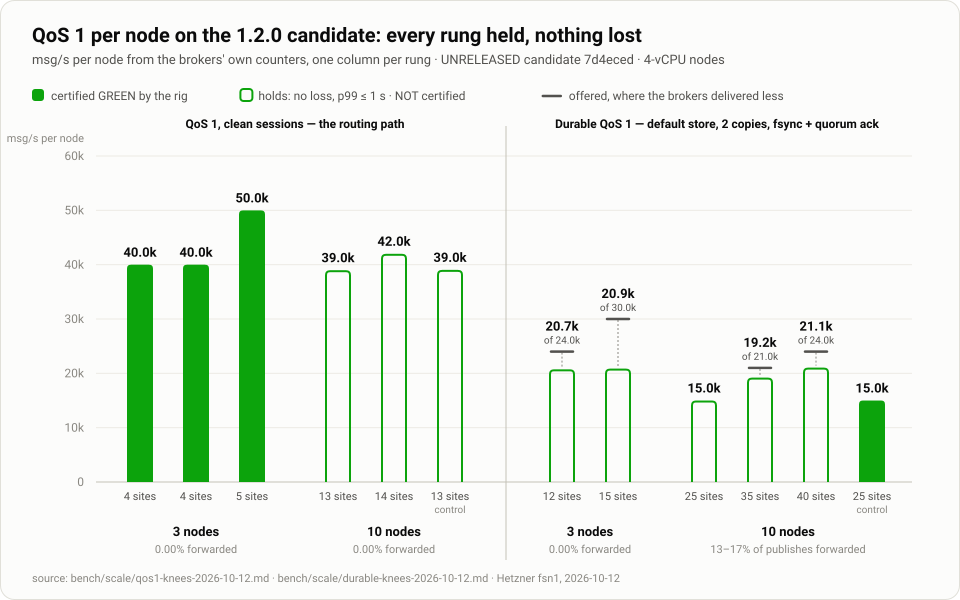
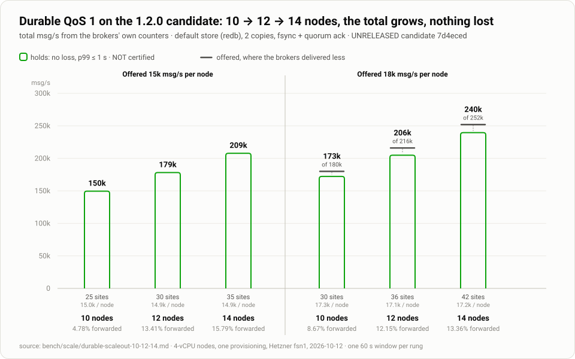

# The scaling curve — throughput and p99 vs node count

**Verified against `v1.0.5` (2026-08-24).** Fifth published run of the ADR 0048
§2 curve: the same workload against fresh 1-, 3- and 5-node clusters of the
signed `v1.0.5` release, one dedicated-vCPU cloud host and one local NVMe disk
per broker, measured by `bench/scale/run.sh` and rendered by
`bench/scale/summarize-curve.py`. Two questions this run answers: **does the
scale-out shape survive a second release and a second disk draw** (yes —
5 nodes beats 1 node by 1.6× on the durable path, again), and **does the
issue #396 SWIM fix make 5-node formation routine** (yes — first-attempt
formation, against v1.0.4's seven attempts). One new finding, disclosed per
the standing rule that **a flat curve is a finding to fix, not a number to
bury**: the first honest measurement of the `relaxed` tier found it broken
(issue #399 — acked-then-dropped under saturation; its rows are absent below).

## Read this first

- **What this is:** mqttd measured against itself at three cluster sizes. No
  competitor appears here — cross-broker comparison is `docs/COMPARISON.md`'s
  job under ADR 0048 §3/§4.
- **Two curves, deliberately** ([ADR 0049](../adr/0049-voter-eligible-durable-ownership.md)):
  the durable QoS 1 curve is fsync- and ownership-bound; the non-durable
  `$share` fan-out curve is routing/CPU-bound. Neither substitutes for the
  other, and the idle-connection point is a third, memory-bound axis.
- **Latency honesty differs by lane.** Lane A percentiles are exact, computed
  from per-message ack RTTs in `crates/mqttd/tests/durable_bench.rs`. Lane B
  percentiles are emqtt-bench histogram **bucket upper bounds** ("p99 ≤ X ms"),
  merged across drivers — coarse, but incapable of flattering.
- **Driver fleet per size:** sizes 1 and 3 ran with **three** drivers, size 5
  with two — the account's ~40-dedicated-vCPU ceiling refuses 5×CCX23 +
  3×CCX33. A quota raise to ~100 vCPU is requested **for this lane B
  driver-fleet shape**; until then every lane B driver-limited flag is
  reproduced below rather than hidden. That request is **not** the durable
  lane A 7/10-node slope in ADR 0073 T4.4 (10+1 = 11 servers / 44 vCPU,
  inside existing limits — the "T4 gated on a quota raise" note is
  withdrawn there).
- **Absolute durable numbers move with the disk draw** (multi-tenant NVMe):
  this run drew slower volumes than v1.0.4's (floors 1,941–2,395 vs
  2,051–2,521 barriers/s, and ~2× the append latency), so its absolute rates
  sit below v1.0.4's while the *shape* and the barrier-rate decoupling hold.
  Read the ratios, not just the cells.
- **Provenance:** size 1 is run `20260823T190100Z`; sizes 3 and 5 are the
  same-night continuation `20260823T205824Z` after a rig fix (the run died
  between sizes when a cloud-init retry poisoned a systemd start limit —
  mechanism and fix in PR #400). Same signed build, host class, region, rig.

## Host, build, configuration

- **Brokers:** Hetzner Cloud CCX23 (4 dedicated vCPU, AMD EPYC-Milan, 16 GB,
  local NVMe), one broker per host, spread placement group, `fsn1`, Ubuntu
  24.04, kernel 6.8.0-137. Data dir on the host's local NVMe — never network
  storage.
- **Broker build:** the released, cosign-signed, byte-reproducible
  `mqttd-1.0.5-x86_64-unknown-linux-musl`, checksum-verified at install.
  Config: the shipped `deploy/systemd/mqttd.service` + the disclosed drop-in
  and env template in `bench/scale/` (health on 0.0.0.0 for private-net
  scraping, `MQTTD_MAX_CONNECTIONS=60000`, plaintext listener on the private
  IP, durable plane ON for lane A / OFF for lanes B–C,
  `TOKIO_WORKER_THREADS` unset, `MQTTD_ALLOW_RELAXED_PUBLISH=1` for the ADR
  0072 tier lanes — disclosed in the template; default lanes publish v3.1.1
  and are unaffected). Cluster PKI from `deploy/systemd/gen-certs.sh`; SWIM
  signed, bound to the routable private IP.
- **Drivers:** CCX33 (8 dedicated vCPU) on the same private network;
  emqtt-bench 0.6.3 (docker, host network) for lanes B–C; `durable_bench`
  built from the release commit for lane A.
- **Topology per size:** fresh cluster (apply → measure → destroy). Founder-
  first bring-up, founder armed to the majority floor before any load; the rig
  proves the private-net full mesh before the first broker starts and gates
  lane A on full membership. Date: 2026-08-23→24.

## Per-host durability barrier floors

Measured on every broker host before any lane (`device_barrier_floor`, scratch
on the data-dir filesystem):

| nodes | per-broker floor (single-writer barriers/s) |
|---|---|
| 1 | 2,162 |
| 3 | 2,177 / 1,954 / 2,096 |
| 5 | 2,395 / 2,031 / 1,941 / 2,261 / 2,109 |

A uniformly slower draw than v1.0.4's, with ~2× its append latency (p99
12.8 ms vs 6.4 ms at size 1) — the honest denominator for every durable row.

## Curve 1 — durable QoS 1, closed loop (spread ownership)

48 closed-loop publishers × window 8, 48 durable subscribers, 256 B payloads,
sessions spread across every node's HRW-owned groups, 60 s windows, median
[min..max] over 3 reps. Acks are given only after the message is fsync'd and
quorum-replicated (ADR 0057).

| nodes | acked msg/s (saturating) | exact p99 (saturating) | exact p99 (uncontended: window 1, one publisher per node) | verdict |
|---|---|---|---|---|
| 1 | 8,503 [8,134..8,636] | 90 ms [88..93] | 1.01 ms [1.00..1.02] | valid |
| 3 | 8,647 [8,352..8,725] | 82 ms [81..84] | 1.81 ms [1.78..1.86] | valid |
| 5 | **13,893 [13,799..14,214]** | 56 ms [55..77] | 1.69 ms [1.68..1.76] | valid — **first-attempt formation** |

QoS 2, same shape: 2,970 [2,965..3,023] msg/s at 1 node, 2,124 [2,111..2,248]
at 3, 3,009 [3,006..3,075] at 5. Clean sessions (nothing durable to write):
32.1k [27.4k..38.7k] at 1 node, 89.4k [79.6k..93.9k] at 3, 109.6k
[109.1k..110.0k] at 5.

**The v1.0.4 findings hold on a second release and a second draw.** The rows
sit at **3.9× / 4.4× / 7.2×** of the slowest member's barrier rate (the
pre-0074 pinning was 0.8–1.35× across four draws) — durable throughput stays
decoupled from the disk. The shape repeats: 3 nodes ≈ 1 node (the quorum tax
fully absorbed — this draw actually reads +1.7%), and **5 nodes = 1.63× a
single node** (v1.0.4: 1.38×) — ownership spread across five owners beats the
quorum tax with room to spare, twice in a row now. Saturating p99 *improves*
with size (90 → 82 → 56 ms): more owners means shallower per-owner queues at
the same offered load.

**v1.0.4 → v1.0.5, honestly:** the absolute cells read lower (8.5k vs 11.8k
at 1 node) on a draw whose volumes are ~10% slower on barrier rate and ~2× on
append latency; the barrier-rate multiples above are the like-for-like
comparison, and they match. No durable-path change shipped in v1.0.5 (its
changes are SWIM addressing and bench hygiene), so the draw is the whole
difference — the multi-tenant-NVMe caveat this doc has carried since v1.0.3.

**Formation, the v1.0.5 proof:** v1.0.4's 5-node point took seven formations
across four paid launches to land once, by luck (issues #393/#396). This
run's 5-node cluster formed **on the first attempt** with the #396 fix aboard
(unroutable addresses can neither poison nor survive in gossip) — the
membership gate passed without a re-form, and the same held at size 3.

## Durability tiers (ADR 0072) — same workload, publisher-selected ack meaning

| nodes | tier | acked msg/s (sat) | exact p99 (sat) | exact p99 (uncontended) |
|---|---|---|---|---|
| 1 | `quorum` | 8,503 [8,134..8,636] | 90 ms | 1.01 ms [1.00..1.02] |
| 1 | `local` | 8,734 [8,716..8,773] | 82 ms | 1.03 ms [1.02..1.06] |
| 3 | `quorum` | 8,647 [8,352..8,725] | 82 ms | 1.81 ms [1.78..1.86] |
| 3 | `local` | 8,230 [8,208..8,325] | 83 ms | 1.83 ms [1.82..1.86] |
| 5 | `quorum` | 13,893 [13,799..14,214] | 56 ms | 1.69 ms [1.68..1.76] |
| 5 | `local` | 13,584 [13,055..13,681] | 77 ms | 1.72 ms [1.68..1.74] |

`quorum` and `local` converge for the fourth run in a row — on datacenter
NVMe, weakening the ack to single-copy buys nothing.

**The `relaxed` rows are absent because the tier is broken, and this run is
the first to measure it (issue #399).** With the #394 bench defect fixed, the
relaxed lane ran honestly for the first time since ADR 0074 shipped: a
relaxed pending is acked `Accepted` on submit even when the append lane
refused the job, and with the ack released early the publisher has no flow
control at all — it free-runs into the bounded lanes and the completions
collapse (measured 0 / 215 / 3,762 msg/s across reps at 1 node; 0 / 0 / 0 at
3 and 5 nodes; deliveries flowing throughout). The hole has existed since ADR
0072 but was masked first by the pre-0074 hub-loop throttle (v1.0.3 measured
2,489 msg/s clean because *everything* was slow), then by #394 hiding the
lanes in v1.0.4. Fix directions are in the issue; the rows return when it
closes.

## Curve 2 — non-durable `$share` fan-out (the ADR 0015 mechanism)

600 publishers → `bench/%i` (QoS 1, 256 B, window 100), 300 subscribers in one
shared group `$share/g1/bench/#`, populations spread across all drivers and
brokers; the same offered ladder (20k…300k msg/s) at every size, 60 s per
rung. Broker restarted clean per size, durable plane off.

Subscriber-side delivered rates (the summarizer's honest lane,
emqtt-bench-counted):

| offered | 1 node | 3 nodes | 5 nodes (2 drivers) |
|---|---|---|---|
| 20k | 18.1k | 18.7k, p99 ≤ 5ms | 19.1k, p99 ≤ 5ms |
| 50k | 18.2k ← plateau | 46.1k, p99 ≤ 25ms | 47.0k, p99 ≤ 5ms |
| 100k | 18.1k | 53.1k | 79.3k |
| 200–300k | ~18.6k | **~53.9k ← plateau** | **~81.4k ← plateau** |

Every rung above 50k is driver-limited (flagged per cell), so these are
floors. Two observations worth carrying anyway:

- **The 5-node floor jumped ~50% against v1.0.4's identical two-driver
  configuration** (~81k vs ~54k delivered). No fan-out code changed in
  v1.0.5; the suspect is the #396 fix — v1.0.4's 5-node cluster ran with
  relay-poisoned SWIM records even when formation succeeded, and v1.0.5's
  gossip is clean. A floor-vs-floor comparison proves nothing alone; the
  three-driver rerun after the quota raise is the test.
- **Broker-received exceeds driver-sent at every rung** — closed-loop QoS 1
  retransmission under deliberate overload; the subscriber-delivered number
  is the one tabled.

## Connections at 50,000

| nodes | connected | broker RSS growth | KiB per idle connection |
|---|---|---|---|
| 1 | 49,998 | 945 MiB | 19.4 |
| 3 | 49,998 | 960 MiB | 19.7 |
| 5 | 50,000 | 944 MiB | 19.3 |

Flat per-connection memory in cluster size, fifth run in a row (~15 KiB/conn
claimed in `docs/SIZING.md`; 19.3–19.7 measured with observability running).

## Losing dimensions, stated first

- **The `relaxed` tier is broken and unmeasured** — issue #399, first honest
  measurement, full mechanism in the tier section. The other two tiers are
  unaffected (their flow control is the ack-wait itself).
- **The run died once between sizes** — a cloud-init clean+reboot retry left
  the enabled mqttd unit crash-looping against a not-yet-pushed config until
  systemd's start limit poisoned it, and bootstrap's own restart was then
  refused. Rig-fixed the same night (PR #400: config-less boots are inert
  via `ConditionPathExists`; bootstrap runs `reset-failed` before its
  restart), and sizes 3/5 completed on the relaunch.
- **Curve 2's 5-node column is a two-driver floor** (quota), and both its
  cells and the v1.0.4 comparison above are floor-vs-floor.
- Lane B p99s are bucket bounds; cross-driver clock skew bounds the finest
  readable bucket.
- Multi-tenant NVMe variance is real and measured per run — this run's
  uniformly slower draw moved every absolute durable cell down ~25–30% while
  the barrier-rate multiples held; the doc's rule stands: read durable rows
  against their printed floors.

## A run judges itself

Enforced mechanically: per-host barrier probes gate Curve 1 (a size without
probes renders UNINTERPRETABLE); `durable_bench`'s verdicts are carried
verbatim; broker counter deltas cross-check driver totals with every mismatch
flagged; driver-limited rungs are excluded from knee detection; preflight
captures every node's `/readyz` + `/statusz`; the rig proves the private-net
full mesh before the first broker starts, gates lane A on full membership,
and collects every host's journal on failure — which is how both of this
campaign's rig defects (#400's start-limit poison, and v1.0.4's #396) went
from mystery to mechanism within hours.

## Reproducing everything above

```sh
cd bench/scale
export HCLOUD_TOKEN=...   # Read & Write token, dedicated Hetzner project
./run.sh smoke            # ~20 min, <€0.50 — proves the rig end to end
MQTTD_VERSION=1.0.5 OBSERVE=1 DRIVER_COUNT=3 ./run.sh full 1 3
MQTTD_VERSION=1.0.5 OBSERVE=1 DRIVER_COUNT=2 ./run.sh full 5
# a single lane can be rerun in isolation, e.g. the durable lane only:
LANES=A MQTTD_VERSION=1.0.5 DRIVER_COUNT=2 ./run.sh full 5
python3 summarize-curve.py .runs/<stamp>/results
```

The rig: `bench/scale/run.sh` (orchestration, including the private-net truth
gate), `bench/scale/terraform/` (hosts), `bench/scale/bootstrap-cluster.sh`
(secrets + founder-first bring-up + the pre-start full-mesh gate),
`bench/scale/run-curve.sh` (lanes, including per-tier saturating + uncontended
variants, the `LANES` filter and the lane A membership gate),
`bench/scale/observe.sh` (live Grafana) — see `bench/scale/README.md`.

## Durable QoS 1 by site on the 1.2.0 candidate (2026-10-12) — not curve points

A different harness from Curve 1 above, and a different binary. Curve 1 is closed loop
(48 publishers, 8 in flight each) on the signed `v1.0.5`. This is the open-loop lane E
ladder: a site is 600 QoS 1 publishers × 10 msg/s × 200 B = 6,000 msg/s into a `$share`
group of 20 **persistent** QoS 1 consumers, so every delivery waits for fsync and
replication, and the rung is the number of sites.

**Read this before any number below:**
- **Unreleased binary.** The `release: v1.2.0` commit `7d4eced8`, cross-built by hand
  (zig cc, x86_64 musl, not stripped, without the jq module), published as the pre-release
  `bench-candidate-7d4eced`, sha256 `9111c1eb…c513`. It is not the release pipeline's
  signed build, and v1.2.0 was not tagged. By this document's own rule a number from an
  unreleased build is **not a published-curve point**; nothing above is replaced.
- **Default store.** `MQTTD_REPLICA_STORE` and `MQTTD_REPLICAS` unset: redb, 2 copies.
  **Not comparable with the log-store figures** in
  [0080-replicas-ab-n3.md](../../bench/scale/0080-replicas-ab-n3.md) (3 nodes GREEN at
  30k msg/s per node with `MQTTD_REPLICA_STORE=log`).
- **Not a comparison.** No v1.1.0 arm ran on the same hosts, so this run does not measure
  a change since v1.1.0.
- **Hardware, date, config.** 10 × CCX23 brokers (4 dedicated vCPU, local NVMe) + 20 ×
  CCX33 drivers, Hetzner `fsn1`, one provisioning, 2026-10-12, arms 10 → 3 → 10 on the same
  hosts, 60 s windows. `OBSERVE=1`: live Grafana was attached. Audit driver rebuilt for
  the run (archive `2cded28d…`).

Card, with the ledger per rung, the crossing table, the writer figures and the commands:
[durable-knees-2026-10-12.md](../../bench/scale/durable-knees-2026-10-12.md). The
clean-session campaign of the same day is in
[QOS1-SCALE-CURVE.md](QOS1-SCALE-CURVE.md#the-120-candidate-at-3-and-10-nodes-2026-10-12--not-curve-points).



Every rung is read twice. **The reading rule:** a rung holds if no message was lost (its
identity ledger closes and no broker dropped anything) and p99 is at or below 1 s, at the
rate the brokers' own counters show. **The rig's verdict** is the certification, and asks
for more: the offer met on schedule, a steady window, a load generator with headroom and
valid driver-side evidence. `summarize-curve.py` prints both. In the chart a filled column
is a rung the rig certified GREEN, and a green outline is a rung that holds and is **not
certified**.

`delivered/s (brokers)` is each broker's own counters over its window (±0.03%: every
broker answered its scrapes within 29 ms). `delivered/s (drivers)` is the driver-side
figure the rig graded. Latencies are histogram bucket upper bounds.

| nodes | sites | offered msg/s | delivered/s (brokers) | of the offer | per node | delivered/s (drivers) | publishes late | p50 · p95 · p99 | reading | the rig's verdict |
|---|---|---|---|---|---|---|---|---|---|---|
| 10 | 25 | 150,000 | 150,023 | 100.0% | 15.0k | 149,071 | 4% | ≤25 · ≤100 · ≤500 ms | holds | NOT CARRIED (1) |
| 10 | 35 | 210,000 | 192,217 | 91.5% | 19.2k | 199,072 | 41% | ≤50 · ≤500 · ≤500 ms | holds | NOT CARRIED (2) |
| 10 | 40 | 240,000 | 210,547 | 87.7% | 21.1k | 219,004 | 53% | ≤100 · ≤500 · ≤500 ms | holds | NOT CARRIED (3) |
| 10 | 25 (drift control) | 150,000 | 149,979 | 100.0% | 15.0k | 149,976 | 3% | ≤25 · ≤50 · ≤500 ms | holds | GREEN |
| 3 | 12 | 72,000 | 62,243 | 86.4% | 20.7k | 62,806 | 57% | ≤100 · ≤500 · ≤500 ms | holds | NOT CARRIED (4) |
| 3 | 15 | 90,000 | 62,611 | 69.6% | 20.9k | 63,429 | 88% | ≤100 · ≤500 · ≤1000 ms | holds | NOT CARRIED (5) |

Every 1-site rung (6,000 msg/s, six of them) is GREEN and holds, at p50 · p95 · p99 ≤ 5 ms.
The ladders stopped after two consecutive NOT CARRIED rungs and skipped 50 sites (10 nodes)
and 18 sites (3 nodes). The five NOT CARRIED verdicts, verbatim:

```text
(1) NOT CARRIED: INVALID EVIDENCE (endpoint scrape window uncertainty exceeds 2%)
(2) NOT CARRIED: INVALID EVIDENCE (endpoint scrape window uncertainty exceeds 2%); NOT STEADY (last aggregate sample below offer; per-site delivery did not remain within the offer band; publisher pacing, scrape timing and broker service are not isolated); OFFER NOT MET (95% of offer); PUBLISHERS LATE (41% of publishes behind schedule — end-to-end publisher timing; scheduling, network and broker service are not isolated)
(3) NOT CARRIED: INVALID EVIDENCE (endpoint scrape window uncertainty exceeds 2%); NOT STEADY (last aggregate sample below offer; per-site delivery did not remain within the offer band; publisher pacing, scrape timing and broker service are not isolated); OFFER NOT MET (91% of offer); PUBLISHERS LATE (53% of publishes behind schedule — end-to-end publisher timing; scheduling, network and broker service are not isolated)
(4) NOT CARRIED: INVALID EVIDENCE (endpoint scrape window uncertainty exceeds 2%); NOT STEADY (last aggregate sample below offer; per-site delivery did not remain within the offer band; publisher pacing, scrape timing and broker service are not isolated); OFFER NOT MET (87% of offer); PUBLISHERS LATE (57% of publishes behind schedule — end-to-end publisher timing; scheduling, network and broker service are not isolated)
(5) NOT CARRIED: INVALID EVIDENCE (endpoint scrape window uncertainty exceeds 2%); NOT STEADY (last aggregate sample below offer; per-site delivery did not remain within the offer band; publisher pacing, scrape timing and broker service are not isolated); OFFER NOT MET (70% of offer); PUBLISHERS LATE (88% of publishes behind schedule — end-to-end publisher timing; scheduling, network and broker service are not isolated)
```

**Ledger.** `bench/scale/qos1-campaign/ledger-report.py` closes on every rung of all three arms:
193,366,130 message identities sent, acknowledged and received, with 0 missing, 0
unacknowledged, 0 duplicates and 0 unexpected. Every broker reports 0 drops on every rung.
The per-rung table is in the card.

### (a) What held

- **10 nodes takes 150,000 msg/s in full: 15.0k msg/s per node**, p99 ≤ 500 ms, twice.
- **Past that the cluster stops taking more at about 21k msg/s per node, at both sizes**:
  19.2–21.1k at 10 nodes, 20.7–20.9k at 3, by the brokers' counters.
- **Nothing was lost and p99 stayed at or below 1 s on every rung.** Past the ceiling the
  cluster slows its publishers; it does not lose what it accepted.
- **The limit is not the disk.** The summarizer's verdict is WRITER-BOUND at both sizes:
  one flush explains at most 17% of a commit, on disks 3–4× apart in flush rate.

### (b) What the rig certifies, and why not the rest

- **One rung is graded GREEN: 150,000 msg/s at 10 nodes**, once, in an arm that fails the
  crossing gate.
- **10 nodes, 25 sites, first pass:** the full offer delivered; rejected only because the
  drivers' endpoint scrapes missed the 2% window bound. The brokers' scrapes took at most
  29 ms.
- **10 nodes at 35 and 40 sites, 3 nodes at 12 and 15 sites:** past the ceiling. The
  publishers ran late (41–88% of publishes behind schedule) and the rungs never went
  steady. No rung flags a saturated driver, and the least-idle driver host averaged
  68–78% idle.
- **3 nodes has no rung above 1 site that took its whole offer.** Its ladder was set from
  the log-store result and started above this store's ceiling. That is a mistake in the
  ladder, not a finding about 3 nodes.

### (c) Cross-node traffic

| | publishes forwarded to another broker | highest single broker |
|---|---|---|
| 3 nodes, every rung | 0.00% | 0.00% |
| 10 nodes, 25 · 35 · 40 sites | 13.60% · 16.84% · 15.48% | 32.00% · 37.87% · 31.40% |
| 10 nodes, 25 sites (drift control) | 13.60% | 32.00% |
| clean sessions, 3 and 10 nodes, every rung | 0.00% | 0.00% |

- **Some cross-node traffic did not stop it scaling.** 10 nodes reached about the same
  ceiling per node while forwarding 13–17% of publishes as 3 nodes did forwarding none.
- **Why it forwards.** A persistent session lives on the broker that owns it, chosen from
  its client id, not on the broker its client dialled
  ([ADR 0005](../adr/0005-session-affinity.md)). With 20 consumers per site spread over 10
  brokers that way, some brokers hold no member of a site's `$share` group and forward
  that site's publishes. At 25 sites that is 34 of 250 site × broker pairs, 13.60%. At 3
  nodes every broker holds members of every site. The counters behind this, and what was
  not checked, are in
  [the card](../../bench/scale/durable-knees-2026-10-12.md#cross-node-traffic).
- The rig's crossing gate (every broker ≤ 0.5%) therefore fails on both 10-node arms. Its
  shape check predicted about 0%, which holds for clean sessions only.

### (d) What cannot be concluded

- **A certified knee, or a certified flat curve.** The ceiling is read from rungs the rig
  graded NOT CARRIED, only two sizes ran, and each rung is one 60 s window.
- **Anything about the log store, or about v1.1.0.**

A sizing estimate for the offers that were not met, with its arithmetic and what fits the
rig's quota, is in
[the card](../../bench/scale/durable-knees-2026-10-12.md#estimate-brokers-needed-to-meet-the-offers-that-were-not-met):
at 15,000 msg/s per node, 210,000 msg/s needs 14 nodes and 240,000 needs 16.

Run: `knee-20261012T122155Z` (untracked).

### (e) Past 10 nodes: 10, 12 and 14 on one provisioning — not curve points

A second durable campaign the same day asked whether the total keeps growing past 10
nodes. Same binary, same store and same reading rule as above, with these differences:
14 × CCX23 brokers + 16 × CCX33 drivers, formed as 14, then 12, then 10 nodes on the same
hosts; **28** persistent consumers per site, not 20, so that two consumer containers
reach every broker at 14 nodes; two rungs per size, at 15k and 18k msg/s per node
offered. Brokers 11–14 are in a second placement group and may share a physical host with
another broker. Card:
[durable-scaleout-10-12-14.md](../../bench/scale/durable-scaleout-10-12-14.md).



| nodes | sites | offered msg/s | delivered/s (brokers) | of the offer | per node | delivered/s (drivers) | publishes late | p50 · p95 · p99 | forwarded, cluster · highest broker | reading | the rig's verdict |
|---|---|---|---|---|---|---|---|---|---|---|---|
| 10 | 25 | 150,000 | 150,419 | 100.3% | 15.0k | 150,401 | 8% | ≤25 · ≤100 · ≤500 ms | 4.78% · 11.99% | holds | NOT CARRIED |
| 10 | 30 | 180,000 | 173,100 | 96.2% | 17.3k | 173,099 | 25% | ≤50 · ≤500 · ≤500 ms | 8.67% · 20.56% | holds | NOT CARRIED |
| 12 | 30 | 180,000 | 179,039 | 99.5% | 14.9k | 179,033 | 7% | ≤50 · ≤100 · ≤500 ms | 13.41% · 33.33% | holds | NOT CARRIED |
| 12 | 36 | 216,000 | 205,750 | 95.3% | 17.1k | 205,744 | 26% | ≤50 · ≤500 · ≤500 ms | 12.15% · 35.33% | holds | NOT CARRIED |
| 14 | 35 | 210,000 | 208,739 | 99.4% | 14.9k | 208,745 | 14% | ≤50 · ≤500 · ≤500 ms | 15.79% · 49.27% | holds | NOT CARRIED |
| 14 | 42 | 252,000 | 240,497 | 95.4% | 17.2k | 240,507 | 28% | ≤100 · ≤500 · ≤500 ms | 13.36% · 39.18% | holds | NOT CARRIED |

Every 1-site rung (six) is GREEN at 6,000 msg/s and p99 ≤ 10 ms. The ledger closes on
every rung: 306,233,432 identities, 0 missing, 0 unacknowledged, 0 duplicates, and every
broker reports 0 drops. The chart draws all six loaded rungs as "holds, not certified".

- **The total grew at each size, at about the same rate per node.** 150,419 → 179,039 →
  208,739 msg/s at 15k per node offered; 173,100 → 205,750 → 240,497 at 18k.
- **What the rig objects to.** At 15k per node, late publishes (7–14%; at 14 nodes the
  rung was also not steady). At 18k, the offer was not met (95–96%), 25–28% of publishes
  were late and no rung went steady. The verdicts are in the card, verbatim.
- **The brokers were the limit at 18k per node, not the load generators.** No rung flags
  a saturated driver core, and the least-idle driver host averaged 59–67% idle on the 18k
  rungs. The least-idle broker host averaged 14–19% idle, and the summarizer's verdict is
  WRITER-BOUND at all three sizes. One rung above 15k per size does not locate a ceiling.
- **Forwarding grew with the cluster and the per-node rate did not fall.** The card of
  section (c) predicted (1 − 1/N)^28 = 5.2%, 8.7% and 12.6% at 10, 12 and 14 nodes.
  Measured at 15k per node: 4.78%, 13.41% and 15.79%. The prediction is about right at
  10 and 14 and low at 12; consumers are not spread evenly across brokers.

What cannot be concluded:

- **That the hosts did not drift.** The closing 14-node arm, the drift control, did not
  run: the re-formed cluster did not reach a full mesh within the rig's 180 s, because one
  broker kept another marked dead
  ([#971](https://github.com/mbilling/fss-mqtt-broker/issues/971)). The comparison across
  sizes rests on one pass per size, with a GREEN 1-site control before and after each.
- **Anything certified, or anything about failure independence at 12 and 14 nodes.**
- **That this is the morning's 10-node arm.** 28 consumers per site and 16 drivers here,
  20 and 20 there.

Run: `knee-20261012T170816Z` (untracked).

## Related

- `docs/benchmarks/DURABLE-PATH.md` — the single-host durable floor and method.
- `docs/adr/0071-owner-side-group-commit.md`, `docs/adr/0072-per-message-durability-selection.md`
  (its `relaxed` tier is the subject of issue #399),
  `docs/adr/0073-scale-out-durable-ownership.md` (awaiting its 7/10-node
  measurement behind the quota raise), `docs/adr/0074-detached-ack-truncate.md`
  (hardware-verified two releases running: durable rows at 3.9–7.2× the
  slowest disk's barrier rate vs the 0.8–1.35× pinning it removed).
- `docs/adr/0048-comparative-benchmarking.md` §2 — the mandate and honesty
  rules; `docs/delivery/0048-comparative-benchmarking.md` T3/T4 track this work.
- Issues: #383 (fixed v1.0.4), #390 / #393 / #394 / #396 (fixed v1.0.5 —
  this run's first-attempt 5-node formation is #396's proof), #399 (open —
  the relaxed tier, found by this run), #400 (rig, fixed mid-campaign).
